# Apache Kafka

## Índice general

### Parte I. Fundamentos, contexto y arquitectura de Apache Kafka

- **1.1.** Del procesamiento batch al procesamiento de eventos
- **1.2.** Historia, origen y evolución de Apache Kafka
- **1.3.** ¿Qué es Apache Kafka y qué problemas resuelve?
- **1.4.** Conceptos fundamentales: eventos, productores, consumidores, tópicos y brokers
- **1.5.** Arquitectura distribuida de Kafka: particiones, offsets, replicación y grupos de consumidores
- **1.6.** Tiempo real, Near Real-Time y procesamiento batch: diferencias y aplicaciones
- **1.7.** Kafka en el ecosistema Big Data: relaciones con Hadoop, Spark, APIs y otros servicios
- **1.8.** Casos de uso: transacciones comerciales, IoT, monitoreo, registros y eventos de aplicaciones

### Parte II. Operación, integración e implementación de Apache Kafka

- **2.1.** Preparación y verificación de Kafka en el entorno Docker
- **2.2.** Administración de tópicos, particiones y configuración básica
- **2.3.** Publicación de eventos mediante productores
- **2.4.** Consumo de eventos y funcionamiento de los grupos de consumidores
- **2.5.** Estructuración de mensajes: texto, JSON, claves y marcas temporales
- **2.6.** Integración con fuentes externas: archivos, bases de datos y APIs REST
- **2.7.** Construcción de un productor que consulta una API y publica eventos en Kafka
- **2.8.** Implementación de flujos en tiempo real y Near Real-Time
- **2.9.** Integración de Kafka con Apache Spark Structured Streaming
- **2.10.** Validación, monitoreo y tratamiento básico de errores

## Parte I. Fundamentos, contexto y arquitectura de Apache Kafka

### 1.1. Del procesamiento batch al procesamiento de eventos

#### 1.1.1. El punto de partida: lo que ya conocemos

Durante las semanas anteriores hemos trabajado con tecnologías que permiten almacenar, organizar, consultar y procesar grandes volúmenes de información. En particular, hemos utilizado HDFS, Apache Hive y Apache Spark dentro de una infraestructura desplegada mediante Docker.

Cada una de estas tecnologías cumple una función específica:

- HDFS permite almacenar archivos de manera distribuida.
- Apache Hive proporciona mecanismos para organizar y consultar datos estructurados mediante SQL.
- Apache Spark permite ejecutar operaciones de transformación y análisis sobre grandes conjuntos de datos.

En las actividades realizadas hasta ahora, los datos generalmente se encontraban disponibles antes de comenzar su procesamiento. Por ejemplo, disponíamos de un archivo CSV con registros de ventas, lo almacenábamos en HDFS y posteriormente utilizábamos Spark para analizarlo.

Este enfoque corresponde al procesamiento por lotes, conocido habitualmente como batch processing.

Figura 1. Flujo de procesamiento batch conocido por los estudiantes


En este modelo, Spark puede leer el archivo, aplicar filtros, agrupar registros, calcular indicadores y almacenar los resultados nuevamente en HDFS, por ejemplo, utilizando Parquet.

El procesamiento batch continúa siendo fundamental en las organizaciones. Se utiliza para generar informes periódicos, consolidar información histórica, ejecutar procesos de transformación y analizar grandes volúmenes de datos.

Sin embargo, no todas las necesidades de información pueden resolverse esperando a que se complete un archivo o a que se ejecute un proceso programado.

#### 1.1.2. ¿Qué ocurre cuando los datos se generan continuamente?

Consideremos una empresa comercializadora que registra las ventas de sus sucursales.

En nuestro trabajo anterior, el análisis comenzaba con un archivo que contenía las transacciones registradas durante un período determinado.

Ahora imaginemos una situación diferente: cada vez que una sucursal realiza una venta, su sistema genera inmediatamente un nuevo registro.

Las transacciones podrían producirse de la siguiente manera:

| Hora     | Ciudad     | Categoría  | Monto    |
| -------- | ---------- | ---------- | -------- |
| 10:00:01 | Santiago   | Tecnología | $245.000 |
| 10:00:03 | Valparaíso | Hogar      | $89.000  |
| 10:00:04 | Concepción | Tecnología | $410.000 |
| 10:00:07 | Santiago   | Vestuario  | $56.000  |

Estos registros ya no representan necesariamente un archivo terminado. Constituyen una secuencia de acontecimientos que ocurren a lo largo del tiempo.

La empresa podría necesitar responder preguntas como: ¿cuántas ventas se están realizando en este momento?, ¿qué sucursal registra un aumento inesperado de transacciones?, ¿se están produciendo operaciones que requieren revisión?

Si la organización espera hasta el final del día para consolidar y procesar todos los registros, sus respuestas llegarán demasiado tarde para determinadas decisiones operativas.

Surge así una nueva necesidad: recibir y utilizar los datos mientras se generan, sin esperar a que finalice un período de recopilación.

#### 1.1.3. Del registro almacenado al evento

Para comprender esta transición necesitamos introducir un concepto fundamental: el evento.

Un evento representa un hecho que ha ocurrido en un sistema y que puede resultar relevante para otras aplicaciones o procesos.

Por ejemplo:

- Se registró una venta.
- Un cliente realizó una compra.
- Un sensor informó una temperatura.
- Un usuario inició sesión.
- Una aplicación detectó un error.

En el caso de nuestra comercializadora, una venta puede representarse mediante un mensaje estructurado:

```
{
  "id_venta": "V10025",
  "fecha": "2026-10-28T10:00:01",
  "ciudad": "Santiago",
  "categoria": "Tecnologia",
  "monto": 245000
}
```

Este mensaje contiene información sobre un acontecimiento específico. El formato JSON permite representar los datos mediante pares de clave y valor, y es habitual en la comunicación entre aplicaciones y servicios.

Observemos una diferencia importante:

En el procesamiento batch, normalmente trabajamos con un conjunto de registros que ya se encuentra disponible.

En el procesamiento de eventos, los registros pueden llegar individualmente y de manera continua, a medida que ocurren los acontecimientos que representan.

Esto no significa que los datos dejen de almacenarse. Significa que ahora podemos incorporarlos a un flujo de información antes de consolidarlos en archivos o tablas históricas.

#### 1.1.4. ¿Por qué necesitamos una nueva arquitectura?

Supongamos que la empresa comercializadora cuenta con tres sistemas interesados en recibir las nuevas transacciones:

1. Un sistema de monitoreo que necesita actualizar sus indicadores.
2. Un sistema de detección de operaciones anómalas.
3. Un sistema de almacenamiento que conserva las transacciones para análisis históricos.

Una alternativa sería conectar directamente el sistema de ventas con cada una de estas aplicaciones.

Sin embargo, a medida que aumenta la cantidad de sistemas, también crece la complejidad de sus conexiones. Una interrupción en una aplicación receptora podría afectar la comunicación, dependiendo de cómo se haya implementado la integración.

Una arquitectura orientada a eventos introduce un componente intermediario que permite desacoplar la generación de información de su consumo.

Figura 2. Distribución de eventos hacia múltiples sistemas

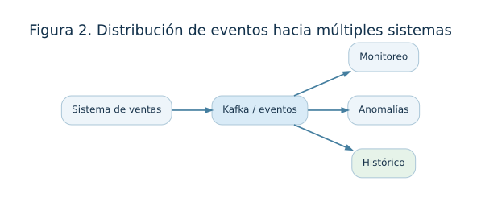

Representación conceptual de una arquitectura orientada a eventos. La plataforma permite distribuir información a distintos consumidores.

En esta arquitectura, el sistema de ventas produce eventos y los publica en una plataforma común. Los sistemas interesados pueden consumirlos de acuerdo con sus propias necesidades.

Este mecanismo facilita el desacoplamiento: el productor no necesita conocer directamente todos los sistemas que utilizarán los eventos, y cada consumidor puede desarrollar su lógica de procesamiento de manera independiente.

Apache Kafka es una tecnología diseñada precisamente para apoyar este tipo de arquitectura.

#### 1.1.5. ¿El procesamiento de eventos reemplaza al procesamiento batch?

No. Ambos enfoques responden a necesidades diferentes y pueden complementarse.

| Aspecto               | Procesamiento batch                | Procesamiento de eventos               |
| --------------------- | ---------------------------------- | -------------------------------------- |
| Entrada               | Conjunto de datos disponible       | Eventos que llegan progresivamente     |
| Ejecución             | Por lotes o programación periódica | Continua o activada por nuevos eventos |
| Propósito habitual    | Consolidación y análisis histórico | Reacción y actualización oportuna      |
| Ejemplo               | Ventas totales del mes             | Nuevas ventas conforme se registran    |
| Tecnologías del curso | HDFS, Hive y Spark                 | Kafka, integrado con otros componentes |

Es importante señalar que Spark también puede trabajar con datos en streaming. Por lo tanto, la diferencia no consiste en que Spark sea exclusivamente batch y Kafka exclusivamente tiempo real.

Kafka permite transportar, almacenar temporalmente según políticas de retención y distribuir eventos; Spark puede encargarse de procesarlos y analizarlos.

Por ejemplo, una arquitectura integrada podría recibir transacciones mediante Kafka, procesarlas utilizando Spark y almacenar resultados en HDFS para su posterior consulta.

De esta manera, las tecnologías que ya conocemos no desaparecen: adquieren nuevas posibilidades de integración.

#### 1.1.6. Síntesis del apartado

Hasta ahora hemos aprendido a trabajar con información que se encuentra almacenada. HDFS, Hive y Spark nos han permitido construir procesos de consulta, transformación y análisis de datos.

Sin embargo, muchas organizaciones necesitan incorporar información que se produce continuamente, como transacciones comerciales, eventos de aplicaciones, registros de sensores o interacciones de usuarios.

El procesamiento orientado a eventos responde a esta necesidad mediante arquitecturas capaces de recibir y distribuir información a medida que se genera.

Apache Kafka será la tecnología que estudiaremos para comprender cómo se implementa esta nueva forma de trabajar con los datos y cómo puede integrarse con la infraestructura Big Data que ya conocemos.

### 1.2. Historia, origen y evolución de Apache Kafka

#### 1.2.1. El contexto tecnológico que dio origen a Kafka

Para comprender el surgimiento de Apache Kafka debemos situarnos a finales de la década de 2000, cuando las grandes plataformas digitales comenzaron a experimentar un crecimiento acelerado en la cantidad de información generada por sus usuarios.

Durante ese período, servicios como redes sociales, plataformas de comercio electrónico y aplicaciones web producían continuamente registros de actividad. Cada interacción podía generar información: una búsqueda, una visita a una página, un inicio de sesión, una compra o un mensaje enviado.

Esta situación planteó un desafío importante para las arquitecturas tradicionales de procesamiento de datos.

Los sistemas informáticos necesitaban gestionar simultáneamente dos necesidades:

- Almacenar y analizar información histórica, para elaborar informes, identificar tendencias y apoyar decisiones.
- Capturar y distribuir información reciente, para alimentar aplicaciones que necesitaban conocer los acontecimientos sin esperar a que finalizara un proceso de recopilación.

El problema no era únicamente el volumen de datos. También importaban la velocidad con que se generaban y la necesidad de distribuirlos entre diferentes aplicaciones.

Por ejemplo, una plataforma digital podía necesitar enviar los registros de actividad de sus usuarios hacia sistemas de monitoreo, motores de recomendación, herramientas analíticas y repositorios históricos.

Si cada sistema debía conectarse directamente con todos los demás, la arquitectura aumentaba progresivamente su complejidad.

Este contexto favoreció el desarrollo de tecnologías especializadas en el transporte y distribución de flujos de información.

#### 1.2.2. El nacimiento de Kafka en LinkedIn

[The Scaling Journey of LinkedIn - ByteByteGo Newsletter](https://images.openai.com/static-rsc-4/zYscGS-6qGAc2oi__XRnPbJ62QBauRN-jnVvqgumqlaABLKCL-zHUr42y-J9y_i6uZeiOndkKlzj6sW0VIk4J7owjBPaIxGhlKuGAz622jkU4qrGOimCdyU_tcAKqfGgbtZemQyKwnh_QQCqGcWFDjuyKSTJdyBQz6fxLz7qxPM?purpose=inline)

Apache Kafka surgió en LinkedIn, la red social orientada al ámbito profesional.

Alrededor de 2010, sus ingenieros necesitaban una infraestructura capaz de recopilar y distribuir grandes cantidades de eventos generados por la actividad de los usuarios y los sistemas internos.

LinkedIn utilizaba diferentes aplicaciones, bases de datos y sistemas de análisis. Cada uno producía información que podía resultar útil para otros componentes de la plataforma.

Sin embargo, integrar estos sistemas mediante conexiones individuales generaba dificultades de mantenimiento, escalabilidad y confiabilidad.

El equipo de ingeniería buscaba construir un mecanismo que permitiera recibir continuamente información desde múltiples fuentes y ponerla a disposición de diferentes consumidores.

La solución debía cumplir varios requisitos:

1. Alto rendimiento: admitir grandes cantidades de mensajes sin convertirse en un cuello de botella.
2. Escalabilidad horizontal: aumentar la capacidad incorporando nuevos servidores.
3. Persistencia: conservar los eventos durante un período determinado para permitir su recuperación.
4. Desacoplamiento: evitar que los sistemas productores dependieran directamente de cada aplicación consumidora.
5. Procesamiento distribuido: aprovechar varios nodos para gestionar grandes flujos de información.

El resultado fue Apache Kafka, desarrollado inicialmente por Jay Kreps, Neha Narkhede y Jun Rao.

Kafka fue publicado como proyecto de código abierto en 2011 y posteriormente pasó a formar parte del ecosistema de la Apache Software Foundation.

Su nombre proviene del escritor Franz Kafka. La elección respondió principalmente a una preferencia por un nombre breve y distintivo, no a una relación técnica con la literatura.

#### 1.2.3. De un sistema interno a una plataforma de código abierto

El desarrollo inicial de Kafka respondía a necesidades concretas de LinkedIn. Sin embargo, los problemas que intentaba resolver no eran exclusivos de esa organización.

Otras empresas también necesitaban conectar aplicaciones, recopilar registros, distribuir eventos y alimentar sistemas de análisis.

La publicación de Kafka como software de código abierto permitió que diferentes organizaciones comenzaran a utilizarlo y contribuir a su evolución.

Figura 3. Principales hitos de la evolución de Apache Kafka

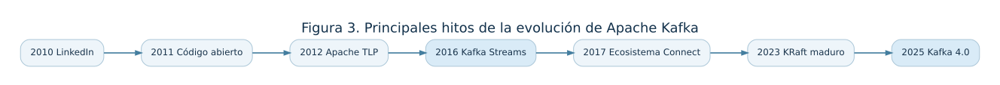

1. 2010 — Desarrollo en LinkedIn

   Nace como solución para gestionar flujos de actividad y registros entre sistemas.
2. 2011 — Publicación como código abierto

   Kafka comienza a desarrollarse dentro del ecosistema Apache.
3. 2012 — Proyecto de nivel superior de Apache

   Se consolida como proyecto independiente bajo la Apache Software Foundation.
4. 2016 — Kafka Streams

   Se amplían las capacidades para desarrollar aplicaciones que procesan flujos de eventos.
5. 2017 — Kafka Connect y ecosistema de integración consolidado

   Kafka amplía su adopción como plataforma de integración de datos y eventos.
6. 2023 — Maduración de KRaft

   Kafka incorpora una arquitectura de administración de metadatos que permite operar sin ZooKeeper.
7. 2025 — Kafka 4.0

   ZooKeeper deja de formar parte de la arquitectura soportada y KRaft se convierte en el mecanismo de administración del clúster.

La evolución de Kafka muestra un cambio importante: dejó de ser principalmente una herramienta para transportar registros entre sistemas y pasó a convertirse en una plataforma central para arquitecturas orientadas a eventos.

Actualmente puede utilizarse para integrar aplicaciones, alimentar sistemas analíticos, distribuir transacciones y construir soluciones de procesamiento continuo.

#### 1.2.4. La evolución del concepto de mensajería

Antes de Kafka ya existían sistemas de mensajería que permitían comunicar aplicaciones. Entre ellos se encontraban tecnologías basadas en colas de mensajes, donde una aplicación enviaba información y otra la recuperaba.

Kafka incorporó un enfoque particularmente útil para los sistemas de datos: el registro distribuido de eventos, conocido como distributed event log.

Para comprender esta diferencia, imaginemos un sistema de ventas que genera tres transacciones consecutivas.

En un modelo tradicional de cola, un mensaje puede retirarse de la cola después de ser procesado, según el funcionamiento y la configuración del sistema.

En Kafka, los eventos se incorporan a un registro ordenado dentro de cada partición y permanecen almacenados según una política de retención, independientemente de que un consumidor ya los haya leído.

Figura 4. Registro de eventos y lectura mediante offsets

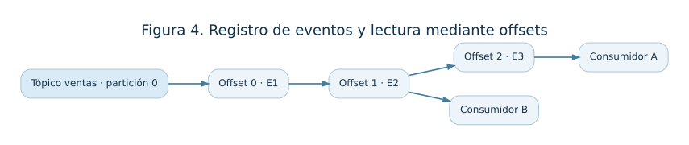

Esta característica permite que distintos consumidores procesen los mismos eventos de manera independiente.

Por ejemplo, un sistema de monitoreo puede consumir las transacciones recientes, mientras otro sistema analiza las mismas transacciones para detectar patrones de comportamiento.

También es posible volver a leer eventos anteriores, siempre que continúen disponibles según la configuración de retención.

Este mecanismo constituye una de las principales diferencias conceptuales entre Kafka y muchos sistemas tradicionales de mensajería.

#### 1.2.5. ZooKeeper y la evolución hacia KRaft

Durante buena parte de su historia, Kafka utilizó Apache ZooKeeper para coordinar determinados aspectos del funcionamiento del clúster.

ZooKeeper era responsable de tareas relacionadas con la coordinación y administración de metadatos, como la información de los brokers y determinados procesos de elección de controladores.

Esto significaba que una instalación tradicional de Kafka requería dos componentes diferenciados:

- Los servidores Kafka, encargados de almacenar y distribuir eventos.
- ZooKeeper, utilizado para determinadas funciones de coordinación.

Con el tiempo, esta dependencia comenzó a representar una complejidad adicional para la administración de las instalaciones.

Para resolverla, Kafka desarrolló KRaft (Kafka Raft), un mecanismo que permite administrar los metadatos del clúster sin depender de ZooKeeper.

Arquitectura tradicional

ZooKeeper

Coordinación

Kafka Brokers

Eventos y particiones

Arquitectura KRaft

Controladores KRaft

Metadatos del clúster

Kafka Brokers

Eventos y particiones

La transición hacia KRaft es relevante porque simplifica la arquitectura y reduce la dependencia de componentes externos para la administración del clúster.

Sin embargo, existe un aspecto importante para nuestro curso.

Nuestra infraestructura Docker actual todavía utiliza Kafka con ZooKeeper.

En el repositorio `juliopez/Hadoop`, el archivo `docker-compose.yml` define ambos servicios, incluyendo la conexión de Kafka con ZooKeeper mediante:

```
KAFKA_ZOOKEEPER_CONNECT: zookeeper:2181
```

Por lo tanto, aunque estudiaremos la evolución hacia KRaft, los ejemplos operativos deberán considerar inicialmente la infraestructura disponible.

Esto permitirá comprender tanto la arquitectura tradicional que utilizamos en el laboratorio como el modelo moderno que caracteriza a las versiones recientes de Kafka.

#### 1.2.6. Kafka y la evolución de las arquitecturas Big Data

El surgimiento de Kafka también puede entenderse como parte de una transformación más amplia de las arquitecturas de datos.

Durante muchos años, las organizaciones concentraron sus esfuerzos en almacenar grandes volúmenes de información y procesarlos posteriormente.

Tecnologías como Hadoop y HDFS permitieron desarrollar soluciones distribuidas para almacenar información a gran escala.

Posteriormente, herramientas como Hive y Spark facilitaron su consulta y procesamiento.

Kafka agregó una capacidad complementaria: incorporar continuamente los eventos generados por los sistemas operacionales.

En una arquitectura integrada, estas tecnologías pueden desempeñar funciones diferentes:

| Componente | Función principal                                        |
| ---------- | -------------------------------------------------------- |
| Kafka      | Recibir, almacenar según retención y distribuir eventos  |
| Spark      | Procesar y transformar datos, tanto batch como streaming |
| HDFS       | Almacenar conjuntos de datos de manera distribuida       |
| Hive       | Organizar y consultar datos estructurados                |

Por ejemplo, una empresa podría utilizar Kafka para recibir nuevas transacciones comerciales y Spark para procesarlas. Posteriormente, los resultados podrían almacenarse en HDFS y consultarse mediante Hive.

De esta manera, Kafka no reemplaza las tecnologías anteriores, sino que contribuye a conectar los sistemas que producen información con aquellos que la procesan y almacenan.

#### 1.2.7. Síntesis del apartado

Apache Kafka surgió como respuesta a los desafíos que enfrentaban las grandes plataformas digitales al necesitar capturar y distribuir información generada continuamente.

Su desarrollo en LinkedIn permitió construir una infraestructura de eventos distribuida, escalable y capaz de atender múltiples consumidores.

Desde su publicación como software de código abierto, Kafka evolucionó hacia una plataforma ampliamente utilizada en arquitecturas orientadas a eventos, incorporando nuevas capacidades y modernizando su funcionamiento interno.

Para nuestro curso, comprender esta evolución resulta importante porque permite identificar el lugar que ocupa Kafka dentro del ecosistema Big Data y su relación con las tecnologías ya estudiadas.

El siguiente paso será analizar qué es exactamente Apache Kafka, cuáles son sus capacidades y qué problemas concretos permite resolver.

### 1.3. ¿Qué es Apache Kafka y qué problemas resuelve?

#### 1.3.1. Definición de Apache Kafka

Apache Kafka es una plataforma distribuida de transmisión de eventos (event streaming) que permite publicar, almacenar y consumir flujos de información de manera continua.

Para comprender esta definición, debemos examinar tres de sus características fundamentales.

Es una plataforma distribuida: puede utilizar varios servidores que trabajan coordinadamente para almacenar y distribuir eventos. Esto permite aumentar su capacidad y disponibilidad a medida que crecen las necesidades de una organización.

Está orientada a eventos: trabaja con mensajes que representan acontecimientos producidos en aplicaciones, dispositivos o sistemas informáticos. Por ejemplo, una compra realizada, una temperatura registrada o una operación bancaria.

Permite transmitir información continuamente: los sistemas productores pueden publicar eventos a medida que ocurren, mientras que los sistemas consumidores pueden recuperarlos y utilizarlos sin esperar a que se genere un archivo completo.

Esta última característica introduce una diferencia importante respecto del procesamiento batch que hemos estudiado durante las semanas anteriores.

Cuando utilizábamos Spark para procesar un archivo CSV almacenado en HDFS, normalmente trabajábamos con un conjunto de registros previamente disponible. Con Kafka podemos construir una arquitectura en la que los nuevos registros se incorporan continuamente al sistema.

Sin embargo, Kafka no sustituye a Spark, HDFS ni Hive. Su función principal es facilitar el flujo de eventos entre los sistemas que generan información y aquellos que necesitan utilizarla.

#### 1.3.2. ¿Qué significa transmitir eventos?

En informática, un evento representa un hecho ocurrido en un momento determinado.

Por ejemplo, imaginemos que una empresa comercializadora utiliza un sistema de ventas conectado a sus distintas sucursales.

Cada vez que se realiza una transacción, el sistema genera información sobre la operación:

```
{
  "id_venta": "V10026",
  "fecha": "2026-10-28T10:15:32",
  "sucursal": "Santiago Centro",
  "producto": "Notebook",
  "cantidad": 1,
  "monto": 650000
}
```

Este mensaje representa un acontecimiento: la realización de una venta.

En una arquitectura tradicional, estos registros podrían almacenarse en una base de datos y exportarse posteriormente a un archivo para su procesamiento.

En una arquitectura basada en Kafka, el sistema de ventas puede publicar el evento inmediatamente después de producirse.

Otros sistemas pueden entonces consumir esa información para diferentes propósitos.

Figura 5. Transmisión de un evento comercial

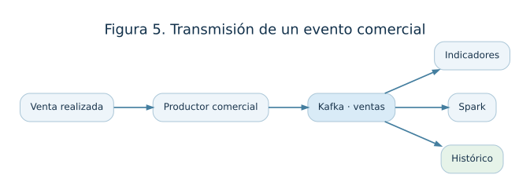

Un mismo evento puede ser utilizado por distintos sistemas, sin que el productor deba establecer una conexión específica con cada uno.

En este ejemplo, el sistema de monitoreo podría actualizar un indicador de ventas, Spark podría ejecutar transformaciones sobre los eventos y otro consumidor podría conservar la información para análisis históricos.

La ventaja es que cada sistema puede utilizar los eventos de acuerdo con sus necesidades.

Es importante comprender que Kafka no realiza automáticamente todos estos análisis. Kafka permite que los eventos estén disponibles; las aplicaciones consumidoras se encargan de interpretarlos y procesarlos.

#### 1.3.3. Primer problema: la integración entre múltiples sistemas

Uno de los principales desafíos que resuelve Kafka es la comunicación entre aplicaciones.

Supongamos que una organización dispone de cuatro sistemas que generan información:

- Un sistema de ventas.
- Una plataforma de comercio electrónico.
- Una aplicación de inventario.
- Un sistema de atención al cliente.

Además, dispone de varias aplicaciones que necesitan utilizar esos datos: monitoreo, análisis, almacenamiento y generación de alertas.

Si cada productor debe comunicarse directamente con cada consumidor, el número de conexiones puede crecer rápidamente.

Figura 6. Integración mediante conexiones directas

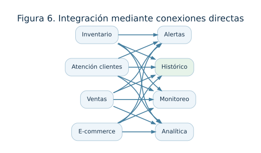

Ejemplo conceptual: múltiples integraciones punto a punto entre productores y consumidores.

Figura 7. Integración mediante Apache Kafka

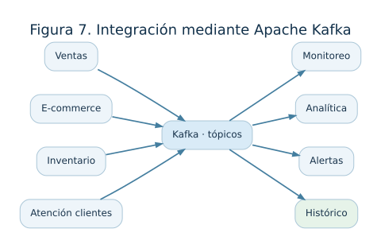

Los sistemas intercambian eventos mediante una plataforma común, reduciendo las dependencias directas.

Kafka permite reducir este acoplamiento porque los productores publican eventos en tópicos y los consumidores los recuperan desde esos tópicos.

Un tópico puede entenderse inicialmente como una categoría o flujo identificado por un nombre. Por ejemplo, podríamos tener un tópico llamado `ventas`, donde se publican las transacciones comerciales.

En el apartado 1.4 estudiaremos con mayor profundidad este concepto.

#### 1.3.4. Segundo problema: el crecimiento del volumen de información

Las organizaciones no generan siempre la misma cantidad de eventos.

Una empresa comercializadora podría registrar cientos de transacciones por hora durante un día normal, pero experimentar un aumento considerable durante una campaña de descuentos.

En ese escenario, los sistemas deben ser capaces de recibir y distribuir una mayor cantidad de mensajes.

Kafka fue diseñado para trabajar con grandes flujos de eventos y permitir el crecimiento de la infraestructura mediante la incorporación de servidores.

Este enfoque se denomina escalabilidad horizontal.

A diferencia de la escalabilidad vertical, que consiste en aumentar los recursos de un único servidor, la escalabilidad horizontal distribuye el trabajo entre varios servidores.

| Escalabilidad vertical                        | Escalabilidad horizontal                                |
| --------------------------------------------- | ------------------------------------------------------- |
| Aumentar memoria RAM o CPU de un servidor     | Incorporar servidores adicionales                       |
| Depende de la capacidad máxima de una máquina | Permite distribuir la carga                             |
| Puede ser suficiente para sistemas pequeños   | Resulta útil para sistemas distribuidos de mayor escala |

Kafka utiliza mecanismos como las particiones para distribuir los datos y facilitar su procesamiento paralelo.

No obstante, agregar servidores no garantiza por sí solo un aumento automático del rendimiento. La distribución de particiones, la configuración y las características de los productores y consumidores también influyen en la capacidad efectiva.

#### 1.3.5. Tercer problema: conservar los eventos para diferentes consumidores

Una característica especialmente importante de Kafka es que los eventos publicados pueden permanecer almacenados durante un período configurable.

Esto permite que un consumidor recupere información aunque no haya estado conectado exactamente en el momento en que se produjo el evento.

Volvamos al caso de las ventas.

Supongamos que a las 10:00 se registra una transacción, pero la aplicación encargada de generar indicadores se encuentra temporalmente detenida.

Si el evento permanece disponible en Kafka, la aplicación podrá recuperarlo posteriormente, de acuerdo con su posición de lectura y las políticas de retención configuradas.

Además, diferentes consumidores pueden leer los mismos eventos de forma independiente.

Por ejemplo:

- Un consumidor actualiza indicadores comerciales.
- Otro identifica transacciones sospechosas.
- Un tercero envía los registros hacia un sistema de almacenamiento histórico.

Esto no significa que Kafka conserve indefinidamente todos los mensajes. La duración y las condiciones de almacenamiento dependen de su configuración.

Tampoco significa que Kafka reemplace a HDFS como repositorio histórico. Ambas tecnologías tienen propósitos diferentes y pueden utilizarse conjuntamente.

#### 1.3.6. Cuarto problema: la necesidad de información oportuna

En determinados procesos, disponer de información varias horas después de que se produce puede ser insuficiente.

Consideremos los siguientes ejemplos:

| Situación                                            | Necesidad de información                    |
| ---------------------------------------------------- | ------------------------------------------- |
| Informe mensual de ventas                            | Procesamiento periódico                     |
| Actualización de ventas durante una jornada          | Información cada pocos segundos             |
| Detección de operaciones potencialmente fraudulentas | Respuesta con muy baja latencia             |
| Monitoreo de temperatura industrial                  | Recepción continua de mediciones            |
| Análisis histórico de clientes                       | Consolidación de grandes volúmenes de datos |

Kafka permite construir sistemas en los que los eventos se transmiten continuamente, pero debemos distinguir entre la velocidad con que se transportan y el tiempo total que tarda una aplicación en producir una respuesta.

Este último depende de toda la arquitectura: la fuente de datos, el productor, Kafka, el consumidor, el procesamiento y el sistema que presenta o almacena los resultados.

Por tanto, utilizar Kafka no garantiza automáticamente que una solución funcione en tiempo real estricto.

Esta distinción será especialmente importante cuando estudiemos las implementaciones real-time y Near Real-Time en el apartado 1.6.

#### 1.3.7. ¿Qué puede hacer Kafka y qué no hace por sí solo?

Para evitar confusiones, resulta conveniente identificar sus capacidades y limitaciones.

| Kafka permite                                  | Kafka no realiza automáticamente                                 |
| ---------------------------------------------- | ---------------------------------------------------------------- |
| Recibir eventos desde aplicaciones productoras | Consultar cualquier API REST sin un componente de integración    |
| Publicar y distribuir eventos mediante tópicos | Ejecutar consultas SQL como Hive                                 |
| Almacenar eventos según políticas de retención | Reemplazar un repositorio histórico como HDFS                    |
| Permitir múltiples consumidores independientes | Construir dashboards o visualizaciones                           |
| Facilitar arquitecturas de streaming           | Ejecutar todos los análisis y transformaciones que realiza Spark |

Existen herramientas complementarias dentro del ecosistema Kafka, como Kafka Connect y Kafka Streams, que amplían las posibilidades de integración y procesamiento.

Sin embargo, debemos distinguir la función del broker Kafka de las capacidades de esos componentes adicionales.

Por ejemplo, para consumir datos de una API REST podríamos desarrollar una aplicación Python que consulte periódicamente el servicio y publique los resultados en Kafka.

También podríamos utilizar una herramienta de integración como Apache NiFi, que ya forma parte de nuestra infraestructura Docker.

En ambos casos, Kafka recibe los eventos publicados por un componente externo; no es el broker quien realiza directamente la solicitud HTTP a la API.

#### 1.3.8. Kafka dentro de nuestra infraestructura Big Data

En el repositorio [juliopez/Hadoop](https://github.com/juliopez/Hadoop) disponemos de una arquitectura que integra Hadoop/HDFS, Hive, Spark, Kafka y otros servicios.

Hasta ahora hemos utilizado principalmente HDFS, Hive y Spark para trabajar con información almacenada.

La incorporación de Kafka permite extender esa arquitectura hacia el tratamiento de eventos.

Figura 8. Ejemplo conceptual de integración con las tecnologías del curso

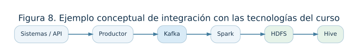

Esquema ilustrativo de integración. No implica que todas estas conexiones estén actualmente implementadas en el entorno Docker.

Esta arquitectura puede ampliarse para almacenar resultados en HDFS y posteriormente consultarlos con Hive.

La ventaja pedagógica es que no necesitamos abandonar lo aprendido: utilizaremos Kafka para incorporar una nueva etapa al flujo de datos.

Antes teníamos principalmente:

Archivos → HDFS → Spark → Resultados.

Ahora podremos estudiar una arquitectura más amplia:

Fuentes de eventos → Kafka → Procesamiento → Almacenamiento y análisis.

Ambos modelos pueden coexistir dentro de una misma organización.

#### 1.3.9. Síntesis del apartado

Apache Kafka es una plataforma distribuida orientada a la transmisión de eventos que facilita la comunicación entre sistemas productores y consumidores de información.

Su utilización responde a necesidades como la integración de aplicaciones, el manejo de grandes volúmenes de eventos, la disponibilidad de mensajes para diferentes consumidores y la construcción de sistemas que requieren información oportuna.

Su principal aporte consiste en permitir que los acontecimientos generados por diferentes fuentes puedan publicarse, almacenarse durante un período configurable y consumirse de manera independiente.

En nuestro curso, Kafka complementará las capacidades de HDFS, Hive y Spark, permitiéndonos comprender cómo evolucionar desde procesos basados principalmente en archivos hacia arquitecturas que incorporan flujos continuos de información.

### 1.4. Conceptos fundamentales: eventos, productores, consumidores, tópicos y brokers

En el apartado anterior comprendimos qué es Apache Kafka y cuáles son los problemas que permite resolver. Ahora necesitamos conocer los componentes que hacen posible su funcionamiento.

Para ello, utilizaremos un ejemplo que nos acompañará durante el resto del material: una empresa comercializadora que registra ventas en diferentes sucursales y necesita distribuir esa información hacia varios sistemas.

El propósito de este apartado es comprender cómo se comunican los componentes de Kafka y qué función cumple cada uno, antes de estudiar su arquitectura distribuida en mayor profundidad.

#### 1.4.1. Una primera aproximación al funcionamiento de Kafka

Imaginemos que una empresa dispone de un sistema informático que registra las transacciones comerciales.

Cada vez que se realiza una venta, el sistema genera información sobre el producto, la sucursal, el monto y la fecha de la operación.

La empresa necesita que esta información esté disponible para diferentes aplicaciones: una plataforma de monitoreo comercial, un sistema de detección de anomalías y un proceso de almacenamiento histórico.

Kafka permite organizar esta comunicación mediante una arquitectura compuesta por tres elementos principales:

- Productores (producers): aplicaciones que envían eventos a Kafka.
- Kafka: plataforma que recibe y almacena los eventos, organizándolos en tópicos.
- Consumidores (consumers): aplicaciones que recuperan los eventos para utilizarlos.

Figura 9. Flujo básico de información en Apache Kafka

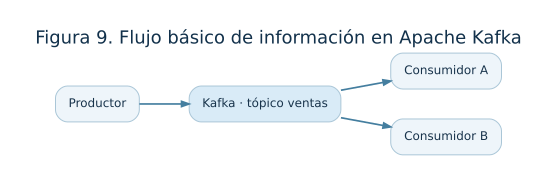

Esquema simplificado del intercambio de eventos. Kafka actúa como intermediario entre las aplicaciones productoras y consumidoras.

Aunque el esquema parece sencillo, cada componente tiene responsabilidades específicas. Comprenderlas será fundamental para interpretar correctamente los ejemplos y las guías prácticas.

#### 1.4.2. Evento: la unidad básica de información

Un evento es un registro que representa un acontecimiento ocurrido en un sistema.

Por ejemplo, cuando una persona compra un producto, el sistema comercial puede generar un evento denominado `venta_realizada`.

Este evento contiene información que describe lo ocurrido:

```
{
  "id_venta": "V10027",
  "fecha": "2026-10-28T11:05:30",
  "sucursal": "Valparaiso",
  "producto": "Monitor",
  "cantidad": 2,
  "monto_total": 320000
}
```

En este ejemplo, podemos identificar los siguientes datos:

| Campo         | Significado                     |
| ------------- | ------------------------------- |
| `id_venta`    | Identificador de la transacción |
| `fecha`       | Momento en que ocurrió la venta |
| `sucursal`    | Lugar donde se registró         |
| `producto`    | Producto comercializado         |
| `cantidad`    | Unidades vendidas               |
| `monto_total` | Valor total de la operación     |

Este contenido se denomina habitualmente payload, es decir, la información transportada por el mensaje.

Sin embargo, un registro de Kafka puede incluir otros elementos además de su contenido: una clave, una marca temporal y encabezados opcionales.

Estos elementos permiten organizar e interpretar los eventos, aunque no siempre es necesario utilizarlos todos.

Un aspecto importante: Kafka no exige que los eventos estén escritos en JSON. Los mensajes se transmiten como datos binarios, y las aplicaciones pueden utilizar diferentes formatos para representar su contenido.

En nuestro curso utilizaremos principalmente JSON porque facilita la lectura y comprensión de los ejemplos.

#### 1.4.3. Productor: la aplicación que publica eventos

Un productor (producer) es una aplicación que envía registros a Kafka.

En nuestro caso, el productor podría ser el sistema de ventas de la comercializadora.

Cada vez que se registra una nueva transacción, el productor prepara un mensaje y lo publica en un tópico de Kafka.

La aplicación productora no necesita conocer todos los sistemas que posteriormente utilizarán esa información.

Su responsabilidad principal consiste en publicar correctamente el evento en el destino correspondiente.

Figura 10. Publicación de eventos por un productor

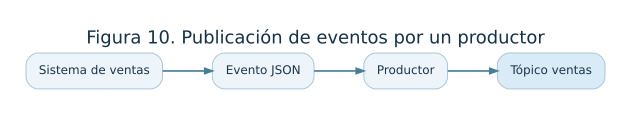

Un productor puede ser desarrollado utilizando diferentes lenguajes de programación, entre ellos Java, Python, Go o JavaScript.

También puede utilizarse una herramienta de integración de datos para actuar como productor.

Por ejemplo, dentro de nuestra infraestructura Docker disponemos de Apache NiFi, que puede participar en flujos de adquisición y publicación de información.

Más adelante estudiaremos cómo una aplicación Python puede consultar una API REST y publicar sus resultados en Kafka.

#### Ejemplo conceptual de un productor Python

El siguiente fragmento ilustra la lógica de publicación de un evento. No corresponde todavía a una implementación completa ni a un ejercicio de laboratorio.

```
evento = {    "id_venta": "V10027",    "sucursal": "Valparaiso",    "monto_total": 320000}productor.send(    "ventas",    value=evento)
```

La instrucción representa la intención de enviar un evento al tópico `ventas`.

Para que este código funcione realmente, se necesita configurar un cliente Kafka, establecer la conexión con el broker y definir cómo se serializa el mensaje. Estos aspectos se abordarán en la segunda parte del documento.

Lo importante, por ahora, es comprender la relación:

El productor genera o recibe información y la publica en Kafka.

#### 1.4.4. Tópico: la organización de los eventos

Un tópico (topic) es una categoría identificada por un nombre en la que Kafka organiza los registros publicados.

Podemos imaginarlo inicialmente como un flujo de información asociado a un propósito determinado.

Por ejemplo, una organización podría disponer de los siguientes tópicos:

| Tópico                 | Información publicada                   |
| ---------------------- | --------------------------------------- |
| `ventas`               | Transacciones comerciales               |
| `inventario`           | Cambios en las existencias de productos |
| `clientes`             | Altas o modificaciones de clientes      |
| `alertas`              | Eventos que requieren atención          |
| `sensores_temperatura` | Mediciones de dispositivos              |

Cuando un productor publica un evento, debe indicar el tópico al que desea enviarlo.

De esta manera, las aplicaciones consumidoras pueden seleccionar los flujos de información que necesitan.

Es importante aclarar que un tópico no es exactamente lo mismo que una tabla de Hive ni un archivo almacenado en HDFS.

Una tabla de Hive permite organizar datos estructurados para consultarlos mediante SQL. Un archivo en HDFS representa información almacenada en un sistema de archivos distribuido.

Un tópico Kafka, en cambio, organiza un registro de eventos que puede recibir nuevas publicaciones continuamente.

Además, un tópico puede dividirse en particiones, que constituyen una característica fundamental de su arquitectura distribuida.

Estudiaremos las particiones con mayor profundidad en el apartado 1.5.

#### 1.4.5. Broker: el servidor que almacena y entrega eventos

Un broker es un servidor Kafka encargado de recibir, almacenar y servir registros a los clientes.

Cuando un productor publica un evento, este es enviado a un broker que aloja la partición correspondiente.

Los consumidores se conectan a los brokers para recuperar los registros que necesitan procesar.

Una instalación Kafka puede disponer de un solo broker o de varios brokers trabajando como parte de un clúster.

Un clúster es un conjunto de servidores que colaboran para ofrecer un servicio distribuido.

Figura 11. Representación conceptual de un clúster Kafka

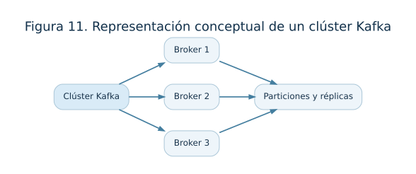

Esquema ilustrativo de un clúster de tres brokers. La distribución real depende de las particiones, réplicas y configuración.

En nuestra infraestructura docente, el archivo `docker-compose.yml` define un servicio denominado `kafka`, asociado a un contenedor con el mismo nombre.

Por lo tanto, cuando utilicemos comandos como:

```
docker exec -it kafka bash
```

estaremos ingresando al contenedor donde se ejecuta el servicio Kafka de nuestro laboratorio.

Conviene distinguir dos conceptos: el contenedor Docker es el entorno donde se ejecuta el software; el broker Kafka es el proceso servidor que proporciona el servicio de almacenamiento y distribución de eventos.

En nuestra configuración educativa, el servicio utiliza una imagen que integra herramientas adicionales. Por eso no debemos asumir que todos los archivos o comandos estarán ubicados en las mismas rutas que en otras distribuciones de Kafka.

#### 1.4.6. Consumidor: la aplicación que recupera eventos

Un consumidor (consumer) es una aplicación que lee registros desde uno o varios tópicos Kafka.

En nuestro ejemplo, un consumidor podría ser un sistema que necesita calcular las ventas acumuladas durante la jornada.

Otro consumidor podría analizar las transacciones para detectar operaciones anómalas.

Un tercero podría transferir los registros hacia un repositorio histórico.

Todos ellos pueden utilizar eventos publicados en el mismo tópico, siempre que su configuración de consumo lo permita.

Figura 12. Un tópico y múltiples aplicaciones consumidoras

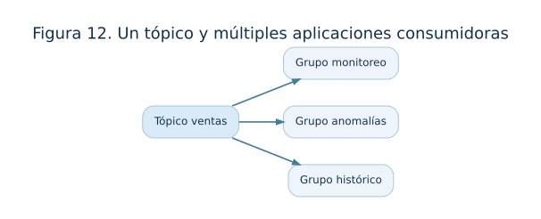

Una característica relevante es que el consumidor mantiene una posición de lectura respecto de las particiones del tópico.

Esta posición permite identificar hasta qué registro ha avanzado el procesamiento.

Kafka utiliza para ello un identificador denominado offset, que estudiaremos en el siguiente apartado.

Por ahora, basta con comprender que los consumidores no necesitan recibir exclusivamente los eventos en el instante exacto en que son publicados.

Pueden recuperar registros disponibles en Kafka según su configuración y las políticas de retención.

#### 1.4.7. ¿Qué ocurre cuando existen varios consumidores?

Consideremos dos situaciones diferentes.

Primera situación: aplicaciones independientes.

El sistema de monitoreo y el sistema de detección de anomalías necesitan analizar todas las ventas.

Cada aplicación puede consumir los eventos de manera independiente utilizando grupos de consumidores diferentes.

Segunda situación: varios procesos de una misma aplicación.

Supongamos que el sistema de monitoreo necesita procesar una gran cantidad de transacciones.

Podría utilizar varios consumidores pertenecientes a un mismo grupo, distribuyendo entre ellos las particiones disponibles.

Esta característica permite organizar el procesamiento paralelo.

Sin embargo, hay una condición importante: dentro de un mismo grupo de consumidores, una partición se asigna normalmente a un solo consumidor activo a la vez.

Por tanto, la cantidad de particiones influye en el paralelismo que puede alcanzarse.

No profundizaremos todavía en estos mecanismos, porque corresponden al apartado 1.5, dedicado a la arquitectura distribuida.

#### 1.4.8. Relación entre los componentes de Kafka y las tecnologías conocidas

Para facilitar la comprensión, podemos establecer algunas relaciones con las herramientas estudiadas anteriormente.

| Concepto Kafka | Relación con conocimientos previos                                            |
| -------------- | ----------------------------------------------------------------------------- |
| Evento         | Puede contener datos semejantes a una fila de un archivo CSV                  |
| Productor      | Aplicación que genera o incorpora nuevos registros                            |
| Tópico         | Organiza un flujo de registros, pero no equivale a una tabla Hive             |
| Broker         | Servidor que almacena y entrega registros Kafka                               |
| Consumidor     | Aplicación que recupera información para utilizarla o procesarla              |
| Spark          | Puede actuar como consumidor y procesar eventos recibidos desde Kafka         |
| HDFS           | Puede almacenar datos derivados de eventos mediante un proceso de integración |

Estas relaciones son útiles como punto de partida, pero no deben interpretarse como equivalencias exactas.

Por ejemplo, aunque un evento pueda contener los mismos campos que una fila CSV, su significado dentro de una arquitectura orientada a eventos es diferente: representa un acontecimiento que puede publicarse y consumirse conforme ocurre.

#### 1.4.9. Ejemplo integrador: una venta desde su origen hasta su consumo

Reunamos ahora los conceptos estudiados.

Una empresa comercializadora registra una nueva venta de un computador por $650.000.

El sistema comercial genera un evento con los antecedentes de la transacción.

Un productor publica ese evento en el tópico `ventas`.

Kafka recibe el registro mediante el broker que corresponde y lo almacena en la partición seleccionada.

Posteriormente, dos aplicaciones consumidoras utilizan la información.

La primera actualiza un indicador comercial. La segunda conserva el registro para su posterior análisis.

Figura 13. Recorrido de una transacción comercial

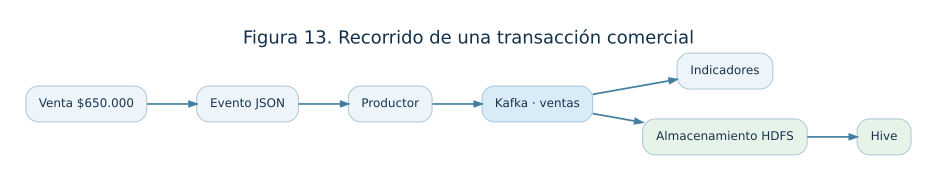

1. Se produce el acontecimiento.

   Una sucursal registra una venta de $650.000.
2. El productor prepara y publica el evento.

   El sistema comercial envía los datos al tópico `ventas`.
3. Kafka almacena el registro.

   El broker responsable recibe el mensaje en una partición del tópico.
4. Los consumidores recuperan el evento.

   Una aplicación actualiza indicadores y otra prepara su almacenamiento histórico.
5. Los datos pueden integrarse con otras tecnologías.

   Los resultados pueden procesarse mediante Spark y almacenarse en HDFS para posteriores consultas con Hive.

Este ejemplo muestra cómo Kafka se incorpora a una arquitectura Big Data sin reemplazar las herramientas previamente estudiadas.

También permite comprender que la transmisión de eventos constituye una etapa distinta del análisis y almacenamiento de la información.

#### 1.4.10. Síntesis del apartado

El funcionamiento de Apache Kafka se comprende inicialmente mediante cinco conceptos fundamentales:

| Concepto   | Función esencial                       |
| ---------- | -------------------------------------- |
| Evento     | Representa un acontecimiento           |
| Productor  | Publica eventos en Kafka               |
| Tópico     | Organiza los registros publicados      |
| Broker     | Recibe, almacena y sirve los registros |
| Consumidor | Recupera eventos para utilizarlos      |

Estos componentes permiten construir sistemas en los que diferentes aplicaciones intercambian información sin establecer conexiones directas entre todos los productores y consumidores.

En nuestro curso utilizaremos estos conceptos para comprender cómo una transacción comercial puede generarse en una aplicación, publicarse en Kafka y posteriormente procesarse o almacenarse mediante otras tecnologías de nuestra infraestructura.

En el siguiente apartado profundizaremos en la arquitectura distribuida de Kafka, incorporando conceptos como particiones, offsets, replicación y grupos de consumidores.

### 1.5. Arquitectura distribuida de Kafka: particiones, offsets, replicación y grupos de consumidores

En el apartado anterior estudiamos los cinco conceptos fundamentales de Apache Kafka: eventos, productores, tópicos, brokers y consumidores. Comprendimos cómo una aplicación puede publicar una transacción comercial y cómo otras aplicaciones pueden recuperar esa información para distintos propósitos.

Sin embargo, todavía debemos responder algunas preguntas importantes:

¿Cómo organiza Kafka miles o millones de eventos? ¿Cómo sabe un consumidor cuáles registros ha leído? ¿Qué sucede si un servidor deja de funcionar? ¿Cómo pueden varios consumidores trabajar simultáneamente?

Para responderlas, necesitamos comprender cuatro mecanismos de su arquitectura distribuida: particiones, offsets, replicación y grupos de consumidores.

Continuaremos utilizando el caso de nuestra empresa comercializadora y estableceremos relaciones con HDFS y Spark, tecnologías que ya conocemos.

#### 1.5.1. ¿Por qué Kafka utiliza una arquitectura distribuida?

Imaginemos que nuestra empresa comercializadora comienza con una sola sucursal que genera aproximadamente 100 transacciones diarias.

Un servidor podría recibir y almacenar esos registros sin mayores dificultades.

Ahora supongamos que la empresa crece hasta disponer de 200 sucursales, una plataforma de comercio electrónico y miles de transacciones por minuto.

La cantidad de información aumenta, pero también lo hacen las necesidades de disponibilidad y procesamiento.

Una arquitectura basada exclusivamente en un servidor presenta limitaciones: existe una capacidad máxima de almacenamiento, procesamiento y transferencia de información, además de una dependencia importante respecto de la disponibilidad de esa máquina.

Kafka permite distribuir los registros entre varios servidores, denominados brokers, que trabajan como parte de un clúster.

Este enfoque nos resulta familiar porque HDFS también utiliza una arquitectura distribuida. No obstante, sus mecanismos y objetivos específicos son diferentes.

| Aspecto                | HDFS                                   | Apache Kafka                             |
| ---------------------- | -------------------------------------- | ---------------------------------------- |
| Unidad de organización | Archivos y bloques                     | Tópicos, particiones y registros         |
| Distribución           | Bloques entre DataNodes                | Particiones entre brokers                |
| Replicación            | Copias de bloques                      | Réplicas de particiones                  |
| Propósito principal    | Almacenamiento distribuido de archivos | Almacenamiento y distribución de eventos |
| Acceso habitual        | Lectura y escritura de archivos        | Publicación y consumo de registros       |

La comparación nos ayuda a comprender la idea general de distribución, pero una partición Kafka no equivale a un bloque HDFS. Sus mecanismos de lectura, escritura y organización son distintos.

#### 1.5.2. Particiones: cómo se organiza un tópico

En el apartado anterior definimos un tópico como un flujo de registros identificado por un nombre.

Ahora debemos agregar una característica esencial: cada tópico se divide en una o más particiones.

Una partición es una secuencia ordenada de registros que Kafka almacena de manera incremental.

Por ejemplo, el tópico `ventas` podría estar dividido en tres particiones.

Figura 14. Tópico `ventas` organizado en tres particiones


Representación simplificada. Los eventos de una partición mantienen su propio orden; no existe necesariamente un orden global entre todas las particiones.

En la figura, cada partición contiene cuatro eventos.

La partición 0 almacena los eventos E1 a E4; la partición 1 contiene E5 a E8; y la partición 2 almacena E9 a E12.

Los identificadores E1 a E12 son únicamente ilustrativos. No representan el orden temporal global en que se produjeron todas las ventas.

Esta distinción es importante: Kafka garantiza el orden de los registros dentro de cada partición, pero no establece automáticamente un orden total entre las diferentes particiones de un tópico.

#### ¿Para qué sirven las particiones?

Las particiones cumplen principalmente dos funciones.

Distribuir la información. Un tópico puede tener sus particiones alojadas en diferentes brokers, evitando que toda su carga dependa de un único servidor.

Facilitar el procesamiento paralelo. Distintos consumidores pertenecientes a un mismo grupo pueden procesar particiones diferentes de manera simultánea.

Esto permite aumentar la capacidad de una aplicación cuando crece el volumen de eventos.

Sin embargo, aumentar la cantidad de particiones también introduce costos de administración y puede modificar las características de distribución y orden de los registros.

Por eso, la cantidad de particiones debe responder a las necesidades del sistema y no elegirse simplemente buscando el número más alto posible.

#### 1.5.3. ¿Cómo decide Kafka a qué partición enviar un evento?

Cuando un productor publica un registro, Kafka necesita determinar la partición de destino.

Una posibilidad es que el productor indique explícitamente la partición.

Otra consiste en utilizar una clave (key), que permite asociar determinados eventos con una misma partición.

Volvamos a nuestra empresa comercializadora.

Supongamos que necesitamos conservar el orden de las operaciones realizadas en cada sucursal.

Podríamos utilizar el identificador de sucursal como clave:

```
{
  "id_venta": "V10028",
  "id_sucursal": "SUC-015",
  "producto": "Teclado",
  "monto": 45000
}
```

Si utilizamos `SUC-015` como clave y mantenemos una estrategia de particionamiento estable, los registros con esa misma clave se dirigirán normalmente a la misma partición.

Esto permite conservar el orden de los eventos asociados a esa sucursal dentro de dicha partición.

Figura 15. Distribución ilustrativa mediante claves

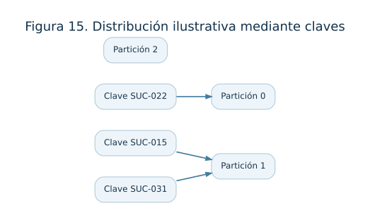

No debemos interpretar que Kafka asigna automáticamente una partición distinta a cada sucursal. Diferentes claves pueden terminar en una misma partición, y la distribución depende de la estrategia de particionamiento utilizada.

Además, cambiar la cantidad de particiones puede modificar el destino de nuevos registros asociados a una misma clave.

Cuando un productor no proporciona una clave, el cliente Kafka utiliza su estrategia de particionamiento correspondiente, que puede variar según la versión y la biblioteca empleada.

#### 1.5.4. Offset: la posición de un registro dentro de una partición

Cada registro almacenado en una partición recibe un identificador numérico denominado offset.

El offset representa la posición del registro dentro de esa partición.

Por ejemplo:

| Partición | Offset | Evento       |
| --------- | ------ | ------------ |
| 0         | 0      | Venta V10028 |
| 0         | 1      | Venta V10029 |
| 0         | 2      | Venta V10030 |
| 1         | 0      | Venta V10031 |
| 1         | 1      | Venta V10032 |

Observemos que los offsets de la partición 0 y la partición 1 comienzan independientemente.

Por lo tanto, un offset no identifica por sí solo un evento dentro de todo Kafka. Para localizar un registro es necesario considerar, como mínimo, su tópico, partición y offset.

Figura 16. Offsets dentro de una partición

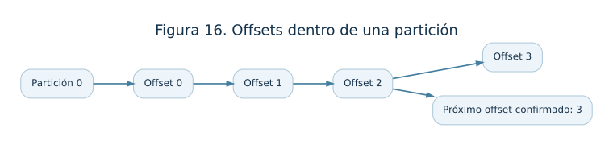

#### ¿Por qué son importantes los offsets?

Los offsets permiten que los consumidores administren su avance de lectura.

Supongamos que una aplicación ha procesado los primeros 100 registros de una partición y posteriormente se detiene.

Al reiniciarse, puede utilizar la posición registrada para continuar desde el punto correspondiente, sin necesidad de comenzar siempre desde el primer evento.

También puede configurarse para leer registros anteriores, siempre que estos continúen disponibles según la política de retención.

Debemos distinguir dos conceptos:

- Offset del registro: posición asignada por Kafka a un evento dentro de una partición.
- Offset confirmado (committed offset): posición que un grupo de consumidores registra para indicar desde dónde deberá reanudar su consumo.

Esta distinción es importante porque leer un mensaje no implica necesariamente que su procesamiento haya finalizado correctamente.

El momento en que se confirma el offset influye en el comportamiento del sistema frente a fallos y posibles reprocesamientos.

#### 1.5.5. Replicación: protección frente a fallos

Hasta ahora hemos explicado cómo Kafka distribuye los registros entre particiones.

Pero surge otra pregunta: ¿qué ocurre si el broker que almacena una partición deja de funcionar?

Kafka incorpora un mecanismo denominado replicación, que permite mantener copias de una partición en distintos brokers.

Cada partición tiene una réplica líder y puede disponer de réplicas adicionales.

La réplica líder es responsable de atender las operaciones ordinarias de lectura y escritura de esa partición. Las réplicas seguidoras mantienen copias de sus registros.

Figura 17. Replicación de una partición entre tres brokers

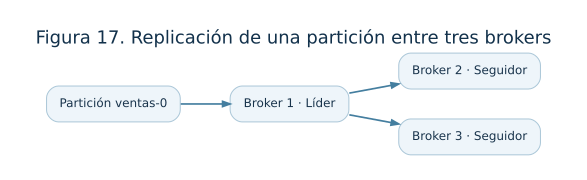

Ejemplo con factor de replicación 3. La cantidad de réplicas debe ser compatible con los brokers disponibles.

El número de copias configuradas se denomina factor de replicación.

Por ejemplo:

| Factor de replicación | Significado                      |
| --------------------- | -------------------------------- |
| 1                     | Una sola copia de cada partición |
| 2                     | Dos copias de cada partición     |
| 3                     | Tres copias de cada partición    |

Si un broker deja de estar disponible, Kafka puede elegir una réplica elegible para asumir el liderazgo y continuar atendiendo las operaciones.

No obstante, la disponibilidad y la protección frente a pérdida de datos dependen de aspectos como la sincronización de las réplicas, las confirmaciones exigidas al productor y la configuración del clúster.

Por ello, la replicación reduce riesgos, pero no constituye por sí sola una garantía absoluta contra toda pérdida de información.

#### Relación con HDFS

Este mecanismo presenta una semejanza conceptual con HDFS.

En HDFS estudiamos que los bloques de un archivo pueden replicarse entre diferentes DataNodes para aumentar la tolerancia a fallos.

Kafka utiliza también la replicación, pero la aplica a las particiones de sus tópicos.

La finalidad general es semejante: evitar que la falla de una máquina implique necesariamente la pérdida o indisponibilidad de la información.

Sin embargo, las unidades de almacenamiento y los mecanismos internos son distintos.

#### 1.5.6. Grupos de consumidores: procesamiento colaborativo

Un grupo de consumidores (consumer group) es un conjunto de consumidores que colaboran para leer y procesar los registros de uno o varios tópicos.

Cada grupo se identifica mediante un nombre o identificador denominado `group.id`.

Para comprender su funcionamiento, imaginemos que nuestra empresa registra miles de ventas por minuto y necesita calcular indicadores comerciales.

Un único consumidor podría no disponer de suficiente capacidad para procesar todos los eventos a la velocidad requerida.

Una alternativa consiste en utilizar varios consumidores pertenecientes al mismo grupo.

Kafka distribuye las particiones del tópico entre los miembros del grupo, de modo que cada partición sea procesada por un solo consumidor activo del grupo en un momento determinado.

Figura 18. Distribución de particiones dentro de un grupo de consumidores

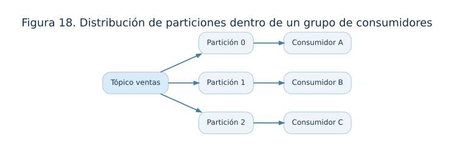

Ejemplo con tres particiones y tres consumidores pertenecientes al mismo grupo.

En este escenario, cada consumidor procesa una partición.

Pero ¿qué sucede si agregamos un cuarto consumidor?

Como el tópico solamente dispone de tres particiones, el cuarto consumidor no tendrá una partición asignada para ese tópico mientras se mantenga esa distribución.

Esto permite comprender una regla fundamental:

Dentro de un mismo grupo, el paralelismo efectivo de consumo de un tópico está limitado por su cantidad de particiones.

Por ejemplo:

| Particiones | Consumidores del grupo | Resultado habitual                          |
| ----------- | ---------------------- | ------------------------------------------- |
| 3           | 1                      | Un consumidor atiende las tres particiones  |
| 3           | 2                      | Las particiones se distribuyen entre ambos  |
| 3           | 3                      | Cada consumidor puede atender una partición |
| 3           | 4                      | Un consumidor queda sin partición asignada  |

La asignación puede variar según la estrategia utilizada y los demás tópicos a los que esté suscrito el grupo.

#### 1.5.7. ¿Qué ocurre si existen varios grupos de consumidores?

Hasta ahora hemos estudiado varios consumidores colaborando dentro de un mismo grupo.

Sin embargo, Kafka también permite que diferentes grupos consuman los mismos eventos de manera independiente.

Por ejemplo, nuestra empresa podría disponer de tres grupos:

- `monitoreo_ventas`: actualiza indicadores comerciales.
- `deteccion_anomalias`: analiza operaciones sospechosas.
- `almacenamiento_historico`: prepara registros para su persistencia.

Cada grupo mantiene su propia posición de consumo y puede procesar los eventos a su propio ritmo.

Figura 19. Diferentes grupos consumiendo un mismo tópico

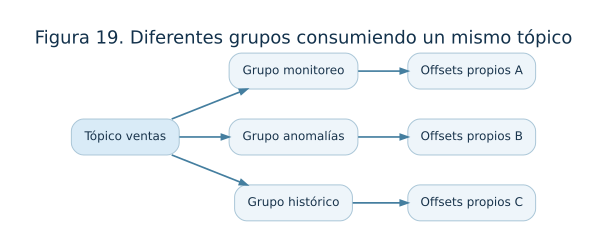

Esto representa una diferencia importante respecto de distribuir el trabajo entre consumidores de un mismo grupo.

Dentro de un grupo, los consumidores colaboran y se reparten las particiones.

Entre grupos diferentes, cada grupo puede leer independientemente los registros del tópico.

Por lo tanto, una misma venta puede ser utilizada por varios sistemas sin que uno de ellos impida el acceso de los demás.

#### 1.5.8. Rebalanceo: adaptación a cambios en los consumidores

Los grupos de consumidores no permanecen necesariamente con la misma cantidad de integrantes.

Un consumidor puede detenerse, fallar o incorporarse al grupo.

Cuando se producen determinados cambios, Kafka debe revisar la distribución de particiones entre los consumidores disponibles.

Este proceso se denomina rebalanceo (rebalance).

Por ejemplo, supongamos que tenemos tres particiones distribuidas entre tres consumidores.

Si uno de los consumidores deja de funcionar, las particiones que tenía asignadas deben redistribuirse entre los consumidores restantes.

De esta manera, el grupo puede continuar procesando los eventos.

El rebalanceo contribuye a la continuidad operativa, aunque puede provocar pausas o cambios temporales en el procesamiento, según la estrategia de asignación y la configuración utilizada.

Por eso, en sistemas productivos resulta importante monitorear la estabilidad de los grupos de consumidores.

#### 1.5.9. ¿Qué sucede si los consumidores procesan más lentamente que los productores?

Consideremos nuevamente nuestra empresa comercializadora.

Supongamos que el sistema de ventas publica 1.000 eventos por minuto, pero una aplicación consumidora solamente alcanza a procesar 600 eventos durante ese mismo período.

En este escenario, la cantidad de eventos pendientes de consumo aumentará.

Kafka permite medir esta diferencia mediante un indicador conocido como consumer lag.

El lag representa el retraso del consumidor respecto de los registros disponibles en una partición, habitualmente expresado como una diferencia entre offsets.

Figura 20. Ejemplo conceptual de retraso de consumo

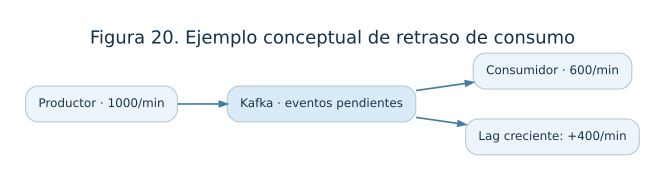

El consumer lag es especialmente importante en arquitecturas de procesamiento Near Real-Time.

Si el retraso aumenta continuamente, la aplicación puede dejar de entregar información con la oportunidad requerida, aunque Kafka continúe recibiendo correctamente los eventos.

Por tanto, no basta con comprobar que los mensajes llegan a Kafka. También debemos verificar que los consumidores sean capaces de procesarlos con una velocidad adecuada.

#### 1.5.10. Nuestra infraestructura Docker: un entorno educativo de un broker

Hasta ahora hemos presentado ejemplos de clústeres con varios brokers y particiones distribuidas.

Sin embargo, debemos distinguir esas arquitecturas conceptuales de la infraestructura que utilizamos actualmente en el curso.

En nuestro repositorio `juliopez/Hadoop`, el archivo `docker-compose.yml` define un servicio Kafka con el nombre de contenedor `kafka`, conectado al servicio `zookeeper`.

La configuración contempla un único servicio Kafka en Docker Compose.

Esto significa que nuestro laboratorio no dispone actualmente de un clúster de varios brokers Kafka independientes.

Podemos estudiar y utilizar tópicos, particiones, productores, consumidores y grupos de consumidores dentro de ese entorno.

No obstante, la replicación entre brokers requiere incorporar servidores Kafka adicionales.

Por ejemplo, un tópico con factor de replicación 3 necesita disponer de al menos tres brokers para alojar sus tres réplicas.

Esta distinción evita que los estudiantes confundan la arquitectura distribuida que Kafka puede implementar con la configuración específica disponible en nuestro laboratorio.

Además, nuestra infraestructura utiliza ZooKeeper, mientras que las versiones modernas de Kafka emplean KRaft.

Por eso, cuando abordemos la operación de Kafka en la segunda parte del material, verificaremos las herramientas y comandos compatibles con la imagen Docker utilizada.

#### 1.5.11. Ejemplo integrador: procesamiento de ventas con varios consumidores

Reunamos los conceptos estudiados mediante un escenario completo.

Nuestra empresa comercializadora dispone de varias sucursales que generan eventos de ventas.

Los productores publican esos eventos en el tópico `ventas`, configurado con tres particiones.

Kafka distribuye los registros entre las particiones según la estrategia de particionamiento utilizada.

Cada registro recibe un offset dentro de su partición.

Un grupo de consumidores denominado `monitoreo_ventas` utiliza tres procesos para distribuir el trabajo.

Otro grupo, denominado `almacenamiento_historico`, consume los mismos registros para conservarlos mediante un proceso de integración.

Si uno de los consumidores del primer grupo deja de funcionar, Kafka puede redistribuir sus particiones entre los consumidores restantes.

Si los consumidores comienzan a procesar más lentamente que los productores, aumentará su retraso de consumo.

Finalmente, si el sistema necesita tolerar la falla de brokers, deberá utilizar una arquitectura con múltiples servidores y replicación configurada apropiadamente.

Este ejemplo permite comprender que los mecanismos de Kafka no funcionan de manera aislada: particiones, offsets, grupos de consumidores y replicación colaboran para distribuir, organizar y mantener disponible el flujo de eventos.

#### 1.5.12. Síntesis del apartado

En este apartado estudiamos los principales mecanismos que sustentan la arquitectura distribuida de Apache Kafka.

| Concepto              | Función principal                                                                  |
| --------------------- | ---------------------------------------------------------------------------------- |
| Partición             | Divide un tópico en secuencias ordenadas de registros                              |
| Offset                | Identifica la posición de un registro dentro de una partición                      |
| Replicación           | Mantiene copias de particiones en distintos brokers                                |
| Grupo de consumidores | Permite distribuir el procesamiento entre consumidores                             |
| Rebalanceo            | Reasigna particiones cuando cambia la composición del grupo                        |
| Consumer lag          | Permite observar el retraso de un consumidor respecto de los registros disponibles |

Estos mecanismos explican cómo Kafka puede atender flujos de información de gran volumen, distribuir el trabajo entre aplicaciones y ofrecer mecanismos de continuidad operativa.

También comprendimos una diferencia importante entre la arquitectura general de Kafka y nuestro entorno docente: aunque Kafka puede utilizar múltiples brokers y replicación, nuestra instalación actual dispone de un único servicio Kafka.

En el siguiente apartado estudiaremos una cuestión central para el curso: qué significa realmente procesar información en tiempo real, en Near Real-Time y mediante batch, y cómo se relacionan estos enfoques con Kafka y Spark.

### 1.6. Tiempo real, Near Real-Time y procesamiento batch: diferencias y aplicaciones

En los apartados anteriores estudiamos cómo Apache Kafka permite recibir, almacenar y distribuir eventos mediante productores, tópicos, brokers y consumidores. También comprendimos cómo las particiones y los grupos de consumidores facilitan el procesamiento paralelo.

Ahora debemos responder una pregunta fundamental: ¿qué significa que un sistema procese información en tiempo real?

La respuesta requiere distinguir tres enfoques: procesamiento por lotes (batch), procesamiento cercano al tiempo real (Near Real-Time o NRT) y procesamiento en tiempo real (real-time).

Esta distinción es especialmente importante porque utilizar Kafka no convierte automáticamente una aplicación en un sistema de tiempo real.

#### 1.6.1. El tiempo como dimensión del procesamiento de datos

Hasta ahora hemos trabajado principalmente con conjuntos de datos almacenados en HDFS, que posteriormente procesamos mediante Apache Spark.

Por ejemplo, nuestra empresa comercializadora podría generar un archivo CSV con todas las ventas realizadas durante una jornada.

Una vez disponible el archivo, ejecutamos un programa PySpark para calcular indicadores como las ventas totales, los productos más vendidos o los ingresos por sucursal.

En este escenario, el procesamiento comienza cuando los datos ya se encuentran disponibles.

Pero imaginemos que la gerencia necesita conocer el comportamiento de las ventas durante la jornada, sin esperar al cierre diario.

La necesidad ya no consiste únicamente en procesar correctamente los datos. También importa cuánto tiempo transcurre entre la generación de una transacción y la disponibilidad de información útil para tomar decisiones.

Este intervalo se relaciona con el concepto de latencia.

En términos generales, la latencia representa el tiempo que transcurre entre dos momentos de un proceso. En sistemas de datos, podemos distinguir la latencia de transmisión, la latencia de procesamiento y la latencia total de extremo a extremo.

Para nuestro curso, utilizaremos principalmente esta última perspectiva:

\\[ \text{Latencia total} = \text{Tiempo de disponibilidad del resultado} - \text{Tiempo de generación del evento} \\]

Por ejemplo, si una venta ocurre a las 10:00:00 y aparece en un indicador a las 10:00:05, la latencia total observada es de cinco segundos.

Esto no significa necesariamente que el sistema sea de tiempo real estricto. Para determinarlo necesitamos conocer los requisitos temporales de la aplicación.

#### 1.6.2. Procesamiento batch: trabajar con conjuntos de datos

El procesamiento por lotes o batch processing consiste en ejecutar operaciones sobre un conjunto de datos disponible para una tarea determinada.

Este enfoque es el que hemos utilizado principalmente durante las semanas anteriores.

Figura 21. Procesamiento batch de transacciones comerciales


Supongamos que el sistema comercial genera un archivo con 100.000 transacciones.

El programa PySpark puede leerlo desde HDFS, aplicar transformaciones, realizar agrupaciones y escribir los resultados.

Este modelo ofrece varias ventajas. Permite procesar grandes volúmenes de información, ejecutar cálculos complejos y trabajar con datos históricos consolidados.

Por ello, continúa siendo apropiado para informes diarios, cierres contables, análisis históricos, procesos de transformación de datos y construcción de conjuntos de información para análisis posteriores.

Su principal limitación aparece cuando necesitamos resultados actualizados con una frecuencia mayor que la del proceso programado.

Si un informe se genera una vez al día, una transacción registrada inmediatamente después de su ejecución podría no aparecer hasta el siguiente ciclo.

Sin embargo, debemos evitar una confusión: batch no significa necesariamente procesamiento lento. Un trabajo batch puede ejecutarse en pocos segundos. Lo que caracteriza al enfoque es su organización en ejecuciones sobre conjuntos de datos, no una duración mínima obligatoria.

#### 1.6.3. Near Real-Time: información con un pequeño retraso

El procesamiento Near Real-Time (NRT) busca que la información esté disponible poco después de producirse, aceptando una latencia limitada que resulta adecuada para la necesidad del negocio.

No existe un umbral universal que determine que una aplicación es NRT por procesar datos cada cinco, diez o treinta segundos.

La clasificación depende de los requisitos operacionales.

Por ejemplo, para una empresa comercializadora podría resultar suficiente actualizar sus indicadores cada diez segundos.

En ese escenario, la organización no necesita necesariamente que cada venta aparezca en el dashboard en el mismo instante en que ocurre, pero tampoco puede esperar hasta el cierre del día.

Una implementación NRT podría funcionar de la siguiente manera:

1. El sistema comercial registra nuevas transacciones.
2. Una aplicación consulta periódicamente una API REST.
3. Los registros nuevos se publican en Kafka.
4. Un consumidor recupera los eventos.
5. Los resultados se actualizan con una frecuencia definida.

Figura 22. Ejemplo de una arquitectura Near Real-Time

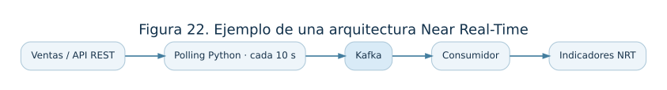

Los diez segundos son una frecuencia ilustrativa de consulta, no una garantía de latencia total.

Este ejemplo introduce un concepto importante: el polling.

Polling significa consultar periódicamente un sistema para comprobar si existe información nueva.

Por ejemplo, una aplicación Python podría consultar una API cada diez segundos para recuperar nuevas transacciones.

La API es una interfaz que permite que una aplicación solicite información o utilice funciones proporcionadas por otro sistema. Cuando hablamos de una API REST, normalmente nos referimos a servicios accesibles mediante solicitudes HTTP.

En nuestro caso, una aplicación podría consultar una API, transformar la respuesta JSON en eventos y publicarlos en Kafka.

Debemos considerar que la frecuencia de consulta no equivale automáticamente a la latencia total.

Si consultamos cada diez segundos, un evento podría permanecer varios segundos sin ser detectado. A ello se suma el tiempo de respuesta de la API, la publicación en Kafka, el procesamiento del consumidor y la actualización del sistema de destino.

Por lo tanto, una arquitectura NRT debe evaluarse considerando el recorrido completo de la información.

#### 1.6.4. Procesamiento en tiempo real: responder dentro de un plazo definido

El concepto de tiempo real (real-time) suele utilizarse de manera amplia en la industria tecnológica.

En ocasiones se emplea para describir aplicaciones que procesan eventos continuamente y entregan resultados con baja latencia.

Sin embargo, desde una perspectiva técnica más estricta, un sistema de tiempo real debe cumplir determinados requisitos temporales.

Esto significa que no basta con obtener un resultado correcto: también debe estar disponible dentro del plazo requerido.

Por ejemplo, imaginemos un sistema industrial que necesita detener una máquina cuando un sensor detecta una condición peligrosa.

Si la respuesta llega demasiado tarde, aunque el cálculo sea correcto, podría no cumplir su propósito.

En sistemas de tiempo real estricto, la capacidad de cumplir los plazos establecidos es una propiedad fundamental.

Kafka puede formar parte de arquitecturas de baja latencia y transmisión continua de eventos, pero no debe considerarse por sí solo una plataforma que garantice tiempos máximos de respuesta para aplicaciones críticas de tiempo real estricto.

En este curso, cuando hablemos de Kafka y real-time streaming, nos referiremos principalmente a flujos continuos de eventos y a sistemas diseñados para responder con baja latencia, distinguiéndolos de aquellos que requieren garantías temporales estrictas.

#### 1.6.5. Comparación entre batch, Near Real-Time y real-time

Los tres enfoques pueden utilizarse dentro de una misma organización.

La elección depende de la necesidad de información, los requisitos de latencia, los costos y la complejidad de implementación.

| Característica               | Batch                                             | Near Real-Time                                     | Real-time                                                   |
| ---------------------------- | ------------------------------------------------- | -------------------------------------------------- | ----------------------------------------------------------- |
| Procesamiento                | Por lotes                                         | Frecuente o continuo                               | Continuo, con requisitos temporales                         |
| Disponibilidad de resultados | Según ejecución programada                        | Con retraso acotado para el caso de uso            | Dentro del plazo requerido                                  |
| Latencia                     | Variable; puede ser elevada entre actualizaciones | Habitualmente segundos o minutos, según aplicación | Según requisitos específicos                                |
| Ejemplo comercial            | Informe de ventas diario                          | Dashboard actualizado cada 10 segundos             | Autorización de una operación con plazo exigente            |
| Tecnologías posibles         | HDFS, Hive, Spark                                 | Kafka, consumidores, Spark Streaming               | Arquitecturas especializadas según las garantías necesarias |

Esta tabla debe interpretarse como una comparación conceptual, no como una clasificación universal basada únicamente en segundos.

Por ejemplo, un sistema que actualiza información cada segundo podría considerarse NRT si no ofrece garantías de cumplimiento de plazos. Del mismo modo, un sistema de tiempo real puede tener un plazo mayor, siempre que ese plazo esté claramente definido y garantizado bajo las condiciones requeridas.

#### 1.6.6. Streaming continuo y microbatch: dos formas de procesar eventos

Hasta ahora hemos utilizado los términos streaming y NRT, pero necesitamos distinguirlos.

Streaming describe el tratamiento de datos que llegan como un flujo, en lugar de depender exclusivamente de conjuntos de datos cerrados.

Existen distintas formas de implementar ese procesamiento.

Una aplicación puede procesar los registros conforme los recibe, sin esperar a formar lotes de tamaño considerable.

Otra alternativa consiste en agrupar los eventos que llegan durante intervalos breves y procesarlos mediante pequeñas ejecuciones sucesivas.

Esta segunda estrategia se denomina microbatch.

Figura 23. Procesamiento continuo y mediante microbatches

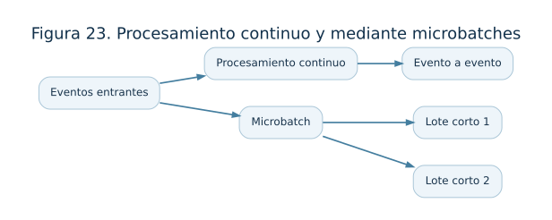

Este concepto resulta especialmente relevante porque ya conocemos Apache Spark.

Spark Structured Streaming permite construir aplicaciones de procesamiento de flujos utilizando operaciones semejantes a las que hemos empleado con DataFrames.

Su motor utiliza habitualmente microbatches para ejecutar consultas de streaming.

Esto significa que podemos aprovechar conocimientos previos como selección de columnas, filtros, agrupaciones y transformaciones para procesar información que llega continuamente.

La diferencia es que, en lugar de trabajar solamente con un DataFrame obtenido desde un archivo cerrado, la aplicación puede operar sobre una fuente de datos que incorpora nuevos registros.

#### 1.6.7. Kafka y Spark: funciones diferentes dentro de una misma arquitectura

Es importante comprender que Kafka y Spark no realizan exactamente el mismo trabajo.

Kafka permite publicar, conservar según retención y distribuir eventos.

Spark puede leer esos eventos y ejecutar operaciones de procesamiento sobre ellos.

Por ejemplo, imaginemos que cada sucursal publica sus ventas en Kafka.

Una aplicación Spark Structured Streaming podría consumir los registros y calcular indicadores de ventas por sucursal.

Posteriormente, los resultados podrían almacenarse en un repositorio o enviarse a otra aplicación.

Figura 24. Integración conceptual de Kafka y Spark

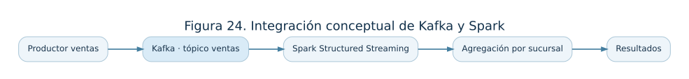

Arquitectura conceptual; la conexión concreta con Spark depende de la versión y de las bibliotecas disponibles.

Esta integración permite comprender que el procesamiento batch y el streaming no son necesariamente alternativas excluyentes.

Una organización puede utilizar Kafka y Spark Streaming para obtener información reciente, mientras conserva HDFS, Hive y los procesos batch para análisis históricos y consolidaciones periódicas.

En nuestro laboratorio, la infraestructura actual utiliza Spark 2.4.0. Por ello, antes de implementar la conexión entre Kafka y Spark Structured Streaming, será necesario verificar la compatibilidad de los conectores y dependencias correspondientes.

#### 1.6.8. Un mismo problema empresarial resuelto mediante tres enfoques

Para comparar los modelos, utilizaremos una misma pregunta:

¿Cuánto está vendiendo nuestra empresa comercializadora?

Escenario A. Informe diario mediante batch

Al finalizar la jornada, la empresa consolida las transacciones en un archivo. Spark procesa los datos almacenados en HDFS y genera un informe de ventas.

Es apropiado para cierres diarios, conciliaciones y análisis históricos.

Escenario B. Dashboard Near Real-Time

Una aplicación consulta una API comercial cada diez segundos, identifica nuevas transacciones y las publica en Kafka. Un consumidor procesa los eventos y actualiza los indicadores.

Es apropiado para seguimiento operacional, siempre que la latencia obtenida cumpla los requisitos del negocio.

Escenario C. Detección de operaciones con respuesta inmediata

Cada transacción genera un evento que debe analizarse dentro de un plazo definido para permitir o rechazar una operación.

En este escenario, Kafka podría formar parte de la arquitectura, pero el cumplimiento de los plazos exige diseñar y verificar el sistema completo.

Los tres escenarios utilizan información comercial, pero responden a necesidades distintas.

El primero prioriza el procesamiento de información consolidada. El segundo busca mantener indicadores actualizados con una latencia aceptable. El tercero incorpora requisitos temporales que pueden ser críticos para la operación.

La decisión tecnológica debe comenzar por la necesidad del negocio y no por la elección anticipada de una herramienta.

#### 1.6.9. ¿Qué determina la latencia de una arquitectura Kafka?

Supongamos que implementamos una solución NRT utilizando una API REST, un productor Python, Kafka y un consumidor.

La latencia total dependerá de varias etapas.

| Etapa                 | Posible contribución a la latencia                               |
| --------------------- | ---------------------------------------------------------------- |
| Generación del evento | Tiempo hasta que el sistema de origen registra el acontecimiento |
| Consulta de la API    | Espera hasta la próxima consulta y tiempo de respuesta           |
| Publicación en Kafka  | Serialización, comunicación y confirmación del mensaje           |
| Consumo               | Frecuencia de lectura y disponibilidad del consumidor            |
| Procesamiento         | Transformaciones y cálculos realizados                           |
| Presentación          | Escritura de resultados y actualización del indicador            |

Por ejemplo, si una aplicación consulta una API cada diez segundos, no podemos afirmar que el dashboard se actualizará exactamente diez segundos después de cada transacción.

Podría tardar más debido al tiempo de respuesta de la API, el procesamiento o la actualización del destino.

También podría tardar menos si el evento ocurre inmediatamente antes de la siguiente consulta.

Por ello, al evaluar una solución NRT debemos medir la latencia real y no asumirla a partir de un único parámetro de configuración.

Otro indicador importante es el consumer lag, estudiado en el apartado anterior.

Si los consumidores procesan menos eventos de los que reciben, el retraso puede aumentar y afectar la oportunidad de los resultados.

#### 1.6.10. ¿Cuándo conviene utilizar cada enfoque?

No todas las aplicaciones necesitan procesamiento continuo.

Implementar una arquitectura de streaming introduce componentes adicionales que deben configurarse, supervisarse y mantenerse.

Por ejemplo, si una institución necesita generar un informe estadístico mensual, un proceso batch podría resolver adecuadamente la necesidad sin incorporar Kafka.

En cambio, si una plataforma comercial necesita monitorear continuamente sus operaciones, una arquitectura basada en eventos puede aportar beneficios importantes.

La selección debe considerar el volumen de información, la frecuencia con que cambian los datos, los requisitos de latencia, la disponibilidad necesaria y los recursos técnicos de la organización.

El objetivo no es reemplazar todos los procesos batch por streaming, sino utilizar cada enfoque cuando aporta valor.

Esta idea será fundamental para comprender las arquitecturas integradas que estudiaremos posteriormente.

#### 1.6.11. Síntesis del apartado

El procesamiento batch, Near Real-Time y real-time representan enfoques diferentes para gestionar la relación entre los datos y el tiempo.

El procesamiento batch trabaja con conjuntos de información y resulta especialmente apropiado para consolidaciones y análisis históricos.

Near Real-Time busca ofrecer resultados con un retraso limitado y aceptable para una necesidad específica.

El procesamiento en tiempo real incorpora requisitos temporales que deben cumplirse, especialmente cuando una respuesta tardía puede afectar el funcionamiento del sistema.

Apache Kafka permite construir arquitecturas que reciben y distribuyen eventos continuamente, pero la latencia total depende de todos los componentes involucrados.

En nuestro curso, esta distinción nos permitirá comprender cómo ampliar la infraestructura basada en HDFS, Hive y Spark para incorporar nuevas fuentes de información y desarrollar soluciones de procesamiento cercano al tiempo real.

### 1.7. Kafka en el ecosistema Big Data: relaciones con Hadoop, Spark, APIs y otros servicios

En los apartados anteriores hemos estudiado qué es Apache Kafka, cómo funciona su arquitectura distribuida y cuáles son las diferencias entre procesamiento batch, Near Real-Time y tiempo real.

Ahora corresponde situar Kafka dentro de una arquitectura Big Data más amplia.

Este apartado tiene especial importancia para nuestro curso, porque no estamos comenzando desde cero. Ya conocemos Hadoop, HDFS, Hive y Spark, y hemos utilizado estas tecnologías para almacenar, transformar y analizar información.

La incorporación de Kafka nos permitirá comprender cómo conectar esos procesos con sistemas que generan datos continuamente.

#### 1.7.1. Del ecosistema de almacenamiento al ecosistema de eventos

Durante las semanas anteriores hemos trabajado con una arquitectura centrada principalmente en datos almacenados.

Por ejemplo, un sistema comercial genera un archivo CSV, que posteriormente cargamos en HDFS. Mediante Spark realizamos transformaciones y cálculos, mientras que Hive permite organizar y consultar información estructurada.

Este enfoque continúa siendo válido para numerosos problemas.

Sin embargo, las organizaciones también necesitan incorporar datos provenientes de aplicaciones web, sensores, plataformas transaccionales, servicios externos y bases de datos que cambian continuamente.

En estos escenarios aparece una necesidad adicional: transportar información desde los sistemas que la producen hacia los sistemas que la procesan y almacenan.

Kafka puede cumplir esa función dentro del ecosistema Big Data.

Figura 25. Evolución de una arquitectura Big Data hacia la incorporación de eventos

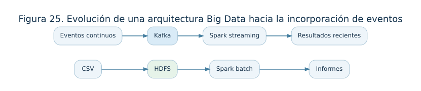

Ambas arquitecturas pueden coexistir. Kafka incorpora una etapa de transmisión de eventos, mientras Spark, HDFS y Hive mantienen sus funciones de procesamiento, almacenamiento y consulta.

La diferencia fundamental no consiste en abandonar los archivos o las bases de datos, sino en disponer de mecanismos para incorporar nueva información a medida que se genera.

#### 1.7.2. Relación entre Kafka y Hadoop/HDFS

Apache Hadoop proporciona un ecosistema de tecnologías orientadas al almacenamiento y procesamiento distribuido de grandes volúmenes de información.

Dentro de ese ecosistema, HDFS permite almacenar archivos distribuyéndolos entre diferentes nodos.

Kafka, por su parte, está diseñado para gestionar registros de eventos que pueden publicarse y consumirse continuamente.

Aunque ambas tecnologías almacenan información, lo hacen con propósitos diferentes.

| Característica       | Kafka                                                   | HDFS                                                      |
| -------------------- | ------------------------------------------------------- | --------------------------------------------------------- |
| Organización         | Tópicos y particiones                                   | Directorios, archivos y bloques                           |
| Información habitual | Registros de eventos                                    | Archivos y conjuntos de datos                             |
| Escritura            | Incorporación de registros a particiones                | Escritura de archivos                                     |
| Lectura              | Consumo mediante offsets                                | Acceso a archivos                                         |
| Retención            | Configurable por tiempo o tamaño, entre otras políticas | Los archivos permanecen hasta que se eliminan o gestionan |
| Uso principal        | Transmisión y distribución de eventos                   | Almacenamiento distribuido                                |

Imaginemos que nuestra empresa comercializadora registra 50.000 transacciones durante una jornada.

Kafka podría recibir esos eventos conforme se producen.

Posteriormente, un proceso consumidor podría agruparlos y almacenarlos en HDFS, por ejemplo, como archivos Parquet organizados por fecha.

De esta manera, Kafka permite incorporar información reciente y HDFS proporciona un repositorio para su conservación y análisis histórico.

Kafka no reemplaza a HDFS como sistema de almacenamiento histórico, aunque pueda conservar eventos durante períodos prolongados cuando su configuración y capacidad lo permiten.

La decisión de almacenar permanentemente los datos en HDFS responde a necesidades de consulta, conservación, gobierno de datos y análisis posteriores.

#### 1.7.3. Relación entre Kafka y Apache Hive

Apache Hive permite trabajar con datos estructurados mediante consultas similares a SQL.

Durante el curso hemos utilizado Hive para organizar y consultar información almacenada en el ecosistema Hadoop.

Kafka no proporciona las mismas capacidades de consulta analítica que Hive.

Por ejemplo, si queremos obtener el total de ventas por sucursal durante el último semestre, podemos utilizar una tabla Hive que contenga las transacciones históricas.

Una consulta ilustrativa podría ser:

```
SELECT
    sucursal,
    SUM(monto_total) AS total_ventas
FROM ventas_historicas
GROUP BY sucursal;
```

Kafka puede participar en una etapa anterior de esa arquitectura, recibiendo los eventos que posteriormente se almacenarán en las tablas o archivos consultados por Hive.

Figura 26. Kafka como fuente de datos para análisis históricos

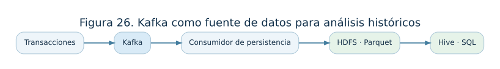

En este escenario, Kafka facilita la disponibilidad de los eventos, mientras Hive proporciona capacidades de consulta sobre los datos almacenados.

#### 1.7.4. Relación entre Kafka y Apache Spark

La integración entre Kafka y Spark es especialmente relevante para nuestro curso.

Ya conocemos Spark como motor de procesamiento distribuido y hemos trabajado con PySpark para leer archivos, transformar DataFrames y generar resultados.

Sin embargo, Spark también dispone de capacidades de procesamiento de flujos mediante Structured Streaming.

Esta funcionalidad permite desarrollar aplicaciones que leen continuamente información desde fuentes compatibles, entre ellas Kafka, siempre que se disponga del conector correspondiente.

Podemos distinguir sus responsabilidades:

Kafka recibe y distribuye los eventos. Mantiene los registros disponibles para que las aplicaciones consumidoras puedan recuperarlos.

Spark procesa los eventos. Puede filtrar registros, transformar columnas, calcular agregaciones y escribir resultados hacia otros sistemas.

Por ejemplo, imaginemos que recibimos eventos con la siguiente estructura:

```
{
  "id_venta": "V10029",
  "sucursal": "Renca",
  "producto": "Mouse",
  "cantidad": 3,
  "monto_total": 45000
}
```

Una aplicación Spark Structured Streaming podría procesar esos registros para calcular las ventas por sucursal.

Conceptualmente, el procesamiento podría incluir operaciones como:

```
ventas_por_sucursal = (    ventas    .groupBy("sucursal")    .sum("monto_total"))
```

Este fragmento muestra una transformación conocida de PySpark. No constituye por sí solo una aplicación de streaming completa.

Para utilizarlo con Kafka sería necesario definir la fuente de streaming, interpretar el contenido de los mensajes, configurar el procesamiento y establecer un destino para los resultados.

Estos aspectos se abordarán en el apartado 2.9.

#### Una consideración importante sobre nuestro laboratorio

Nuestra infraestructura utiliza una imagen de Spark 2.4.0.

Por tanto, no debemos copiar indiscriminadamente ejemplos desarrollados para versiones modernas de Spark, porque algunas funciones, dependencias o configuraciones pueden ser diferentes.

Cuando implementemos la integración, tendremos que utilizar conectores compatibles con la versión instalada o evaluar explícitamente una actualización del entorno.

#### 1.7.5. Relación entre Kafka y las APIs REST

Hasta ahora hemos utilizado ejemplos en los que una aplicación genera eventos y los publica directamente en Kafka.

Sin embargo, muchas organizaciones obtienen información desde servicios externos mediante APIs REST.

Una API REST permite que una aplicación interactúe con un servicio mediante solicitudes HTTP.

Por ejemplo, un sistema podría consultar una API para recuperar información sobre ventas, productos, pedidos o condiciones meteorológicas.

Una respuesta podría contener datos estructurados en JSON:

```
{
  "pedido": "P1025",
  "estado": "despachado",
  "fecha_actualizacion": "2026-10-28T12:30:00"
}
```

Ahora bien, Kafka no consulta automáticamente una API REST.

Para incorporar esa información necesitamos un componente que realice la consulta y publique los resultados.

Ese componente podría ser una aplicación Python.

Figura 27. Integración entre una API REST y Kafka

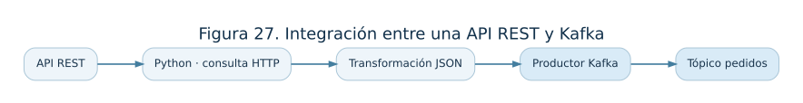

La aplicación Python puede utilizar una biblioteca HTTP para consultar la API y un cliente Kafka para publicar los eventos.

Un ejemplo conceptual sería:

```
# Obtener información desde una API
respuesta = consultar_api()

# Preparar los registros obtenidos
eventos = transformar_respuesta(respuesta)

# Publicar cada evento en Kafka
for evento in eventos:
    publicar_en_kafka("pedidos", evento)
```

Las funciones utilizadas son ilustrativas; no corresponden a una implementación ejecutable.

En la segunda parte del material desarrollaremos los componentes necesarios para construir un productor real.

También debemos considerar que no todas las APIs permiten recuperar información nueva mediante el mismo mecanismo.

Algunas entregan registros paginados, otras permiten consultar modificaciones desde una fecha determinada y otras proporcionan notificaciones mediante webhooks.

Por lo tanto, el diseño de la integración dependerá de las características del servicio externo.

#### 1.7.6. Relación entre Kafka y Apache NiFi

Nuestra infraestructura Docker también incluye Apache NiFi.

NiFi es una plataforma orientada a automatizar el movimiento y la transformación de datos entre sistemas.

Permite construir flujos de integración mediante componentes configurables, denominados processors, que realizan operaciones como recibir información, transformarla, dirigirla hacia diferentes destinos y gestionar determinadas condiciones de error.

Por ejemplo, podríamos utilizar NiFi para consultar una API REST, transformar su respuesta y publicar los registros en Kafka.

Figura 28. Integración conceptual mediante Apache NiFi

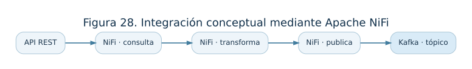

Esta alternativa resulta interesante porque permite desarrollar integraciones mediante una interfaz visual.

No obstante, debemos comprender que NiFi y Kafka cumplen funciones diferentes.

NiFi se orienta a la construcción y administración de flujos de datos entre sistemas.

Kafka proporciona una plataforma distribuida para publicar, conservar y consumir eventos.

Pueden utilizarse conjuntamente, pero ninguno reemplaza automáticamente todas las capacidades del otro.

En nuestro curso priorizaremos comprender primero los productores y consumidores Kafka. Posteriormente podremos relacionar estos mecanismos con herramientas de integración como NiFi.

#### 1.7.7. Kafka Connect: integración mediante conectores

Kafka dispone de un componente denominado Kafka Connect, diseñado para facilitar la transferencia de datos entre Kafka y otros sistemas.

Kafka Connect utiliza conectores que pueden realizar dos funciones principales.

Un source connector obtiene información desde un sistema externo y la incorpora a tópicos Kafka.

Un sink connector consume registros desde Kafka y los envía hacia un sistema de destino.

Figura 29. Funciones de Kafka Connect

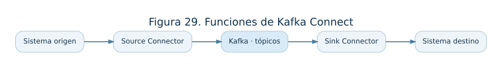

Por ejemplo, una organización podría utilizar un conector de origen para incorporar registros desde una base de datos y un conector de destino para almacenarlos en otro sistema.

Sin embargo, no debemos suponer que cualquier integración se encuentra disponible de manera predeterminada.

Cada conector tiene requisitos específicos, y algunos deben instalarse o configurarse por separado.

En particular, la integración con APIs REST puede requerir conectores adicionales o el desarrollo de una aplicación personalizada.

Por ello, para nuestras primeras implementaciones utilizaremos productores y consumidores que permitan observar directamente cómo se publican y recuperan los eventos.

#### 1.7.8. Relación con las bases de datos tradicionales

Hasta ahora hemos mencionado archivos, APIs y sistemas de procesamiento. Sin embargo, gran parte de la información empresarial se encuentra originalmente en bases de datos.

Por ejemplo, una empresa puede utilizar MySQL para almacenar ventas, productos, clientes y pedidos.

Kafka puede incorporarse para distribuir información relacionada con los cambios producidos en esos sistemas.

Una posibilidad consiste en que la propia aplicación publique un evento cada vez que registra una operación.

Otra alternativa es utilizar mecanismos de captura de cambios en bases de datos, conocidos como Change Data Capture (CDC).

CDC permite identificar operaciones como inserciones, actualizaciones o eliminaciones y transmitir información sobre esos cambios hacia otros sistemas.

Por ejemplo, cuando una venta se incorpora a una base de datos, una solución CDC puede detectar la modificación y publicar un evento en Kafka.

Esto facilita que otras aplicaciones reciban información sobre cambios recientes sin consultar continuamente todas las tablas.

No obstante, CDC requiere herramientas y configuraciones específicas. Kafka, por sí solo, no inspecciona automáticamente las modificaciones de una base de datos.

#### 1.7.9. Arquitectura integrada: de una API REST al análisis histórico

Reunamos ahora las tecnologías estudiadas mediante un ejemplo completo.

Nuestra empresa comercializadora dispone de una API REST que permite consultar las transacciones registradas en sus sucursales.

La organización necesita dos resultados:

Primero, disponer de indicadores actualizados durante la jornada.

Segundo, conservar las transacciones para realizar análisis históricos.

Una arquitectura conceptual podría incluir las siguientes etapas:

Figura 30. Arquitectura integrada de adquisición, procesamiento y almacenamiento

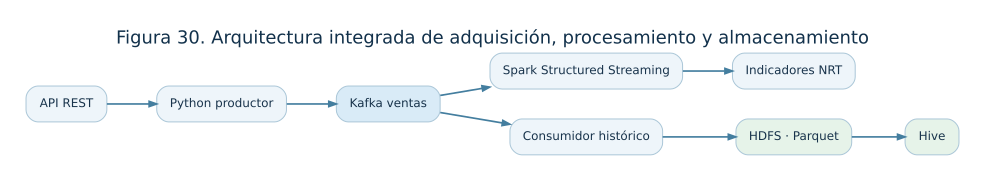

Arquitectura conceptual de referencia. Las integraciones representadas deben implementarse y validarse; no corresponden necesariamente a servicios ya conectados en nuestro laboratorio.

En esta arquitectura, la aplicación Python actúa como productor y Kafka distribuye los eventos.

Spark Structured Streaming puede consumir las transacciones para calcular indicadores recientes.

En paralelo, otro consumidor puede preparar los registros para su almacenamiento histórico en HDFS.

Posteriormente, Hive permite consultar los datos consolidados.

Este ejemplo muestra que una arquitectura Big Data puede combinar componentes de streaming con tecnologías de almacenamiento y procesamiento batch.

También nos permite anticipar el trabajo que desarrollaremos en la segunda parte del documento, especialmente cuando construyamos un productor que consulte una API REST y publique eventos en Kafka.

#### 1.7.10. Consideraciones para nuestra infraestructura Docker

Nuestro repositorio [juliopez/Hadoop](https://github.com/juliopez/Hadoop) reúne diversas tecnologías que permiten estudiar el ecosistema Big Data de manera integrada.

Entre los servicios definidos se encuentran HDFS, Hive, Spark, Kafka, ZooKeeper, NiFi y MySQL.

Sin embargo, debemos distinguir entre disponer de los servicios instalados y tener implementados los flujos de integración entre ellos.

La presencia de Kafka y Spark dentro del mismo archivo Docker Compose no significa que exista automáticamente una aplicación que transmita eventos entre ambos.

Del mismo modo, disponer de NiFi no implica que ya esté configurado un flujo que consulte una API REST y publique registros en Kafka.

Cada integración requiere definir conexiones, formatos de datos, credenciales cuando correspondan, tratamiento de errores y mecanismos de verificación.

Por ello, nuestras futuras guías prácticas avanzarán progresivamente desde la operación básica de Kafka hasta su integración con fuentes externas y Spark.

#### 1.7.11. Síntesis del apartado

Apache Kafka ocupa un lugar importante dentro del ecosistema Big Data porque facilita la transmisión de eventos entre sistemas que generan, procesan y almacenan información.

Su relación con las tecnologías estudiadas puede resumirse de la siguiente manera:

| Tecnología     | Función dentro de una arquitectura integrada                                   |
| -------------- | ------------------------------------------------------------------------------ |
| Kafka          | Publicación, almacenamiento temporal según retención y distribución de eventos |
| HDFS           | Almacenamiento distribuido de archivos y datos históricos                      |
| Hive           | Organización y consulta de datos estructurados                                 |
| Spark          | Procesamiento distribuido batch y streaming                                    |
| APIs REST      | Acceso a información y funciones de sistemas externos                          |
| Python         | Desarrollo de aplicaciones productoras, consumidoras y de integración          |
| NiFi           | Automatización de flujos de adquisición, transformación y transferencia        |
| Kafka Connect  | Integración mediante conectores de origen y destino                            |
| Bases de datos | Almacenamiento operacional y posible fuente de cambios o eventos               |

La principal conclusión es que Kafka no reemplaza a las demás tecnologías del ecosistema, sino que permite conectarlas mediante flujos de eventos.

En nuestro curso, esta integración representa la transición desde una arquitectura centrada principalmente en archivos y procesamiento batch hacia otra capaz de incorporar información generada continuamente.

En el siguiente apartado examinaremos aplicaciones concretas de Kafka en distintos sectores, incluyendo transacciones comerciales, Internet de las Cosas, monitoreo, registros de aplicaciones y otros escenarios de procesamiento de eventos.

### 1.8. Casos de uso: transacciones comerciales, IoT, monitoreo, registros y eventos de aplicaciones

En los apartados anteriores estudiamos los fundamentos de Apache Kafka, su arquitectura distribuida y su relación con tecnologías como Hadoop, Hive, Spark y las APIs REST.

Ahora corresponde examinar cómo estos conceptos se aplican a situaciones reales.

Kafka puede utilizarse en organizaciones de distintos sectores, como comercio, industria, servicios financieros, telecomunicaciones, transporte y plataformas digitales. Aunque sus necesidades son diferentes, comparten una característica: generan información continuamente y necesitan distribuirla hacia sistemas que la utilizan con distintos propósitos.

En este apartado revisaremos cinco escenarios de aplicación, identificando el problema que enfrentan las organizaciones, el papel que desempeña Kafka y las tecnologías que pueden complementarlo.

#### 1.8.1. Transacciones comerciales: seguimiento continuo de ventas

Comenzaremos con el caso que hemos utilizado a lo largo del documento: una empresa comercializadora que registra transacciones en distintas sucursales.

Supongamos que la organización dispone de 50 establecimientos y una plataforma de comercio electrónico.

Cada venta genera información sobre el producto, la sucursal, el monto, la cantidad y el momento de la transacción.

Tradicionalmente, estos datos podrían consolidarse al finalizar la jornada y procesarse mediante un trabajo batch.

Sin embargo, la empresa necesita conocer durante el día el comportamiento de las ventas, identificar sucursales con mayor actividad y detectar cambios inesperados en la demanda.

#### ¿Cómo puede intervenir Kafka?

Cada sistema comercial puede publicar los eventos de venta en un tópico denominado `ventas`.

Por ejemplo:

```
{
  "id_venta": "V10030",
  "fecha": "2026-10-28T14:35:20",
  "sucursal": "Renca",
  "producto": "Notebook",
  "cantidad": 1,
  "monto_total": 720000
}
```

Distintos consumidores pueden utilizar estos eventos de manera independiente.

Figura 31. Arquitectura de eventos para transacciones comerciales

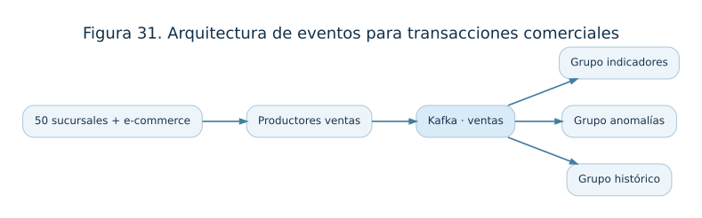

Un consumidor puede alimentar un sistema de indicadores operacionales, otro puede identificar patrones inusuales y un tercero puede preparar los registros para su almacenamiento histórico.

Esta arquitectura permite que las aplicaciones utilicen las mismas transacciones sin establecer conexiones directas entre todos los sistemas.

#### ¿Qué aporta Kafka?

Su principal aporte es facilitar la distribución de eventos comerciales hacia diferentes aplicaciones, permitiendo que cada una procese la información según sus necesidades.

La detección de anomalías, el cálculo de indicadores y la construcción de dashboards requieren componentes adicionales. Kafka proporciona el flujo de eventos que esas aplicaciones necesitan.

Este caso será especialmente relevante para nuestras futuras actividades prácticas, porque permite relacionar Kafka con el procesamiento de datos comerciales que ya hemos desarrollado mediante PySpark.

#### 1.8.2. Internet de las Cosas (IoT): recepción de datos desde sensores

El segundo escenario corresponde al Internet de las Cosas (Internet of Things, IoT).

IoT hace referencia a dispositivos físicos que incorporan sensores, conectividad y capacidades para generar o intercambiar información.

Estos dispositivos pueden encontrarse en instalaciones industriales, vehículos, sistemas agrícolas, edificios inteligentes o redes de monitoreo ambiental.

Imaginemos una empresa que dispone de sensores de temperatura instalados en cámaras de refrigeración.

Cada dispositivo registra periódicamente la temperatura de su entorno.

Un evento podría tener la siguiente estructura:

```
{
  "sensor_id": "TEMP-025",
  "ubicacion": "Camara_03",
  "fecha": "2026-10-28T14:36:00",
  "temperatura": 5.8,
  "unidad": "C"
}
```

La organización necesita almacenar las mediciones, observar su evolución y generar alertas cuando la temperatura supera los límites establecidos.

#### ¿Cómo puede intervenir Kafka?

Los dispositivos pueden enviar sus mediciones hacia una plataforma de adquisición que las publique en Kafka.

Un consumidor puede analizar los valores y generar alertas, mientras otro conserva las mediciones para análisis históricos.

Figura 32. Flujo de información desde sensores IoT

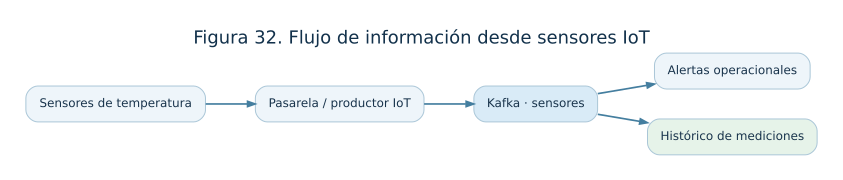

En este escenario, Kafka facilita la recepción y distribución de grandes cantidades de mediciones.

Sin embargo, debemos distinguir entre monitoreo y control industrial crítico.

Kafka puede participar en sistemas que generan alertas operacionales, pero no debe asumirse que proporciona las garantías temporales necesarias para ejecutar directamente mecanismos de seguridad industrial.

Los sistemas de control con requisitos estrictos de respuesta deben diseñarse utilizando tecnologías y mecanismos apropiados para esas condiciones.

#### 1.8.3. Monitoreo de sistemas: observación continua del funcionamiento de aplicaciones

Las organizaciones utilizan numerosas aplicaciones, servidores y servicios que deben funcionar de manera coordinada.

Para administrarlos, necesitan conocer aspectos como la disponibilidad, el rendimiento, los errores y el comportamiento de sus componentes.

Por ejemplo, una plataforma de comercio electrónico podría necesitar monitorear:

- Cantidad de solicitudes recibidas.
- Tiempo de respuesta de sus servicios.
- Errores producidos durante las operaciones.
- Estado de los servidores.
- Número de transacciones procesadas.

Estos datos pueden generarse continuamente y provenir de diferentes fuentes.

#### ¿Cómo puede intervenir Kafka?

Los sistemas pueden publicar eventos de monitoreo en tópicos específicos.

Por ejemplo:

```
{
  "servicio": "procesamiento_pedidos",
  "fecha": "2026-10-28T14:40:15",
  "tipo_evento": "error",
  "codigo": 503,
  "descripcion": "Servicio temporalmente no disponible"
}
```

Un consumidor podría identificar un aumento en la frecuencia de errores y generar una alerta.

Otro podría almacenar los registros para analizar tendencias de rendimiento.

Kafka permite centralizar la distribución de estos eventos y desacoplar los sistemas que los generan de las herramientas que los analizan.

No obstante, la visualización de métricas, la generación de alertas y la administración de incidentes corresponden a aplicaciones especializadas.

Kafka puede formar parte de la arquitectura de observabilidad, pero no constituye por sí mismo una plataforma completa de monitoreo.

#### 1.8.4. Registros de aplicaciones: recopilación y análisis de logs

Los sistemas informáticos generan continuamente registros de funcionamiento, conocidos como logs.

Un log puede informar que un usuario inició sesión, que una aplicación procesó una solicitud o que se produjo un error.

Por ejemplo:

```
2026-10-28 14:42:10 INFO  Usuario autenticado
2026-10-28 14:42:11 INFO  Pedido P1025 registrado
2026-10-28 14:42:12 ERROR Fallo en servicio de pago
```

Estos registros son importantes para diagnosticar problemas, auditar operaciones y comprender el comportamiento de las aplicaciones.

Sin embargo, cuando una organización utiliza numerosos servidores, recopilar y analizar todos sus logs puede convertirse en una tarea compleja.

Kafka puede actuar como plataforma intermedia para recibir registros desde múltiples sistemas y distribuirlos hacia herramientas de almacenamiento, búsqueda y análisis.

Figura 33. Centralización de registros de aplicaciones

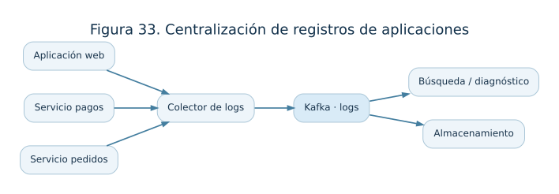

Esta arquitectura permite que los registros de diferentes aplicaciones estén disponibles para múltiples consumidores.

Debemos considerar que los logs pueden contener información sensible, como identificadores de usuarios o detalles internos de los sistemas. Por ello, su publicación y conservación requieren controles adecuados de acceso, protección de datos y políticas de retención.

#### 1.8.5. Eventos de aplicaciones: comunicación entre servicios

Otro caso importante corresponde a las aplicaciones construidas mediante múltiples servicios.

Imaginemos una plataforma de comercio electrónico que dispone de componentes independientes para administrar pedidos, inventario, pagos y notificaciones.

Cuando un cliente realiza una compra, deben producirse varias operaciones.

El sistema de pedidos registra la transacción, el inventario necesita conocer los productos vendidos y el servicio de notificaciones debe informar al cliente.

Una alternativa consiste en establecer conexiones directas entre todos los servicios.

Otra posibilidad es utilizar eventos.

Por ejemplo, cuando se registra un pedido, el sistema correspondiente publica un evento:

```
{
  "tipo_evento": "pedido_creado",
  "id_pedido": "P1026",
  "cliente_id": "C305",
  "fecha": "2026-10-28T14:45:00",
  "monto_total": 185000
}
```

El servicio de inventario puede consumir ese evento para actualizar sus registros.

El servicio de notificaciones puede utilizarlo para iniciar el envío de una confirmación.

Otro sistema puede conservar la información para análisis comercial.

Figura 34. Comunicación entre servicios mediante eventos

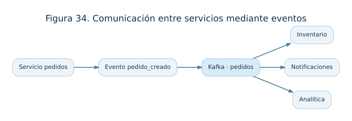

Este enfoque se relaciona con las arquitecturas orientadas a eventos (Event-Driven Architecture, EDA).

En una arquitectura orientada a eventos, las aplicaciones pueden reaccionar ante acontecimientos publicados por otros componentes, reduciendo ciertas dependencias directas entre servicios.

Sin embargo, esta estrategia también introduce desafíos.

Por ejemplo, un servicio puede procesar un evento más de una vez en determinadas condiciones, o recibirlo después de que otros componentes hayan avanzado en sus operaciones.

Por ello, las aplicaciones deben diseñarse considerando aspectos como la idempotencia, el tratamiento de errores y la consistencia de los datos.

La idempotencia significa, de manera simplificada, que repetir una operación no debe producir efectos adicionales no deseados.

Por ejemplo, procesar dos veces un evento `pedido_creado` no debería provocar que se descuente dos veces el mismo inventario.

Estos aspectos son especialmente importantes cuando Kafka participa en procesos empresariales que modifican información operacional.

#### 1.8.6. Comparación de los principales casos de uso

Los escenarios anteriores muestran que Kafka puede participar en soluciones con propósitos diferentes.

| Caso de uso               | Evento principal       | Necesidad empresarial          | Posibles consumidores                  |
| ------------------------- | ---------------------- | ------------------------------ | -------------------------------------- |
| Transacciones comerciales | Venta registrada       | Seguimiento de operaciones     | Indicadores, analítica, almacenamiento |
| IoT                       | Medición de sensor     | Supervisión de condiciones     | Alertas, análisis de series temporales |
| Monitoreo                 | Métrica o incidente    | Observación del funcionamiento | Sistemas de monitoreo y alertas        |
| Logs                      | Registro de aplicación | Diagnóstico y auditoría        | Búsqueda, análisis y almacenamiento    |
| Eventos de aplicaciones   | Pedido creado          | Coordinación entre servicios   | Inventario, notificaciones, analítica  |

Aunque estos escenarios pertenecen a ámbitos diferentes, todos comparten una estructura general:

Un sistema produce un acontecimiento, Kafka permite distribuirlo y una o más aplicaciones lo utilizan.

La forma específica de implementar cada solución dependerá de las necesidades de la organización, el volumen de información, la latencia requerida y los sistemas involucrados.

#### 1.8.7. ¿Cuándo Kafka aporta valor y cuándo podría no ser necesario?

Hasta ahora hemos revisado diferentes aplicaciones de Kafka, pero es importante evitar la idea de que toda solución de datos necesita incorporar esta tecnología.

Kafka resulta especialmente útil cuando una organización debe gestionar flujos continuos de eventos, distribuir información entre múltiples consumidores o desacoplar sistemas que producen y utilizan datos.

También puede ser apropiado cuando se necesita conservar temporalmente los eventos para permitir su consumo posterior o su reprocesamiento.

Sin embargo, su incorporación implica administrar brokers, tópicos, particiones, configuraciones, consumidores y mecanismos de monitoreo.

Por ejemplo, si una pequeña organización necesita procesar un archivo de ventas una vez al mes, probablemente pueda resolver el problema mediante una base de datos o un proceso batch, sin necesidad de introducir Kafka.

Del mismo modo, una integración sencilla entre dos aplicaciones puede resolverse mediante una API REST sin incorporar necesariamente una plataforma de eventos.

La decisión debe responder a los requisitos del sistema.

Criterios orientativos para evaluar Kafka

| ¿Los datos se generan continuamente?                   | Kafka puede facilitar su distribución.                       |
| ------------------------------------------------------ | ------------------------------------------------------------ |
| ¿Varias aplicaciones necesitan los mismos eventos?     | Kafka permite consumidores independientes.                   |
| ¿Se necesita recuperar o reprocesar eventos recientes? | La retención y los offsets pueden resultar útiles.           |
| ¿Solo se procesa un archivo mensual?                   | Un proceso batch puede ser suficiente.                       |
| ¿Se necesita una consulta puntual a un servicio?       | Una integración directa mediante API puede ser más sencilla. |

Esta evaluación permite comprender que Kafka no es una solución universal, sino una tecnología especializada que debe incorporarse cuando sus capacidades justifican la complejidad adicional.

#### 1.8.8. El caso que utilizaremos como referencia en nuestro curso

Para mantener la continuidad entre los fundamentos teóricos y las futuras actividades prácticas, utilizaremos principalmente el escenario de transacciones comerciales.

La idea general será disponer de una fuente de información que genere o entregue registros de ventas, publicarlos en Kafka y recuperarlos mediante aplicaciones consumidoras.

Posteriormente, estudiaremos cómo integrar esos eventos con Spark Structured Streaming.

Figura 35. Arquitectura de referencia para la segunda parte del curso

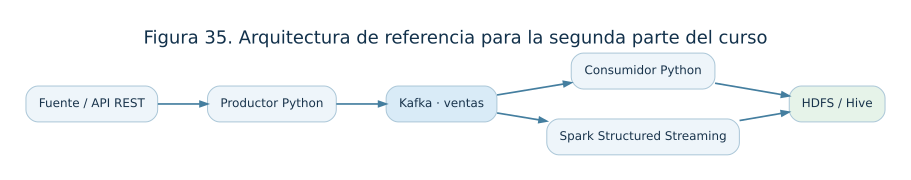

Flujo conceptual que servirá como referencia para comprender las implementaciones posteriores.

Este escenario tiene varias ventajas pedagógicas.

Primero, utiliza información familiar: ventas, productos, cantidades, montos y fechas.

Segundo, permite trabajar con estructuras JSON sencillas.

Tercero, facilita comprender las funciones de productores, tópicos y consumidores sin introducir simultáneamente demasiados conceptos nuevos.

Finalmente, permite establecer una relación directa con las transformaciones y agregaciones que ya conocemos de PySpark.

Debemos recordar que este documento corresponde al material teórico del curso. La implementación detallada se desarrollará posteriormente en dos guías prácticas independientes, una para cada sesión destinada al trabajo con Kafka.

#### 1.8.9. Síntesis del apartado

Apache Kafka puede utilizarse en diferentes contextos donde las organizaciones necesitan recibir y distribuir información generada continuamente.

Entre sus aplicaciones se encuentran el seguimiento de transacciones comerciales, la adquisición de mediciones IoT, el monitoreo de sistemas, la recopilación de logs y la comunicación entre servicios mediante eventos.

En todos estos casos, Kafka desempeña una función central: proporcionar una plataforma que permita publicar, conservar durante un período configurable y consumir registros de eventos.

Sin embargo, las operaciones de análisis, visualización, control o almacenamiento histórico requieren aplicaciones y tecnologías complementarias.

La incorporación de Kafka debe justificarse a partir de las necesidades del sistema y no únicamente por su capacidad tecnológica.

## Cierre de la Parte I

Con este apartado completamos la primera parte del documento: Fundamentos, contexto y arquitectura de Apache Kafka.

A lo largo de sus ocho apartados estudiamos la transición desde el procesamiento batch hacia los eventos, el origen y evolución de Kafka, sus principales componentes, su arquitectura distribuida, las diferencias entre enfoques temporales de procesamiento, su integración con el ecosistema Big Data y sus aplicaciones empresariales.

Ya contamos con la base conceptual necesaria para avanzar hacia la operación de Kafka dentro de nuestra infraestructura Docker.

La segunda parte estará orientada a comprender cómo se administran los tópicos, cómo se publican y consumen eventos, cómo se integran fuentes externas y cómo se relaciona Kafka con Spark Structured Streaming.

---

## Parte II. Operación, integración e implementación de Apache Kafka

### 2.1. Preparación y verificación de Kafka en el entorno Docker

#### 2.1.1. Del conocimiento conceptual al entorno de trabajo

En la Parte I estudiamos los fundamentos de Apache Kafka, su arquitectura distribuida y su relación con Hadoop, HDFS, Hive y Spark. Comprendimos cómo los productores publican eventos en tópicos, cómo los brokers almacenan registros y cómo los consumidores recuperan información.

Ahora relacionaremos estos conceptos con la infraestructura del curso de Big Data. Nuestro laboratorio utiliza **Docker** para ejecutar diferentes servicios en contenedores. Esta decisión facilita disponer de un entorno relativamente reproducible, donde tecnologías con distintas dependencias pueden operar coordinadamente.

En las semanas anteriores utilizamos esta infraestructura con HDFS, Hive y Spark. Ahora incorporamos Kafka a nuestros procedimientos de operación e integración. El primer objetivo no es publicar eventos inmediatamente, sino **comprobar que el servicio está disponible y comprender cómo acceder a él**.

#### 2.1.2. Kafka dentro de nuestra infraestructura Docker

El entorno docente se define en el repositorio [juliopez/Hadoop](https://github.com/juliopez/Hadoop), mediante `docker-compose.yml`. Entre los servicios disponibles se encuentran HDFS, Hive, Spark, Kafka, ZooKeeper, NiFi y MySQL.

**Que dos servicios estén disponibles dentro de Docker no significa que exista una integración funcional entre ellos.** Por ejemplo, aunque Kafka y Spark estén ejecutándose, todavía necesitaremos una aplicación y dependencias compatibles para consumir eventos con Spark Structured Streaming.

Kafka utiliza el servicio `kafka` y ZooKeeper el servicio `zookeeper`. Nuestra instalación educativa corresponde a un broker único coordinado mediante ZooKeeper.

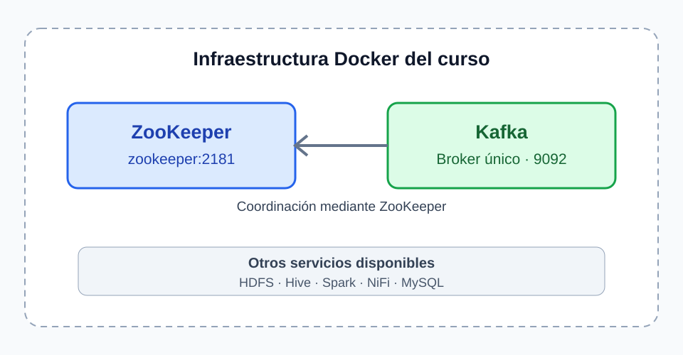

*Figura 36. Kafka y ZooKeeper dentro del entorno Docker del curso. Esquema conceptual: no representa integración automática con los otros servicios.*

Esta configuración difiere de las arquitecturas modernas basadas en KRaft. Los procedimientos deben corresponder a la versión realmente instalada y no simplemente a la documentación más reciente.

#### 2.1.3. Identificación de los componentes configurados

| Componente | Configuración del laboratorio |
|---|---|
| Servicio Kafka | `kafka` |
| Contenedor Kafka | `kafka` |
| Imagen Kafka | `landoop/fast-data-dev:latest` |
| Puerto del broker | `9092` |
| Interfaz web de la distribución | `3030` |
| Servicio ZooKeeper | `zookeeper` |
| Imagen ZooKeeper | `zookeeper:3.8.7` |
| Puerto ZooKeeper | `2181` |
| Conexión Kafka–ZooKeeper | `zookeeper:2181` |

El parámetro `KAFKA_ZOOKEEPER_CONNECT: zookeeper:2181` indica la dirección que Kafka utiliza para comunicarse con ZooKeeper. El nombre `zookeeper` identifica el servicio dentro de Docker y `2181` su puerto.

Kafka también debe anunciar a los clientes cómo conectarse a los brokers. Una configuración incorrecta de las direcciones anunciadas puede producir errores incluso cuando el servicio está en ejecución.

La configuración documentada del laboratorio contiene:

```yaml
KAFKA_ADVERTISED_HOST_NAME: 172.27.1.16
```

Esta dirección debe verificarse en el entorno donde efectivamente se ejecutan los contenedores.

#### 2.1.4. Verificación de los contenedores

```bash
docker ps
```

Este comando muestra los contenedores actualmente ejecutándose, con información como nombre, imagen, estado y puertos. Nos interesa comprobar la presencia de `kafka` y `zookeeper`.

```bash
docker ps -a
```

La opción `-a` muestra también los contenedores detenidos. `Exited` significa que el contenedor no está funcionando; `Up` indica que está en ejecución, pero no garantiza por sí solo el correcto funcionamiento interno del broker.

Debemos distinguir entre **existencia del contenedor**, **ejecución del contenedor** y **disponibilidad funcional del servicio Kafka**.

#### 2.1.5. Acceso al contenedor Kafka

```bash
docker exec -it kafka bash
```

| Elemento | Significado |
|---|---|
| `docker exec` | Ejecuta un comando dentro de un contenedor existente |
| `-i` | Mantiene la entrada interactiva |
| `-t` | Asigna una terminal |
| `kafka` | Nombre del contenedor |
| `bash` | Intérprete de comandos |

**Ingresar al contenedor no equivale a conectarse al broker mediante el protocolo Kafka.** Estamos accediendo al entorno del sistema donde se ejecutan los procesos y herramientas. Las rutas y utilidades pueden variar según la distribución instalada; debemos comprobar las disponibles en `landoop/fast-data-dev:latest`.

#### 2.1.6. Verificación de los registros del servicio

```bash
docker logs kafka
docker logs --tail 50 kafka
docker logs -f kafka
```

Estos comandos permiten consultar los registros completos, las últimas cincuenta líneas o seguir los mensajes conforme aparecen. Pueden ayudar a detectar errores de conexión con ZooKeeper, configuración o puertos.

Una advertencia no significa necesariamente que Kafka haya dejado de funcionar; asimismo, la ausencia de errores evidentes no demuestra disponibilidad funcional. La lectura de registros debe complementarse con una prueba de comunicación.

#### 2.1.7. Comprobación de la disponibilidad del broker

Una operación administrativa de referencia es:

```bash
kafka-topics --bootstrap-server localhost:9092 --list
```

Según la distribución, el ejecutable puede denominarse `kafka-topics.sh` o ubicarse en otra ruta. Algunas versiones anteriores utilizan parámetros diferentes. **La compatibilidad de este comando debe verificarse contra la imagen real del laboratorio**.

`--bootstrap-server` identifica la dirección inicial del broker. `localhost:9092` supone que el cliente se ejecuta en un entorno donde el broker está accesible mediante esa dirección. Desde otro contenedor o máquina, puede ser necesario utilizar otra.

Una lista vacía de tópicos no implica necesariamente un error: podría indicar que todavía no existen tópicos de usuario.

#### 2.1.8. La interfaz web de Kafka

La distribución del laboratorio expone el puerto `3030` para una interfaz web. Según la publicación de puertos y la conectividad, puede accederse mediante:

```text
http://localhost:3030
```

La disponibilidad depende de la configuración de red y del estado del contenedor. La interfaz facilita la observación, pero no reemplaza la comprensión de los comandos administrativos ni de los mecanismos de publicación y consumo.

#### 2.1.9. Problemas frecuentes de disponibilidad y conectividad

| Situación | Posible explicación | Primera verificación |
|---|---|---|
| Kafka no aparece en `docker ps` | Contenedor detenido o no iniciado | `docker ps -a` |
| Kafka no inicia | Configuración o dependencia | `docker logs kafka` |
| No conecta con ZooKeeper | Servicio o dirección incorrecta | Estado de `zookeeper` y registros |
| El cliente no accede al broker | Dirección o puerto incorrectos | Configuración de conectividad |
| La interfaz web no responde | Puerto o servicio inaccesible | Estado y puertos |
| No aparecen tópicos | Aún no se han creado | Consulta administrativa |

No todos los problemas de conexión se originan en el broker. En Docker, `localhost` se refiere al entorno desde el que se ejecuta la aplicación: dentro de otro contenedor no identifica necesariamente al broker Kafka.

#### 2.1.10. Secuencia de verificación recomendada

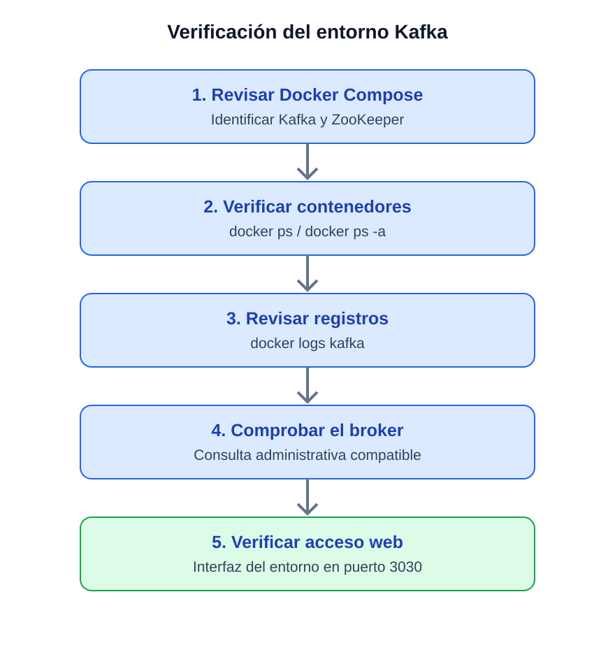

*Figura 37. Secuencia de verificación del entorno Kafka.*

El procedimiento recomendado comienza con la revisión de Docker Compose, continúa con el estado de los contenedores y sus registros, y termina con la comprobación funcional del broker y de la interfaz web. Esta progresión permite reducir errores de diagnóstico.

#### 2.1.11. Síntesis del apartado

Relacionamos los fundamentos de Kafka con nuestra infraestructura Docker, identificamos el broker único coordinado mediante ZooKeeper y distinguimos los niveles de verificación: contenedor, servicio y conectividad del cliente. Docker facilita el despliegue, pero no elimina la necesidad de revisar configuraciones, dependencias y direcciones de conexión.

En el apartado **2.2. Administración de tópicos, particiones y configuración básica**, estudiaremos cómo Kafka organiza y administra los recursos que almacenan los eventos.

---

### 2.2. Administración de tópicos, particiones y configuración básica

#### 2.2.1. De la disponibilidad del broker a la organización de los eventos

En el apartado anterior estudiamos cómo identificar y verificar los servicios Kafka y ZooKeeper dentro de nuestra infraestructura Docker. Comprendimos que la ejecución de un contenedor no garantiza, por sí sola, la disponibilidad funcional del broker y que es necesario comprobar tanto su estado como la conectividad de los clientes.

Una vez establecido ese entorno, el siguiente paso consiste en comprender cómo se organizan y administran los eventos que circulan por Kafka. Kafka no funciona como una base de datos relacional tradicional. Los productores publican registros en flujos de eventos, mientras que los consumidores recuperan esos registros de acuerdo con sus necesidades y posiciones de lectura.

Para organizar estos flujos, Kafka utiliza **tópicos (*topics*)**, que representan categorías lógicas de eventos. Una empresa comercial podría generar eventos relacionados con ventas, pagos, inventario, despachos y devoluciones. En nuestro curso utilizaremos como ejemplo transversal una empresa que registra transacciones comerciales en tiempo real.

#### 2.2.2. El tópico como unidad lógica de organización

Un tópico es una categoría identificada mediante un nombre, en la cual los productores publican eventos y desde la cual los consumidores pueden recuperarlos.

| Tópico | Eventos que representa |
|---|---|
| `ventas` | Ventas realizadas |
| `pagos` | Pagos autorizados o rechazados |
| `inventario` | Cambios en las existencias |
| `despachos` | Preparación y envío de pedidos |
| `devoluciones` | Productos devueltos por clientes |

Un tópico no es simplemente una carpeta que contiene archivos: Kafka administra sus registros mediante particiones, offsets y políticas de conservación. Un mismo tópico puede recibir eventos de múltiples productores y ser leído por diferentes aplicaciones consumidoras.

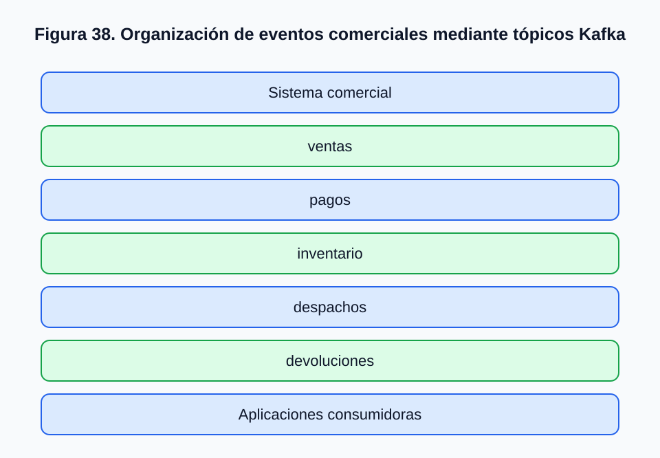

*Figura 38. Organización de eventos comerciales mediante tópicos Kafka.*

#### 2.2.3. Las particiones y su función en la arquitectura de Kafka

Kafka almacena los eventos de cada tópico en una o varias **particiones (*partitions*)**. Cada partición es un registro ordenado y de solo anexado (*append-only log*). Supongamos que `ventas` dispone de tres particiones. Los eventos se distribuyen entre ellas según la configuración y el comportamiento del productor.

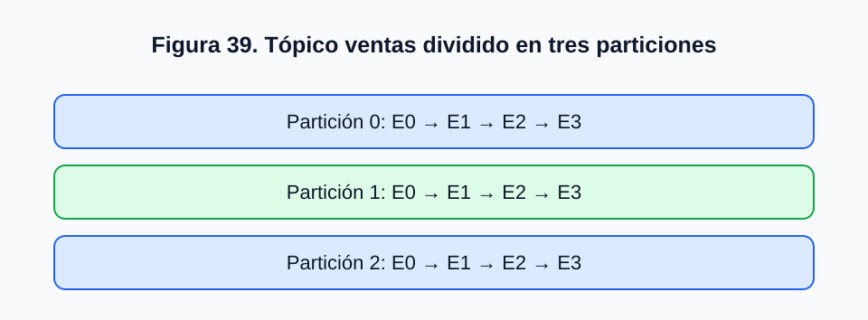

*Figura 39. Tópico `ventas` dividido en tres particiones.*

**Kafka garantiza el orden de los registros dentro de cada partición, pero no un orden total entre todas las particiones de un tópico.** Si una empresa necesita preservar el orden de las operaciones de un cliente, puede utilizar su identificador como clave de particionamiento. Bajo una estrategia consistente, los eventos asociados con esa clave se dirigirán a la misma partición. Modificar la cantidad de particiones puede alterar esa asignación para los eventos futuros.

#### 2.2.4. Los offsets: identificación de la posición de los eventos

Dentro de cada partición, Kafka asigna a los registros un identificador de posición denominado **offset**.

| Partición | Offset | Evento |
|---|---:|---|
| 0 | 0 | Venta A |
| 0 | 1 | Venta B |
| 0 | 2 | Venta C |
| 1 | 0 | Venta D |
| 1 | 1 | Venta E |
| 2 | 0 | Venta F |

El offset 0 aparece en las tres particiones sin que exista duplicación de identificadores, porque cada offset pertenece a una partición diferente. Para identificar la posición de un evento se consideran tópico, partición y offset. Los consumidores mantienen posiciones de lectura independientes. Leer un evento no lo elimina: su permanencia depende de las políticas de conservación. Retención y compactación pueden provocar que algunos offsets antiguos ya no correspondan a registros recuperables.

#### 2.2.5. Creación de tópicos y parámetros básicos

Kafka proporciona herramientas para crear, describir, modificar y eliminar tópicos. Una operación de referencia es:

```bash
kafka-topics --bootstrap-server localhost:9092 \
  --create \
  --topic ventas \
  --partitions 3 \
  --replication-factor 1
```

| Parámetro | Función |
|---|---|
| `--bootstrap-server localhost:9092` | Dirección inicial para conectarse al broker |
| `--create` | Solicita la creación de un tópico |
| `--topic ventas` | Define el nombre |
| `--partitions 3` | Establece tres particiones |
| `--replication-factor 1` | Establece una réplica por partición |

El factor de replicación 1 es coherente con el laboratorio de un único broker. No se pueden distribuir tres réplicas de una misma partición entre brokers distintos si solo existe uno.

**Compatibilidad:** la sintaxis basada en `--bootstrap-server` debe verificarse contra las herramientas efectivamente disponibles en la imagen `landoop/fast-data-dev:latest`. Algunas versiones antiguas utilizan parámetros asociados con ZooKeeper.

#### 2.2.6. Consulta y descripción de tópicos

```bash
kafka-topics --bootstrap-server localhost:9092 --list
```

```bash
kafka-topics --bootstrap-server localhost:9092 \
  --describe \
  --topic ventas
```

La descripción permite consultar cantidad de particiones, factor de replicación, líderes y réplicas asignadas. En nuestro laboratorio la distribución será sencilla; en entornos de producción, estos datos permiten analizar la distribución entre múltiples brokers.

#### 2.2.7. Replicación, liderazgo y tolerancia a fallos

Cada partición dispone de una réplica líder y puede disponer de réplicas adicionales. El líder atiende las escrituras y lecturas ordinarias; las réplicas seguidoras mantienen copias sincronizadas del registro.

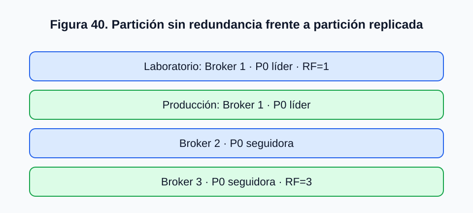

*Figura 40. Diferencia entre una partición sin redundancia y una partición replicada.*

El particionamiento distribuye registros entre secuencias de almacenamiento; la replicación mantiene copias de una misma partición. En un único broker con factor de replicación 1, la falla del broker interrumpe la disponibilidad de las particiones alojadas en él. La infraestructura docente no representa una arquitectura de alta disponibilidad.

#### 2.2.8. Configuración de retención y conservación de eventos

Kafka no elimina automáticamente los eventos después de su lectura. Las políticas de retención temporal y por tamaño determinan qué registros pueden conservarse.

- `retention.ms`: período de retención temporal expresado en milisegundos.
- `retention.bytes`: límite de retención por tamaño aplicado por partición.

La eliminación no necesariamente ocurre exactamente cuando se alcanza el límite: intervienen los segmentos y los procesos de limpieza. Kafka también ofrece **compactación del registro (*log compaction*)**, orientada a conservar registros recientes asociados con claves, útil para representar el último estado conocido de una entidad.

#### 2.2.9. Modificación de particiones y administración del ciclo de vida

Kafka permite aumentar la cantidad de particiones de un tópico, por ejemplo, de tres a seis. Esto puede ampliar el paralelismo del consumo, pero también alterar la asignación de claves a particiones futuras. **Aumentar las particiones no redistribuye automáticamente los registros históricos**. Eliminar un tópico puede implicar pérdida de datos y exige procedimientos controlados en producción.

#### 2.2.10. Criterios para diseñar tópicos en un sistema de transacciones comerciales

Separar `ventas`, `pagos` e `inventario` facilita la delimitación de responsabilidades, aunque crear demasiados tópicos también aumenta la complejidad.

| Criterio | Pregunta de diseño |
|---|---|
| Propósito | ¿Qué proceso representa el evento? |
| Productores | ¿Qué sistemas generan registros? |
| Consumidores | ¿Quiénes necesitan leerlos? |
| Ordenamiento | ¿Qué eventos deben mantener secuencia? |
| Volumen | ¿Cuántos eventos se publicarán? |
| Paralelismo | ¿Cuántas particiones son necesarias? |
| Conservación | ¿Durante cuánto tiempo se requieren los datos? |
| Disponibilidad | ¿Qué tolerancia a fallos se necesita? |

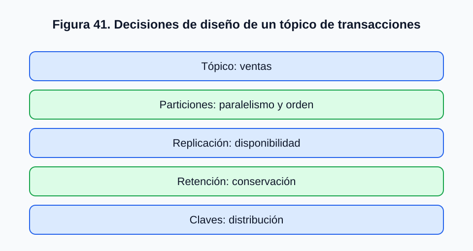

*Figura 41. Decisiones de diseño para un tópico de transacciones comerciales.*

#### 2.2.11. Síntesis del apartado

La administración de tópicos combina operaciones técnicas y decisiones arquitectónicas. Los tópicos organizan los flujos; las particiones almacenan secuencias de registros; los offsets identifican posiciones; la replicación aporta redundancia; y la retención determina la conservación. En el apartado **2.3** estudiaremos cómo los productores publican eventos en estos tópicos.

---

### 2.3. Publicación de eventos mediante productores

#### 2.3.1. Del tópico al flujo de eventos

Los tópicos organizan los eventos, pero necesitan aplicaciones capaces de generarlos y publicarlos: los **productores (*producers*)**. Un productor construye registros y los envía a un tópico Kafka. Puede ser una aplicación empresarial, servicio web, proceso automatizado, dispositivo IoT o programa de integración. En una venta comercial, el sistema de origen registra la operación, el productor construye y transmite el evento y el broker recibe y almacena el registro.

#### 2.3.2. Arquitectura básica de publicación

El productor necesita una dirección inicial de conexión y el tópico de destino. No necesita conocer las aplicaciones que consumirán posteriormente los eventos: este desacoplamiento facilita incorporar nuevos consumidores.

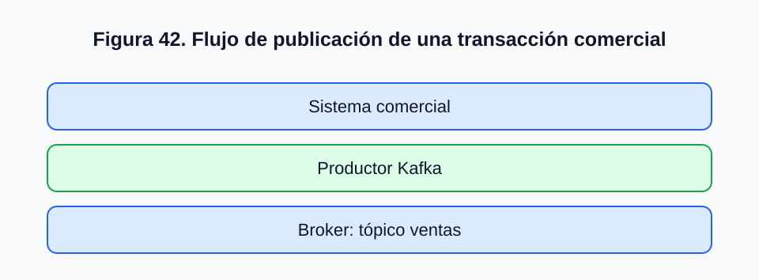

*Figura 42. Flujo de publicación de una transacción comercial en Kafka.*

#### 2.3.3. Estructura de un registro publicado

| Componente | Descripción |
|---|---|
| Tópico | Destino lógico |
| Clave (*key*) | Identificador opcional que puede intervenir en el particionamiento |
| Valor (*value*) | Contenido principal |
| Marca temporal (*timestamp*) | Tiempo asociado al registro |
| Cabeceras (*headers*) | Metadatos opcionales |
| Partición | Destino explícito o automático |

```json
{
  "id_venta": "V-1048",
  "id_cliente": "C-025",
  "fecha": "2026-10-29T11:35:00-03:00",
  "monto": 45990,
  "medio_pago": "tarjeta",
  "estado": "confirmada"
}
```

Kafka no interpreta automáticamente el JSON: el productor debe serializar el contenido en bytes. La fecha del JSON es distinta de la marca temporal propia del registro Kafka. Estos formatos se profundizarán en el apartado 2.5.

#### 2.3.4. Configuración mínima de un productor

El parámetro `bootstrap.servers` proporciona direcciones iniciales para descubrir brokers:

```properties
bootstrap.servers=localhost:9092
```

La dirección adecuada depende de dónde se ejecuta el cliente. En Java pueden declararse serializadores:

```properties
key.serializer=org.apache.kafka.common.serialization.StringSerializer
value.serializer=org.apache.kafka.common.serialization.StringSerializer
```

Otras bibliotecas, como las de Python, pueden utilizar mecanismos diferentes.

#### 2.3.5. Publicación mediante la consola

```bash
kafka-console-producer \
  --bootstrap-server localhost:9092 \
  --topic ventas
```

```text
Venta V-1048 confirmada
Venta V-1049 confirmada
Venta V-1050 rechazada
```

Normalmente cada línea representa un registro. Esta herramienta permite comprobar el mecanismo de publicación sin desarrollar una aplicación. **La sintaxis y la ruta del ejecutable deben verificarse contra la imagen real del laboratorio**, que utiliza una distribución anterior.

#### 2.3.6. Productores programáticos: publicación desde aplicaciones

Ejemplo ilustrativo con `kafka-python`:

```python
from kafka import KafkaProducer
import json

productor = KafkaProducer(
    bootstrap_servers="localhost:9092",
    value_serializer=lambda valor: json.dumps(
        valor
    ).encode("utf-8")
)

venta = {
    "id_venta": "V-1048",
    "id_cliente": "C-025",
    "monto": 45990,
    "estado": "confirmada"
}

resultado = productor.send("ventas", value=venta)
metadata = resultado.get(timeout=10)

print(
    f"Evento publicado en "
    f"partición {metadata.partition}, "
    f"offset {metadata.offset}"
)

productor.close()
```

El programa crea un productor, serializa el objeto a JSON UTF-8, solicita el envío y espera el resultado para conocer partición y offset. Los errores y tiempos de espera deben gestionarse en aplicaciones reales. **Este ejemplo no ha sido validado todavía en el contenedor docente**: requiere biblioteca compatible y conectividad.

#### 2.3.7. Publicación asíncrona y confirmación

La publicación puede ser asíncrona. Debemos distinguir entre solicitar el envío, transmitir el registro y obtener confirmación del broker. Que `send()` retorne no demuestra por sí solo almacenamiento exitoso.

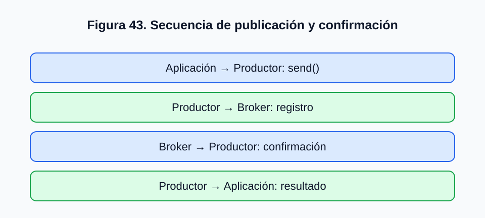

*Figura 43. Secuencia simplificada de publicación y confirmación.*

#### 2.3.8. Garantías de entrega y parámetro acks

| Valor | Comportamiento | Consideración |
|---|---|---|
| `acks=0` | No espera confirmación del broker | Menor garantía |
| `acks=1` | Confirma el líder después de escribir en su log | Puede existir pérdida ante ciertos fallos |
| `acks=all` | Espera las confirmaciones requeridas de réplicas sincronizadas | Mayor protección con replicación adecuada |

`acks=all` no es una garantía absoluta. Depende del factor de replicación y las réplicas sincronizadas. En nuestro laboratorio de broker único no existen copias independientes entre servidores.

#### 2.3.9. Reintentos, duplicados e idempotencia

Los reintentos ayudan ante fallos temporales, pero pueden duplicar publicaciones si el broker almacenó un registro y la confirmación se perdió. Kafka ofrece idempotencia del productor:

```properties
enable.idempotence=true
```

La idempotencia evita determinados duplicados de reintentos dentro de sus garantías, pero no deduplica automáticamente dos eventos de negocio generados de forma independiente. El comportamiento exacto depende de versión y configuración.

#### 2.3.10. Particionamiento: claves y distribución

El productor puede elegir una partición explícitamente, utilizar una clave o dejar que el cliente distribuya registros sin clave. Usar el identificador del cliente como clave puede preservar el orden de eventos de ese cliente dentro de una partición, mientras no cambien las condiciones relevantes del particionamiento.

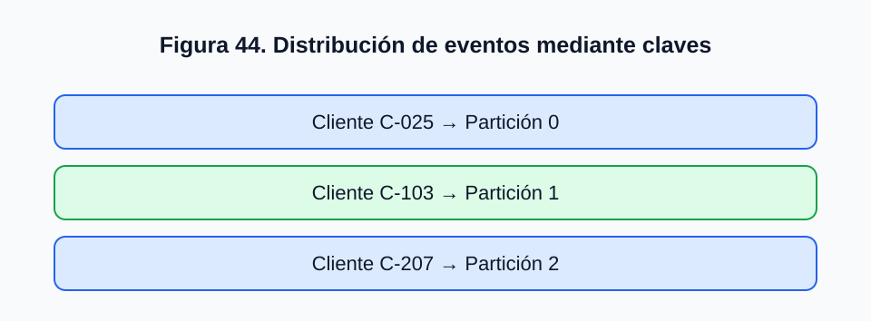

*Figura 44. Distribución ilustrativa de eventos comerciales mediante claves.*

Una clave muy frecuente puede concentrar carga en una partición (*data skew*). La elección de claves debe equilibrar ordenamiento y distribución.

#### 2.3.11. Agrupación de mensajes, latencia y rendimiento

El productor puede agrupar registros destinados a una partición antes de enviarlos (*batching*). Entre los parámetros relacionados están `batch.size`, `linger.ms` y `compression.type`. Lotes mayores pueden reducir solicitudes y mejorar rendimiento, pero añadir espera puede incrementar latencia.

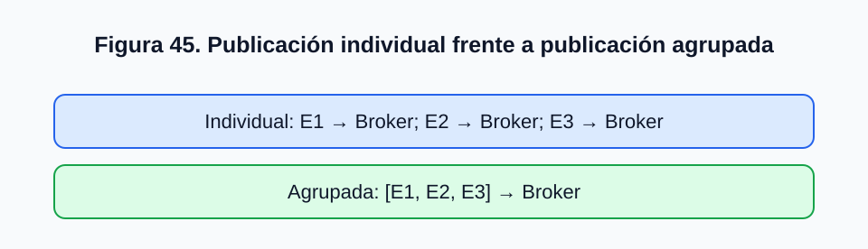

*Figura 45. Publicación individual frente a publicación agrupada.*

#### 2.3.12. Errores frecuentes

| Situación | Posible causa | Verificación |
|---|---|---|
| No hay conexión | Dirección incorrecta | Conectividad y advertised listeners |
| Tópico inexistente | Nombre o configuración | Consultar tópicos |
| Error de serialización | Datos incompatibles | Revisar conversión a bytes |
| Tiempo de espera | Comunicación o broker | Registros y configuración |
| Duplicados | Reintentos o eventos repetidos | Idempotencia e identificadores |
| Carga desequilibrada | Claves concentradas | Particionamiento |
| Pérdida | Garantías insuficientes | Confirmaciones y replicación |

Conviene distinguir fallos transitorios recuperables de errores permanentes que requieren intervención.

#### 2.3.13. Aplicación al caso comercial

La empresa registra una venta, construye el evento, lo serializa y publica en `ventas`. Kafka lo almacena en una partición y posteriormente los consumidores pueden recuperarlo. Surge un problema adicional: si la base de datos confirma la venta, pero falla la publicación, ambos sistemas pueden quedar desincronizados. El patrón **Transactional Outbox** es una alternativa arquitectónica para abordar esa consistencia, mediante una tabla de eventos pendientes y publicación posterior.

#### 2.3.14. Síntesis del apartado

Los productores publican eventos, serializan registros, seleccionan particiones y gestionan confirmaciones. Estudiamos `acks`, reintentos, idempotencia, agrupación y errores de publicación. En el apartado **2.4** examinaremos cómo los consumidores recuperan esos registros y coordinan el procesamiento.

---

### 2.4. Consumo de eventos y funcionamiento de los grupos de consumidores

#### 2.4.1. Del productor al consumidor: completar el flujo de eventos

En el apartado 2.3 estudiamos cómo las aplicaciones productoras construyen registros, los serializan y los publican en los tópicos de Kafka. El valor de una arquitectura orientada a eventos depende también de la capacidad de otras aplicaciones para recuperar y utilizar esa información.

Un **consumidor (*consumer*)** es una aplicación que se suscribe a uno o varios tópicos y recupera registros de sus particiones. Por ejemplo, a partir de una venta publicada en `ventas`, distintas aplicaciones pueden actualizar indicadores, detectar operaciones anómalas o alimentar un sistema analítico. El consumidor no necesita consultar directamente al sistema que registró la venta: recupera el evento desde Kafka.

#### 2.4.2. Arquitectura básica del consumo de eventos

Una empresa puede publicar ventas en Kafka y permitir que varias aplicaciones independientes las procesen.

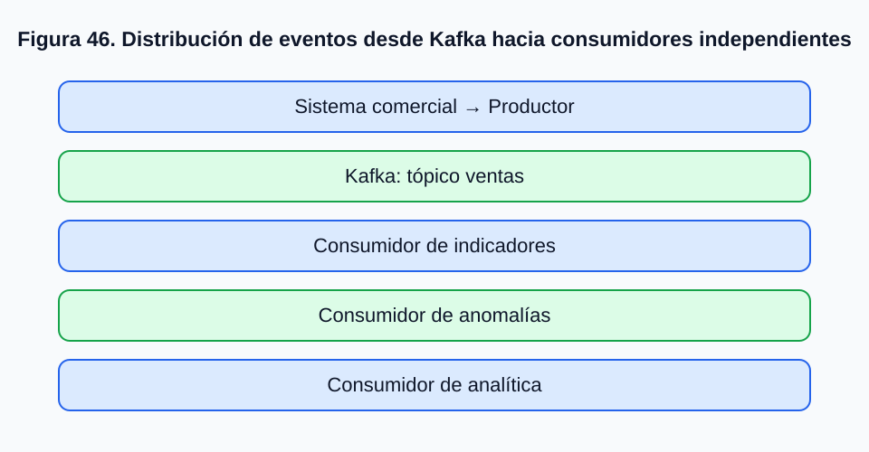

*Figura 46. Distribución de eventos desde Kafka hacia distintos consumidores.*

Una aplicación calcula ingresos acumulados, otra evalúa patrones inusuales y otra incorpora datos a un repositorio analítico. Ninguna necesita esperar a que las otras terminen. **La lectura de un evento no lo elimina del tópico**, de modo que grupos independientes pueden consumirlo.

#### 2.4.3. El modelo de consumo mediante polling

Kafka utiliza un modelo en que los consumidores solicitan datos mediante consultas (*polling*). El proceso general consiste en establecer conexión, suscribirse a tópicos, obtener particiones asignadas, solicitar registros, procesarlos y repetir la consulta.

En la API Java, una operación representativa es `poll()`. Una consulta puede devolver múltiples registros. Aunque se recuperen pequeños lotes, esto no equivale al procesamiento batch tradicional de grandes conjuntos históricos: los eventos pueden generarse continuamente.

#### 2.4.4. Los offsets desde la perspectiva del consumidor

Cada registro tiene un offset dentro de su partición.

| Offset | Evento |
|---:|---|
| 0 | Venta V-1001 |
| 1 | Venta V-1002 |
| 2 | Venta V-1003 |
| 3 | Venta V-1004 |
| 4 | Venta V-1005 |

Debemos distinguir entre la posición actual de lectura y los offsets confirmados (*committed offsets*) del grupo. Un offset confirmado normalmente representa **la siguiente posición desde la cual se debe reanudar el consumo**. Si se procesaron los registros hasta el offset 2, confirmar el offset 3 indica que la siguiente posición pendiente es 3.

#### 2.4.5. Confirmación automática y manual de offsets

| Modalidad | Característica | Consideración |
|---|---|---|
| Automática | El cliente confirma posiciones periódicamente | Simplifica el desarrollo, pero no asegura que cada evento haya terminado de procesarse |
| Manual | La aplicación decide cuándo confirmar | Permite coordinar el avance con la finalización de tareas |

Si una aplicación falla durante el procesamiento, la relación entre avance real y offsets confirmados determina si ciertos eventos podrían repetirse u omitirse. La estrategia debe responder a los requisitos de confiabilidad.

#### 2.4.6. ¿Qué es un grupo de consumidores?

Un **grupo de consumidores (*consumer group*)** es un conjunto de instancias que colaboran para procesar registros. Cada grupo tiene un identificador `group.id`.

Dentro de un grupo, una partición se asigna normalmente a una sola instancia a la vez. Así se distribuye el trabajo sin que todas las instancias procesen los mismos registros de esa partición.

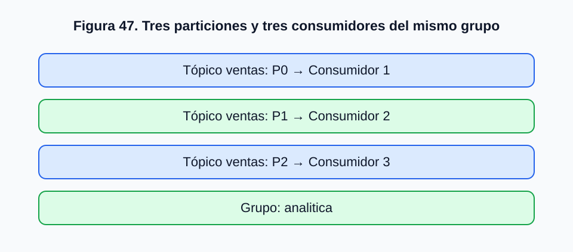

*Figura 47. Distribución ilustrativa de tres particiones entre tres consumidores del mismo grupo.*

#### 2.4.7. Relación entre particiones y paralelismo

| Consumidores en el grupo | Distribución posible para tres particiones |
|---:|---|
| 1 | Un consumidor procesa las tres |
| 2 | Uno procesa dos y otro una |
| 3 | Cada uno procesa una |
| 4 | Al menos uno queda sin particiones asignadas |

**Agregar consumidores no siempre aumenta el paralelismo**. Si existen más consumidores que particiones, algunos quedarán sin asignación de ese tópico. Aumentar particiones también puede afectar el orden de eventos asociados con claves.

#### 2.4.8. Diferentes grupos pueden consumir los mismos eventos

Los consumidores de un grupo colaboran; **los grupos diferentes mantienen posiciones independientes**.

Por ejemplo, los grupos `indicadores`, `fraudes` e `historico` pueden leer el mismo tópico `ventas` y procesarlo con finalidades diferentes.

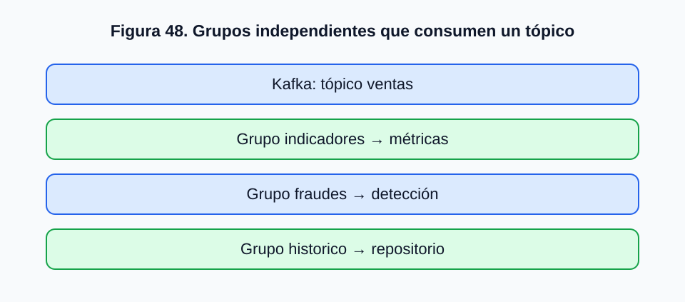

*Figura 48. Grupos independientes que consumen un mismo tópico.*

Un grupo puede procesar casi inmediatamente mientras otro mantiene retraso, sin bloquearse entre sí. Sin embargo, todos están sujetos a la retención del tópico.

#### 2.4.9. Rebalanceo de grupos de consumidores

Cuando cambia la composición de un grupo, Kafka puede redistribuir particiones mediante un **rebalanceo (*rebalance*)**. Esto puede ocurrir cuando se incorpora un consumidor, otro deja de funcionar, alguien abandona el grupo, cambian particiones o se incumplen ciertos intervalos de actividad.

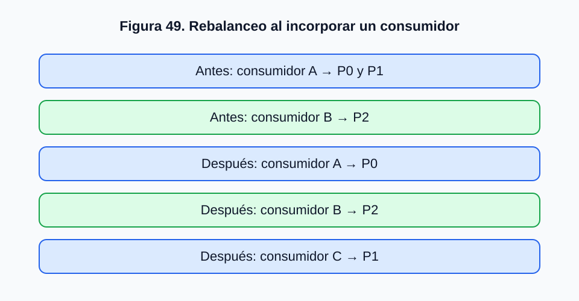

*Figura 49. Redistribución ilustrativa de particiones después de incorporar un consumidor.*

Durante el rebalanceo puede verse temporalmente afectado el procesamiento. El comportamiento depende de la versión, del protocolo y de la estrategia de asignación.

#### 2.4.10. Recuperación después de un fallo

Si un consumidor se detiene, puede reanudar a partir de los offsets confirmados. Dos situaciones son importantes:

**A.** El evento fue procesado, pero su offset no se confirmó. Tras reiniciar, podría procesarse nuevamente.

**B.** El offset fue confirmado antes de completar el procesamiento. Tras un fallo, podría omitirse un evento cuya operación de negocio no terminó.

Por ello, la confirmación de offsets es una decisión central de confiabilidad.

#### 2.4.11. Semánticas de procesamiento y entrega

| Semántica | Interpretación |
|---|---|
| *At-most-once* | Un registro puede procesarse como máximo una vez, pero puede perderse ante fallos |
| *At-least-once* | Se busca evitar pérdidas mediante reintentos, aunque pueden aparecer duplicados |
| *Exactly-once* | El efecto se materializa una sola vez dentro de un alcance transaccional definido |

Estas garantías dependen de Kafka, del consumidor, del momento de confirmación y de los sistemas externos. Una actualización en una base de datos externa no se vuelve automáticamente *exactly-once* por utilizar Kafka.

#### 2.4.12. Consumo mediante la consola de Kafka

```bash
kafka-console-consumer \
  --bootstrap-server localhost:9092 \
  --topic ventas \
  --from-beginning
```

`--from-beginning` permite comenzar desde los primeros registros **todavía disponibles** cuando no existe una posición previa aplicable; no recupera datos eliminados por retención.

```bash
kafka-console-consumer \
  --bootstrap-server localhost:9092 \
  --topic ventas \
  --group analitica
```

La sintaxis y opciones deben comprobarse en la imagen real del laboratorio, que utiliza una distribución anterior.

#### 2.4.13. Implementación conceptual de un consumidor en Python

```python
from kafka import KafkaConsumer
import json

consumidor = KafkaConsumer(
    "ventas",
    bootstrap_servers="localhost:9092",
    group_id="indicadores",
    auto_offset_reset="earliest",
    enable_auto_commit=False,
    value_deserializer=lambda valor: json.loads(
        valor.decode("utf-8")
    )
)

try:
    for mensaje in consumidor:
        venta = mensaje.value

        print(
            f"Venta: {venta['id_venta']} | "
            f"Monto: {venta['monto']}"
        )

        # Confirmar después de completar el procesamiento.
        consumidor.commit()

finally:
    consumidor.close()
```

El consumidor se suscribe a `ventas`, participa en `indicadores`, deserializa JSON y confirma manualmente. `auto_offset_reset="earliest"` se aplica cuando el grupo no dispone de una posición válida; no reinicia el consumo en cada ejecución.

En producción, `commit()` debe ejecutarse después de completar las operaciones de negocio y deben gestionarse excepciones. Este ejemplo es didáctico y aún no está validado contra la distribución específica del laboratorio.

#### 2.4.14. El retraso del consumidor o consumer lag

El **consumer lag** expresa la diferencia entre la posición final del registro y la posición confirmada por el grupo, según la herramienta y métrica utilizadas.

Si la siguiente posición del registro es 1000 y el grupo confirmó 850:

```text
Lag = 1000 - 850 = 150
```

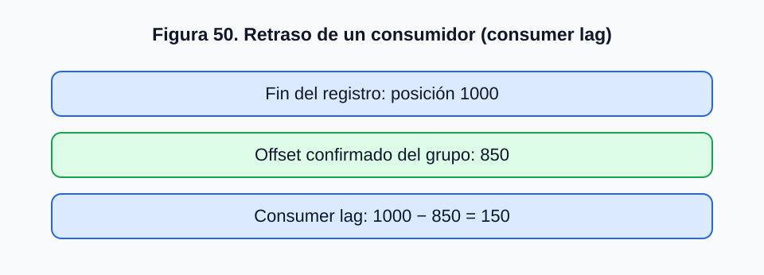

*Figura 50. Representación conceptual del retraso de un consumidor.*

Un lag elevado puede señalar que se publican eventos más rápido de lo que se procesan, aunque no todo lag distinto de cero implica una falla. El lag mide posiciones, no directamente tiempo.

#### 2.4.15. Aplicación al caso de transacciones comerciales

La empresa publica ventas en un tópico con tres particiones y establece tres grupos independientes.

| Grupo | Propósito | Procesamiento posible |
|---|---|---|
| `indicadores` | Métricas comerciales | Total de ventas y montos |
| `fraudes` | Detección de anomalías | Reglas de riesgo |
| `historico` | Repositorio analítico | Incorporación de registros |

Cada grupo puede tener varias instancias, con el límite de paralelismo determinado por las particiones. Los requisitos de confirmación pueden variar según la criticidad de cada aplicación.

#### 2.4.16. Síntesis del apartado

Estudiamos cómo los consumidores recuperan eventos mediante *polling*, administran offsets y confirman su avance. Los grupos permiten distribuir particiones entre instancias; grupos diferentes procesan independientemente los mismos eventos. Analizamos rebalanceo, recuperación, semánticas de procesamiento y *consumer lag*. En el apartado **2.5. Estructuración de mensajes: texto, JSON, claves y marcas temporales** profundizaremos en la representación de registros.

---

### 2.5. Estructuración de mensajes: texto, JSON, claves y marcas temporales

#### 2.5.1. De la publicación de eventos a la representación de la información

En los apartados anteriores estudiamos cómo Kafka organiza los registros mediante tópicos y particiones, cómo los productores publican eventos y cómo los consumidores recuperan esa información.

Sin embargo, todavía debemos resolver una cuestión fundamental: **¿cómo representar los datos para que diferentes aplicaciones puedan intercambiarlos e interpretarlos correctamente?**

Una aplicación registra una venta por $45.990. El productor puede publicar:

```text
Venta realizada por $45.990
```

Este mensaje es comprensible para una persona, pero presenta limitaciones para el procesamiento automatizado. Una alternativa es una estructura explícita:

```json
{
  "id_venta": "V-1048",
  "id_cliente": "C-025",
  "monto": 45990,
  "moneda": "CLP",
  "estado": "confirmada"
}
```

**Kafka transporta y almacena registros cuyos componentes clave y valor se representan como secuencias de bytes.** La interpretación corresponde a los productores, consumidores y serializadores. Kafka no exige JSON ni otro formato específico.

#### 2.5.2. Diferencia entre evento, registro y mensaje

Un **evento** representa algo que ocurrió o un cambio de estado relevante para el sistema: por ejemplo, el cliente C-025 realizó la venta V-1048 por $45.990.

Un **registro Kafka** es la representación técnica almacenada en una partición; puede contener clave, valor, marca temporal, cabeceras y metadatos. **Mensaje** suele designar la información transmitida entre productor y consumidor.


*Figura 51. Transformación de un evento de negocio en un registro Kafka.*

Un mismo hecho de negocio puede representarse mediante texto, JSON o Avro. El significado del evento puede mantenerse aunque cambie su representación técnica.

#### 2.5.3. Mensajes de texto: simplicidad y limitaciones

```text
Venta V-1048 confirmada
```

El texto resulta útil para verificar conexiones y comprender la publicación desde consola, pero presenta dificultades de interpretación automática. Comparemos:

```text
Venta V-1048 confirmada por 45990 pesos
La transacción V-1049 fue aprobada. Total: $52.990
```

Aunque ambos describen ventas, usan estructuras distintas. Un consumidor tendría que interpretar las frases para extraer montos. **El texto libre es útil para ejemplos sencillos, pero no suele ser la mejor alternativa para intercambiar datos estructurados.**

#### 2.5.4. JSON como formato de intercambio de eventos

JSON (*JavaScript Object Notation*) representa información mediante pares de clave y valor, objetos y arreglos:

```json
{
  "id_venta": "V-1048",
  "id_cliente": "C-025",
  "fecha": "2026-10-29T11:35:00-03:00",
  "productos": [
    {"codigo": "P-101", "cantidad": 2, "precio_unitario": 15995},
    {"codigo": "P-205", "cantidad": 1, "precio_unitario": 14000}
  ],
  "monto_total": 45990,
  "moneda": "CLP",
  "estado": "confirmada"
}
```

Los campos son explícitos y sus tipos reconocibles; el consumidor puede leer `monto_total` sin interpretar lenguaje natural. JSON es legible y facilita depuración, pero no incorpora por sí solo un contrato formal de esquema, puede ocupar más espacio que formatos binarios y exige serialización.

#### 2.5.5. Serialización y deserialización

Kafka no almacena directamente objetos Python o diccionarios. El productor los transforma en bytes mediante **serialización**; el consumidor reconstruye la información mediante **deserialización**.

```python
import json

venta = {"id_venta": "V-1048", "monto": 45990}
mensaje = json.dumps(venta).encode("utf-8")
venta_recuperada = json.loads(mensaje.decode("utf-8"))
```


*Figura 52. Proceso de serialización y deserialización de un evento JSON.*

Productor y consumidor deben usar mecanismos compatibles. Interpretar bytes JSON con un formato incompatible puede provocar errores.

#### 2.5.6. La clave del mensaje y su relación con las particiones

Un registro puede contener **clave (*key*)** y **valor (*value*)**. La clave no es necesariamente un identificador único del evento; suele asociar registros con una entidad y contribuir a seleccionar la partición.

Por ejemplo, clave `C-025` y valor:

```json
{"id_venta": "V-1048", "monto": 45990, "estado": "confirmada"}
```

Una estrategia basada en la clave puede enviar los eventos de C-025 a la misma partición bajo condiciones estables de particionamiento, preservando su orden de incorporación.

| Clave Kafka | Identificador de venta |
|---|---|
| `C-025` | `V-1048` |
| `C-025` | `V-1051` |
| `C-025` | `V-1057` |
| `C-103` | `V-1060` |


*Figura 53. Diferencia entre clave de particionamiento e identificador del evento.*

La selección de claves debe considerar ordenamiento, distribución de carga y necesidades de consumidores.

#### 2.5.7. Registros sin clave y registros con clave nula

Kafka admite registros sin clave:

```python
productor.send("ventas", value=venta)
```

La distribución sin clave depende del particionador y de la versión del cliente; no debe asumirse que todos usan *round-robin*. Algunas implementaciones favorecen la agrupación por partición.

Una **clave nula** es distinta de un **valor nulo**. Los registros con valor nulo pueden utilizarse en tópicos compactados como *tombstones*, para representar la eliminación lógica del estado asociado con una clave, según el contrato de la aplicación.

#### 2.5.8. Marcas temporales: cuándo ocurrió y cuándo se registró un evento

Debemos distinguir **tiempo del evento (*event time*)**, momento en que ocurrió el hecho; **tiempo de incorporación (*ingestion time*)**, cuando ingresa a un sistema; y **tiempo de procesamiento (*processing time*)**, cuando una aplicación lo procesa.

| Referencia | Momento |
|---|---|
| Venta realizada | 11:35:00 |
| Evento publicado y recibido | 11:35:02 |
| Procesamiento analítico | 11:35:07 |


*Figura 54. Diferencias entre tiempo del evento, incorporación y procesamiento.*

La marca temporal del registro Kafka puede corresponder a `CreateTime` o `LogAppendTime`, según versión y configuración. No necesariamente coincide con el instante del hecho de negocio. Puede ser útil incluir `fecha_venta` en el valor. Esta distinción será esencial al estudiar ventanas de tiempo con Spark Structured Streaming.

#### 2.5.9. Formatos de fecha y zonas horarias

ISO 8601 permite representar fechas inequívocas:

```text
2026-10-29T11:35:00-03:00
2026-10-29T14:35:00Z
```

Ambas expresiones representan el mismo instante. En cambio, `29/10/2026 11:35` carece de información explícita de zona horaria. En sistemas distribuidos conviene documentar el huso horario o normalizar a UTC.

#### 2.5.10. Cabeceras de los registros Kafka

Las **cabeceras (*headers*)** contienen metadatos opcionales sin mezclarlos necesariamente con el valor principal.

| Cabecera | Valor ilustrativo |
|---|---|
| `origen` | `plataforma_web` |
| `version_evento` | `1` |
| `tipo_evento` | `venta_confirmada` |
| `correlation_id` | `REQ-8421` |

Pueden identificar origen, versión o correlación entre servicios. Kafka no interpreta automáticamente estos metadatos como reglas de negocio: su significado requiere acuerdos entre aplicaciones.

#### 2.5.11. Contratos de datos y evolución de esquemas

Un **contrato de datos (*data contract*)** define la estructura y significado de los eventos. Por ejemplo, `id_venta` obligatorio, `id_cliente` como identificador, `monto_total` numérico en pesos chilenos, `moneda` como código, `fecha_venta` inequívoca y `estado` con valores definidos.

Cambiar:

```json
{"id_venta": "V-1048", "monto": 45990}
```

por:

```json
{"id_venta": "V-1048", "monto_total": 45990, "moneda": "CLP"}
```

puede romper un consumidor que espera `monto`. **Modificar JSON no garantiza compatibilidad**. Las versiones de eventos, reglas de compatibilidad y soluciones como JSON Schema, Apache Avro y Protocol Buffers ayudan a formalizar contratos. Kafka no impone automáticamente un esquema a todos los valores.

#### 2.5.12. Comparación de formatos

| Formato | Ventajas | Limitaciones |
|---|---|---|
| Texto libre | Simple, inspección fácil | Difícil de interpretar automáticamente |
| JSON | Legible, ampliamente compatible | Tamaño relativo y validación adicional |
| Avro | Binario compacto, soporte de esquemas | Herramientas y gestión de esquemas |
| Protocol Buffers | Binario eficiente, contratos explícitos | Definición y generación de estructuras |

En el laboratorio utilizaremos principalmente JSON por su legibilidad e interoperabilidad con Python, APIs y herramientas analíticas.

#### 2.5.13. Construcción de un evento comercial estructurado

```json
{
  "id_evento": "EVT-20261029-0001",
  "tipo_evento": "venta_confirmada",
  "version": 1,
  "fecha_evento": "2026-10-29T11:35:00-03:00",
  "datos": {
    "id_venta": "V-1048",
    "id_cliente": "C-025",
    "monto_total": 45990,
    "moneda": "CLP",
    "medio_pago": "tarjeta",
    "estado": "confirmada"
  }
}
```

`id_evento` identifica la ocurrencia; `tipo_evento` expresa qué ocurrió; `version` identifica el contrato; `fecha_evento` representa el momento del hecho y `datos` contiene los atributos comerciales. Esta organización es una decisión de diseño, no una exigencia de Kafka.

```python
import json

clave = "C-025"
evento = {
    "id_evento": "EVT-20261029-0001",
    "tipo_evento": "venta_confirmada",
    "version": 1,
    "fecha_evento": "2026-10-29T11:35:00-03:00",
    "datos": {
        "id_venta": "V-1048",
        "id_cliente": "C-025",
        "monto_total": 45990,
        "moneda": "CLP",
        "medio_pago": "tarjeta",
        "estado": "confirmada"
    }
}

clave_bytes = clave.encode("utf-8")
valor_bytes = json.dumps(evento, ensure_ascii=False).encode("utf-8")
```

Estas secuencias de bytes pueden utilizarse como clave y valor. El ejemplo se concentra en transformación de datos y no requiere ejecutar Kafka.

#### 2.5.14. Errores frecuentes en la estructuración

| Problema | Ejemplo | Consecuencia |
|---|---|---|
| Campos inconsistentes | `monto` vs. `monto_total` | Errores de interpretación |
| Tipos incompatibles | Monto como texto | Dificultad de cálculo |
| Fechas ambiguas | `10/11/2026` | Interpretaciones diferentes |
| Sin identificador | Falta `id_evento` | Difícil detectar duplicados |
| Cambio sin versión | Se elimina campo requerido | Fallos en consumidores |
| Clave mal elegida | Una clave para todos | Carga desequilibrada |
| Serialización incompatible | Formatos distintos | Error de deserialización |

La calidad de una arquitectura de eventos depende de datos consistentes y documentados, no solamente de que Kafka pueda transportar registros.

#### 2.5.15. Síntesis del apartado

Diferenciamos evento, mensaje y registro; comparamos texto y JSON; estudiamos serialización, claves, marcas temporales, cabeceras, contratos y evolución de esquemas. Finalmente definimos un evento comercial estructurado como referencia para las siguientes integraciones.

En el apartado **2.6. Integración con fuentes externas: archivos, bases de datos y APIs REST** estudiaremos cómo obtener información desde otros sistemas y transformarla en eventos publicables en Kafka.

---

### 2.6. Integración con fuentes externas: archivos, bases de datos y APIs REST

#### 2.6.1. Kafka como componente de integración de datos

En los apartados anteriores estudiamos cómo Kafka organiza, recibe, almacena y distribuye eventos. Comprendimos el funcionamiento de productores, consumidores, tópicos, particiones y grupos de consumidores, así como la estructuración mediante JSON, claves y marcas temporales.

En los sistemas empresariales, la información normalmente se origina en aplicaciones y plataformas ya operativas: bases de datos transaccionales, archivos periódicos, aplicaciones web, servicios externos y dispositivos.

**Kafka puede actuar como plataforma de distribución de eventos entre sistemas heterogéneos**, siempre que existan componentes capaces de extraer, transformar y publicar la información. Kafka no consulta automáticamente cualquier base de datos, archivo o API por el solo hecho de estar disponible.

#### 2.6.2. Arquitectura general de integración

La integración puede organizarse en tres etapas:

1. **Obtención:** recuperar información desde un sistema de origen.
2. **Transformación:** validar, estructurar y serializar los datos.
3. **Publicación:** enviar los registros a un tópico Kafka.


*Figura 55. Arquitectura general de integración de fuentes externas con Kafka.*

El componente puede ser un programa Python, un servicio Java, un conector o una herramienta como Apache NiFi. La elección depende de la fuente, la frecuencia, el volumen y los requisitos de confiabilidad.

#### 2.6.3. Integración mediante archivos

Los archivos CSV, JSON y de texto son fuentes habituales en ingeniería de datos. Por ejemplo, una empresa genera un archivo diario de ventas:

```csv
id_venta,id_cliente,fecha,monto,estado
V-1048,C-025,2026-10-29T11:35:00-03:00,45990,confirmada
V-1049,C-103,2026-10-29T11:36:00-03:00,52990,confirmada
V-1050,C-207,2026-10-29T11:37:00-03:00,18990,rechazada
```

Una aplicación puede leerlo y publicar cada fila como evento independiente. **Publicar datos en Kafka no convierte automáticamente el origen en una fuente de tiempo real**: si el archivo es diario, la información puede tener horas de antigüedad.

#### 2.6.4. Lectura y transformación de archivos CSV mediante Python

```python
import csv

with open(
    "ventas.csv",
    mode="r",
    encoding="utf-8",
    newline=""
) as archivo:

    lector = csv.DictReader(archivo)

    for fila in lector:
        evento = {
            "id_venta": fila["id_venta"],
            "id_cliente": fila["id_cliente"],
            "fecha_evento": fila["fecha"],
            "monto": int(fila["monto"]),
            "estado": fila["estado"]
        }

        print(evento)
```

Este programa **no publica todavía en Kafka**: ilustra obtención y transformación. `csv.DictReader` permite acceder por nombres de columnas y `int()` convierte el monto desde texto. Una integración robusta debe gestionar filas incompletas, evitar reprocesamientos y recuperar ejecuciones interrumpidas.

#### 2.6.5. Integración con bases de datos relacionales

Una base de datos comercial puede contener:

| id_venta | id_cliente | fecha | monto | estado |
|---|---|---|---:|---|
| V-1048 | C-025 | 2026-10-29 11:35 | 45990 | confirmada |
| V-1049 | C-103 | 2026-10-29 11:36 | 52990 | confirmada |
| V-1050 | C-207 | 2026-10-29 11:37 | 18990 | rechazada |

Una estrategia de extracción incremental utiliza un punto de control:

```sql
SELECT
    id_venta,
    id_cliente,
    fecha,
    monto,
    estado
FROM ventas
WHERE fecha_actualizacion > :ultima_fecha_procesada
ORDER BY fecha_actualizacion, id_venta;
```

Una marca temporal de actualización no garantiza por sí sola capturar todos los cambios: varias filas pueden compartir fecha y pueden existir situaciones de concurrencia. Deben considerarse identificadores, puntos de control y transacciones.

#### 2.6.6. Consulta periódica frente a captura de cambios

Dos enfoques son **polling**, que consulta periódicamente tablas, y **Change Data Capture (CDC)**, que captura modificaciones del origen, frecuentemente a través de registros transaccionales.

| Característica | Consulta periódica | CDC |
|---|---|---|
| Mecanismo | Consultas sobre tablas | Captura de cambios |
| Frecuencia | Intervalo de consulta | Puede aproximarse al cambio |
| Carga | Consultas repetidas | Depende de conector y sistema |
| Complejidad | Relativamente sencilla | Configuración especializada |
| Cambios detectados | Según diseño de consulta | Puede capturar inserciones, actualizaciones y eliminaciones |


*Figura 56. Diferencia conceptual entre consulta periódica y CDC.*

Una venta puede pasar de pendiente a confirmada y anulada. Una consulta al estado actual puede no preservar todas las transiciones, mientras un CDC configurado correctamente puede generar eventos para los cambios. CDC requiere permisos, compatibilidad e infraestructura; no es superior en todos los escenarios.

#### 2.6.7. Kafka Connect y los conectores de integración

**Kafka Connect** proporciona una arquitectura de transferencia de datos entre Kafka y otros sistemas mediante conectores.

- **Source connectors:** extraen información externa y la publican en Kafka.
- **Sink connectors:** consumen registros Kafka y los entregan a sistemas externos.


*Figura 57. Arquitectura conceptual de Kafka Connect.*

La disponibilidad de Kafka no implica que todos los conectores estén instalados o configurados. Deben comprobarse las herramientas y versiones del laboratorio.

#### 2.6.8. Apache NiFi como alternativa de integración

Nuestro entorno docente también contempla Apache NiFi, plataforma para diseñar y ejecutar flujos de datos. Un flujo podría obtener datos de una API REST, validar la respuesta, transformar a JSON y publicar en Kafka.

NiFi permite visualizar las etapas; Kafka recibe, conserva y distribuye los eventos. **Son tecnologías complementarias, no equivalentes.** Que ambos servicios aparezcan en Docker Compose no significa que exista una integración funcional: deben configurarse procesadores, conexiones y parámetros compatibles.

#### 2.6.9. Integración mediante APIs REST

Las APIs REST permiten obtener información mediante HTTP. Una operación ilustrativa:

```text
GET /api/ventas
```

Puede devolver:

```json
{
  "ventas": [
    {"id_venta": "V-1048", "id_cliente": "C-025", "monto": 45990, "estado": "confirmada"},
    {"id_venta": "V-1049", "id_cliente": "C-103", "monto": 52990, "estado": "confirmada"}
  ]
}
```

Un programa consulta la API, interpreta el JSON y publica cada venta en Kafka. Esto permite integrar sistemas sin acceso directo a sus bases de datos. Como REST responde habitualmente a solicitudes, la obtención periódica requiere un proceso de consulta programada.

#### 2.6.10. Consulta de una API REST mediante Python

```python
import requests

url = "https://api.ejemplo.com/ventas"

respuesta = requests.get(
    url,
    timeout=10
)

respuesta.raise_for_status()

datos = respuesta.json()

for venta in datos["ventas"]:
    print(venta)
```

La dirección es **ilustrativa y no corresponde a un servicio real verificado**. Se establece la URL, se ejecuta la solicitud HTTP, se comprueba el estado mediante `raise_for_status()` y se interpreta la respuesta JSON. Este código todavía no incorpora Kafka: el apartado 2.7 combinará obtención y publicación.

#### 2.6.11. Integración mediante consultas periódicas

Una aplicación podría consultar una API cada 30 segundos, pero eso no garantiza que la información tenga exactamente 30 segundos de antigüedad. También depende de la actualización del origen. Deben respetarse límites de solicitudes por minuto, hora o día, y gestionarse las respuestas y fallos.

#### 2.6.12. Paginación, límites y recuperación de errores

Muchas APIs distribuyen resultados entre páginas:

```text
GET /api/ventas?page=1&limit=100
GET /api/ventas?page=2&limit=100
GET /api/ventas?page=3&limit=100
```

| Situación | Interpretación | Acción general |
|---|---|---|
| HTTP 200 | Éxito | Validar y procesar |
| HTTP 400 | Solicitud incorrecta | Revisar parámetros |
| HTTP 401 | Autenticación inválida | Revisar credenciales |
| HTTP 403 | Acceso prohibido | Revisar permisos |
| HTTP 429 | Límite alcanzado | Respetar política de reintentos |
| HTTP 500 | Error del servidor | Evaluar reintento controlado |
| Timeout | Sin respuesta oportuna | Registrar y gestionar fallo |

No todos los errores deben reintentarse igual: credenciales incorrectas requieren corrección, mientras una interrupción transitoria puede justificar un reintento controlado.

#### 2.6.13. Duplicación y estado de extracción

Si una API devuelve las últimas cien ventas, consultarla cada minuto y publicar todos los resultados podría generar duplicados. Estrategias de control incluyen:

- Identificadores únicos de eventos.
- Consulta de modificaciones desde una fecha.
- Punto de control de última extracción.
- Comparación con identificadores procesados.
- Paginación incremental o cursores cuando estén disponibles.

**Una clave Kafka no elimina automáticamente duplicados**: dos publicaciones con la misma clave pueden generar registros distintos. La deduplicación requiere diseño explícito.

#### 2.6.14. Integración batch, near real-time y streaming

| Modalidad | Característica | Ejemplo |
|---|---|---|
| Batch | Procesamiento en intervalos amplios | Archivo diario |
| Near Real-Time | Actualizaciones frecuentes con retraso acotado según diseño | Consulta API cada 30 segundos |
| Streaming | Procesamiento continuo de eventos disponibles | Publicación desde sistema transaccional |


*Figura 58. Diferencias conceptuales entre batch, near real-time y streaming.*

Una fuente diaria publicada en Kafka sigue teniendo actualización diaria; una API consultada cada minuto utiliza extracción periódica aunque alimente un flujo de eventos. El apartado 2.8 profundizará estas modalidades.

#### 2.6.15. Criterios para seleccionar un mecanismo

| Criterio | Pregunta de diseño |
|---|---|
| Fuente | ¿Archivo, base de datos o API? |
| Frecuencia | ¿Cada cuánto cambian los datos? |
| Latencia | ¿Qué retraso se acepta? |
| Volumen | ¿Cuántos registros se procesarán? |
| Confiabilidad | ¿Cómo se recuperan fallos? |
| Duplicados | ¿Cómo se detectan registros repetidos? |
| Seguridad | ¿Qué autenticación y permisos se requieren? |
| Mantenimiento | ¿Quién administra la integración? |
| Compatibilidad | ¿Qué versiones y conectores están disponibles? |

Un CSV diario puede requerir solo un proceso programado; cambios inmediatos de base de datos podrían justificar CDC; una API REST es adecuada cuando el servicio externo expone HTTP pero no acceso directo a su base.

#### 2.6.16. Aplicación al laboratorio de Big Data

La infraestructura Docker del curso contempla Kafka, ZooKeeper y otras tecnologías, pero debemos distinguir servicios disponibles de conexiones realmente implementadas.

La secuencia didáctica será: obtener y transformar datos externos; implementar un productor Python que consulte una API REST y publique eventos; consumir y procesar mediante herramientas como Spark Structured Streaming.

Kafka no reemplaza la API ni transforma automáticamente los datos: su función en esta arquitectura es recibir, conservar y distribuir eventos.

#### 2.6.17. Síntesis del apartado

Estudiamos integración mediante archivos CSV/JSON, bases relacionales, extracción incremental, CDC, Kafka Connect, NiFi y APIs REST. Revisamos HTTP, paginación, límites de solicitudes, errores, duplicados y puntos de control. Distinguimos batch, near real-time y streaming, subrayando que la frecuencia de actualización depende de toda la arquitectura.

En el apartado **2.7. Construcción de un productor que consulta una API y publica eventos en Kafka** integraremos estos conceptos mediante Python.

---

### 2.7. Construcción de un productor que consulta una API y publica eventos en Kafka

#### 2.7.1. Del estudio de las integraciones a la construcción de una aplicación

En el apartado 2.6 examinamos archivos, bases de datos, CDC, Kafka Connect, NiFi y APIs REST. Ahora desarrollaremos una aplicación que reúna esos conceptos en un procedimiento operativo: **un productor Python capaz de consultar una API REST, recuperar JSON, transformarlo en eventos y publicarlo en un tópico Kafka**.

La solución relaciona una fuente HTTP, una aplicación que obtiene y transforma los datos, y un broker Kafka que recibe los eventos. Además de ejecutar el programa, estudiaremos las decisiones de diseño y las limitaciones que diferencian una demostración de un sistema de producción.

#### 2.7.2. Escenario de trabajo y objetivos

Continuaremos con el caso transversal de transacciones comerciales. Supongamos que una API devuelve:

```json
{
  "ventas": [
    {
      "id_venta": "V-1048",
      "id_cliente": "C-025",
      "monto": 45990,
      "moneda": "CLP",
      "estado": "confirmada",
      "fecha": "2026-10-29T11:35:00-03:00"
    },
    {
      "id_venta": "V-1049",
      "id_cliente": "C-103",
      "monto": 52990,
      "moneda": "CLP",
      "estado": "confirmada",
      "fecha": "2026-10-29T11:36:00-03:00"
    }
  ]
}
```

La aplicación debe recuperar estas ventas y publicar cada una como registro independiente en `ventas`. Los objetivos son obtener datos por HTTP, validarlos y transformarlos, publicarlos con un productor Kafka y comprobar su disponibilidad para consumidores.

Para no depender inicialmente de servicios externos, construiremos una API local de demostración, que posteriormente podrá sustituirse por una API real.

#### 2.7.3. Arquitectura de la solución

La arquitectura contempla cuatro componentes: **API REST** (fuente JSON), **productor Python** (consulta, valida y publica), **broker Kafka** (almacena eventos en `ventas`) y **consumidor de verificación** (observa registros).

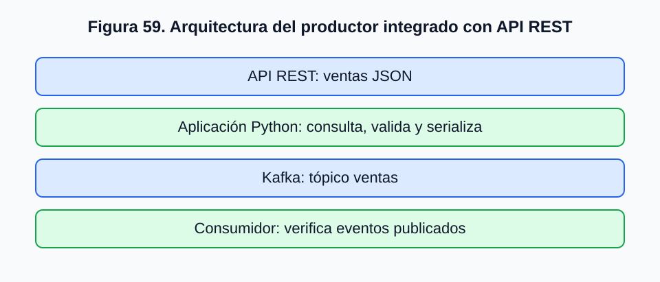

*Figura 59. Arquitectura del productor Python integrado con una API REST.*

La API no se comunica directamente con Kafka. Python establece ambas conexiones; los errores HTTP, la transformación y las confirmaciones Kafka requieren tratamiento diferenciado.

#### 2.7.4. Condiciones previas del laboratorio

Comprobaremos el estado del entorno Docker:

```bash
docker ps
docker logs --tail 50 kafka
```

La existencia del contenedor no garantiza que el broker sea accesible desde el entorno de Python. La dirección depende de dónde se ejecuta el cliente:

| Ubicación del productor | Dirección que debe evaluarse |
|---|---|
| Contenedor Kafka | `localhost:9092` |
| Otro contenedor de la red Docker | Nombre del servicio y listener accesible |
| Sistema anfitrión | Puerto publicado y dirección anunciada accesible |
| Equipo externo | Dirección de red y listener accesibles |

La configuración histórica incluye `172.27.1.16` como dirección anunciada, que debe verificarse. Utilizaremos `localhost:9092` como **valor inicial configurable, no garantía de conectividad**.

Necesitaremos Python y las bibliotecas `requests` y `kafka-python`:

```bash
python -m pip install requests kafka-python
```

La compatibilidad debe comprobarse contra las versiones instaladas.

#### 2.7.5. Organización del proyecto

```text
productor-api-kafka/
├── api_demo.py
├── productor.py
├── verificar_eventos.py
└── requirements.txt
```

| Archivo | Responsabilidad |
|---|---|
| `api_demo.py` | API REST local de demostración |
| `productor.py` | Consulta y publicación |
| `verificar_eventos.py` | Consumo de comprobación |
| `requirements.txt` | Dependencias |

Separar la fuente de la aplicación permite sustituir la API local sin rediseñar necesariamente la publicación.

#### 2.7.6. Construcción de una API REST de demostración

El archivo `requirements.txt` contendrá:

```text
Flask
requests
kafka-python
```

Instalamos:

```bash
python -m pip install -r requirements.txt
```

Archivo `api_demo.py`:

```python
from flask import Flask, jsonify

app = Flask(__name__)

VENTAS = [
    {
        "id_venta": "V-1048",
        "id_cliente": "C-025",
        "monto": 45990,
        "moneda": "CLP",
        "estado": "confirmada",
        "fecha": "2026-10-29T11:35:00-03:00"
    },
    {
        "id_venta": "V-1049",
        "id_cliente": "C-103",
        "monto": 52990,
        "moneda": "CLP",
        "estado": "confirmada",
        "fecha": "2026-10-29T11:36:00-03:00"
    },
    {
        "id_venta": "V-1050",
        "id_cliente": "C-207",
        "monto": 18990,
        "moneda": "CLP",
        "estado": "rechazada",
        "fecha": "2026-10-29T11:37:00-03:00"
    }
]

@app.get("/api/ventas")
def obtener_ventas():
    return jsonify({"ventas": VENTAS})

if __name__ == "__main__":
    app.run(host="127.0.0.1", port=5000, debug=False)
```

Iniciamos el servicio:

```bash
python api_demo.py
```

Y desde otro terminal del mismo entorno:

```bash
curl http://127.0.0.1:5000/api/ventas
```

El servicio devuelve las tres ventas en JSON. Es una demostración con datos estáticos, sin autenticación ni persistencia. Si el productor se ejecuta en otro contenedor, `127.0.0.1` no apuntará automáticamente a la API; deberá adaptarse la conectividad.

#### 2.7.7. Diseño del evento publicado en Kafka

Mantendremos el diseño del apartado 2.5, separando metadatos y datos de negocio:

```json
{
  "id_evento": "venta-V-1048-confirmada",
  "tipo_evento": "venta_confirmada",
  "version": 1,
  "fecha_evento": "2026-10-29T11:35:00-03:00",
  "datos": {
    "id_venta": "V-1048",
    "id_cliente": "C-025",
    "monto_total": 45990,
    "moneda": "CLP",
    "estado": "confirmada"
  }
}
```

El identificador del evento se deriva de venta y estado para que sea estable en consultas repetidas. Esto es didáctico: si una venta regresa a un estado anterior, podría repetirse el identificador. En producción convendría utilizar un identificador de cambio o versión provisto por la fuente.

La clave Kafka será `id_cliente`, por ejemplo `C-025`. Esto asocia ventas del mismo cliente, pero puede desequilibrar la distribución si ciertos clientes concentran muchas transacciones.

#### 2.7.8. Transformación y validación de registros

Antes de publicar debemos comprobar los campos requeridos y su consistencia:

```python
def transformar_venta(venta):
    campos_requeridos = [
        "id_venta", "id_cliente", "monto",
        "moneda", "estado", "fecha"
    ]

    for campo in campos_requeridos:
        if campo not in venta:
            raise ValueError(
                f"Falta el campo obligatorio: {campo}"
            )

    monto = int(venta["monto"])

    if monto < 0:
        raise ValueError("El monto no puede ser negativo")

    return {
        "id_evento": (
            f"venta-{venta['id_venta']}-{venta['estado']}"
        ),
        "tipo_evento": f"venta_{venta['estado']}",
        "version": 1,
        "fecha_evento": venta["fecha"],
        "datos": {
            "id_venta": venta["id_venta"],
            "id_cliente": venta["id_cliente"],
            "monto_total": monto,
            "moneda": venta["moneda"],
            "estado": venta["estado"]
        }
    }
```

La validación es básica: una aplicación productiva también comprobaría fechas, tipos, estados permitidos y reglas comerciales. **No debemos publicar automáticamente cualquier dato recibido sin verificar su estructura y consistencia.**

#### 2.7.9. Implementación del productor Kafka en Python

Archivo `productor.py`:

```python
import json
import os
import requests

from kafka import KafkaProducer

API_URL = os.getenv(
    "API_URL",
    "http://127.0.0.1:5000/api/ventas"
)

KAFKA_BOOTSTRAP_SERVERS = os.getenv(
    "KAFKA_BOOTSTRAP_SERVERS",
    "localhost:9092"
)

TOPICO = "ventas"


def transformar_venta(venta):
    campos_requeridos = [
        "id_venta",
        "id_cliente",
        "monto",
        "moneda",
        "estado",
        "fecha"
    ]

    for campo in campos_requeridos:
        if campo not in venta:
            raise ValueError(
                f"Falta el campo obligatorio: {campo}"
            )

    monto = int(venta["monto"])

    if monto < 0:
        raise ValueError(
            "El monto no puede ser negativo"
        )

    return {
        "id_evento": (
            f"venta-{venta['id_venta']}-"
            f"{venta['estado']}"
        ),
        "tipo_evento": f"venta_{venta['estado']}",
        "version": 1,
        "fecha_evento": venta["fecha"],
        "datos": {
            "id_venta": venta["id_venta"],
            "id_cliente": venta["id_cliente"],
            "monto_total": monto,
            "moneda": venta["moneda"],
            "estado": venta["estado"]
        }
    }


def consultar_api():
    respuesta = requests.get(
        API_URL,
        timeout=10
    )

    respuesta.raise_for_status()

    datos = respuesta.json()

    ventas = datos.get("ventas")

    if not isinstance(ventas, list):
        raise ValueError(
            "La API no entregó una lista de ventas"
        )

    return ventas


def crear_productor():
    return KafkaProducer(
        bootstrap_servers=KAFKA_BOOTSTRAP_SERVERS,
        key_serializer=lambda clave: clave.encode(
            "utf-8"
        ),
        value_serializer=lambda valor: json.dumps(
            valor,
            ensure_ascii=False
        ).encode("utf-8"),
        acks="all",
        retries=3
    )


def publicar_ventas():
    ventas = consultar_api()

    productor = crear_productor()

    publicados = 0

    try:
        for venta in ventas:
            try:
                evento = transformar_venta(venta)

                clave = venta["id_cliente"]

                resultado = productor.send(
                    TOPICO,
                    key=clave,
                    value=evento
                )

                metadatos = resultado.get(
                    timeout=15
                )

                publicados += 1

                print(
                    f"Evento publicado: "
                    f"{evento['id_evento']} | "
                    f"partición={metadatos.partition} | "
                    f"offset={metadatos.offset}"
                )

            except (ValueError, TypeError) as error:
                print(
                    f"Registro inválido: {error}"
                )

    finally:
        productor.close()

    print(
        f"Total de eventos publicados: {publicados}"
    )


if __name__ == "__main__":
    publicar_ventas()
```

Esta implementación utiliza `kafka-python`, cuya compatibilidad debe comprobarse con la versión del laboratorio. Es una aplicación docente, no una integración empresarial terminada.

#### 2.7.10. Análisis de los componentes del productor

**Variables de entorno:** permiten adaptar las direcciones sin editar el código:

```bash
export KAFKA_BOOTSTRAP_SERVERS=localhost:9092
export API_URL=http://127.0.0.1:5000/api/ventas
```

**Timeout HTTP:** `timeout=10` evita una espera indefinida. **Validación:** se comprueba que `ventas` sea una lista. **Serialización:** clave UTF-8 y valor JSON. **Confirmación:** `resultado.get(timeout=15)` espera la operación y devuelve partición y offset. **Cierre:** `finally` procura cerrar el productor ante errores.

`acks="all"` solicita confirmación según las réplicas sincronizadas y configuración del tópico. En el broker único docente no proporciona redundancia física. `retries=3` habilita ciertos reintentos, pero no garantiza ausencia de duplicados ni recuperación ante cualquier fallo.

#### 2.7.11. Secuencia completa de ejecución

1. Verificar Kafka: `docker ps`.
2. Comprobar que el tópico `ventas` existe; preferir creación explícita como en 2.2.
3. Iniciar API: `python api_demo.py`.
4. Comprobar HTTP: `curl http://127.0.0.1:5000/api/ventas`.
5. Ejecutar productor desde otro terminal: `python productor.py`.
6. Consumir registros para verificar recepción.

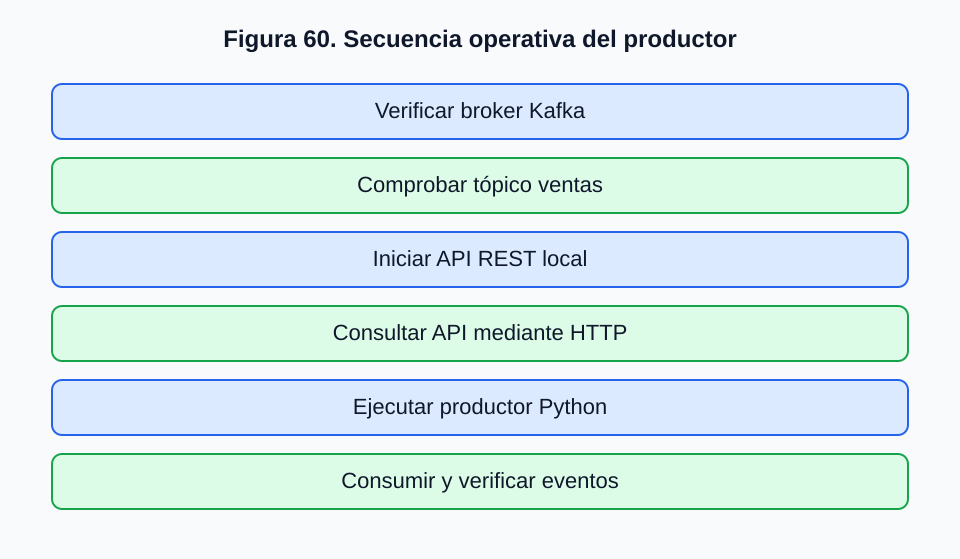

*Figura 60. Secuencia operativa de ejecución y verificación.*

Una salida **ilustrativa, no verificada en el laboratorio**, sería:

```text
Evento publicado: venta-V-1048-confirmada | partición=1 | offset=0
Evento publicado: venta-V-1049-confirmada | partición=2 | offset=0
Evento publicado: venta-V-1050-rechazada | partición=0 | offset=0
Total de eventos publicados: 3
```

Las particiones y offsets reales dependen del tópico, su historial y el particionador. Verificar por etapas permite separar errores de API, Kafka y transformación.

#### 2.7.12. Verificación de eventos publicados

Archivo `verificar_eventos.py`:

```python
import json
import os

from kafka import KafkaConsumer

SERVIDOR = os.getenv(
    "KAFKA_BOOTSTRAP_SERVERS",
    "localhost:9092"
)

consumidor = KafkaConsumer(
    "ventas",
    bootstrap_servers=SERVIDOR,
    auto_offset_reset="earliest",
    group_id="verificacion-ventas",
    value_deserializer=lambda valor: json.loads(
        valor.decode("utf-8")
    )
)

try:
    for mensaje in consumidor:
        print(
            f"Partición: {mensaje.partition} | "
            f"Offset: {mensaje.offset}"
        )

        print(
            json.dumps(
                mensaje.value,
                ensure_ascii=False,
                indent=2
            )
        )

finally:
    consumidor.close()
```

El consumidor muestra registros disponibles y permanece esperando eventos nuevos. `auto_offset_reset="earliest"` no fuerza reiniciar desde cero si el grupo ya tiene offsets confirmados válidos; para repetir la prueba puede requerirse un grupo nuevo o administrar offsets.

#### 2.7.13. Diferencia entre envío, confirmación y procesamiento

Debemos distinguir: el productor **invoca el envío**; Kafka **confirma la publicación** según configuración; un consumidor **procesa posteriormente** el registro.

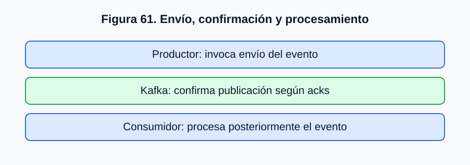

*Figura 61. Diferencia entre envío del productor, confirmación del broker y procesamiento del consumidor.*

Que `resultado.get()` devuelva metadatos no demuestra que una aplicación analítica haya terminado su trabajo. Para comprobar procesamiento se debe observar el consumidor o sistema de destino.

#### 2.7.14. Limitaciones de la implementación inicial

La aplicación consulta una sola vez; no incorpora ejecución periódica. Publica todas las ventas obtenidas y, si se ejecuta dos veces, puede repetir registros. La gestión de errores es simplificada y no conserva puntos de control entre ejecuciones. La API es estática, no una fuente que produzca transacciones continuamente.

Estas limitaciones permiten reconocer la diferencia entre demostración y operación permanente.

#### 2.7.15. Hacia un productor periódico con control de duplicados

Una evolución sería consultar cada 30 segundos, pero **agregar una espera no resuelve la duplicación**. Debemos identificar registros ya publicados y mantener estado de extracción.

Un conjunto de identificadores en memoria se pierde al reiniciar. Persistirlos en un archivo o base de datos mejora la recuperación, aunque subsiste un problema: el productor puede publicar correctamente y fallar antes de registrar el identificador como procesado. Al reiniciar, podría volver a publicarlo.

Por ello, la deduplicación y recuperación robustas pueden requerir identificadores estables, operaciones idempotentes y coordinación entre confirmación de Kafka y estado de extracción.

#### 2.7.16. Actividad práctica propuesta

El estudiante ejecutará la API, verificará su respuesta HTTP, publicará ventas en Kafka y utilizará un consumidor para comprobar los eventos. Luego incorporará una venta, ejecutará nuevamente el productor y analizará los duplicados.

| Desafío | Evidencia esperada |
|---|---|
| Verificar API | Respuesta JSON por HTTP |
| Publicar | Confirmaciones con partición y offset |
| Consumir | Eventos visualizados |
| Agregar venta | Nuevo registro disponible |
| Ejecutar dos veces | Explicación de duplicados |
| Simular error | Análisis del comportamiento |

La finalidad no es solo ejecutar comandos: se espera explicar el recorrido de la información y reconocer las limitaciones del sistema.

#### 2.7.17. Síntesis del apartado

Construimos una integración docente entre API REST y Kafka mediante Python: organización de archivos, API local Flask, estructura de eventos, validación, serialización, productor y consumidor de verificación. Diferenciamos envío, confirmación y procesamiento, y analizamos los límites de una solución sin periodicidad ni estado persistente.

El apartado **2.8. Implementación de flujos en tiempo real y Near Real-Time** profundizará en ejecución continua, frecuencia, latencia y recuperación.

---

### 2.8. Implementación de flujos en tiempo real y Near Real-Time

#### 2.8.1. De la integración puntual al procesamiento continuo

En el apartado 2.7 desarrollamos una aplicación Python capaz de consultar una API REST, transformar los registros obtenidos y publicarlos en un tópico Kafka. Comprendimos el recorrido de los datos desde una fuente externa hasta el sistema de mensajería distribuida. Sin embargo, nuestro productor consultaba una sola vez y terminaba.

En organizaciones que registran ventas durante toda la jornada, actualizan asistencia académica o reciben continuamente mediciones, los datos no constituyen un conjunto cerrado. Se generan, modifican y reciben a lo largo del tiempo. Necesitamos evolucionar hacia una arquitectura que incorpore información de manera continua o periódica, con retrasos compatibles con las necesidades del sistema.

Este apartado diferencia batch, Near Real-Time y streaming, y examina los desafíos de la ejecución prolongada de productores Kafka.

#### 2.8.2. ¿Qué significa realmente procesar datos en tiempo real?

En lenguaje cotidiano, *tiempo real* suele significar rapidez. Técnicamente, un sistema de tiempo real es aquel cuya corrección depende tanto del resultado como del cumplimiento de restricciones temporales. En control industrial, una respuesta tardía puede ser inútil aunque sea correcta.

En analítica de datos se emplea a menudo «tiempo real» para flujos con baja latencia. **Kafka no garantiza por sí solo que toda una arquitectura cumpla plazos estrictos de tiempo real**: la latencia depende de fuentes, productores, red, broker, consumidores y sistemas posteriores.

| Modalidad | Característica principal | Ejemplo |
|---|---|---|
| Batch | Procesamiento en conjuntos o intervalos programados | Consolidación diaria de ventas |
| Near Real-Time (NRT) | Actualizaciones con retrasos relativamente pequeños y aceptables | Consulta API cada 30 segundos |
| Streaming | Eventos incorporados y procesados continuamente a medida que están disponibles | Publicación de cada transacción al producirse |

No existen límites temporales universales entre estas categorías. Treinta segundos pueden ser adecuados para un tablero comercial e inaceptables para un sistema de seguridad.

#### 2.8.3. Generación, disponibilidad y procesamiento de eventos

Supongamos que una venta ocurre a las 11:35:00, está disponible en la API a las 11:35:03, se publica en Kafka a las 11:35:31 y se procesa a las 11:35:33. Distinguimos:

- **Tiempo del evento:** momento de la venta.
- **Tiempo de disponibilidad:** momento en que la fuente permite recuperarla.
- **Tiempo de publicación:** incorporación a Kafka.
- **Tiempo de procesamiento:** ejecución de la operación del consumidor.


*Figura 62. Línea temporal ilustrativa de un evento, no medida en el laboratorio.*

La latencia extremo a extremo se calcula como:

```text
L_total = t_procesamiento - t_evento
L_total = 33 segundos
```

Entre la publicación Kafka y el procesamiento transcurren solamente dos segundos. La mayor parte del retraso está en la fuente o frecuencia de consulta. **Un broker rápido no implica una arquitectura de baja latencia extremo a extremo.**

#### 2.8.4. Latencia, throughput y frecuencia de actualización

**Latencia** es el tiempo transcurrido entre dos momentos definidos; debemos especificarlos. **Throughput** es la cantidad de registros o volumen procesado por unidad de tiempo. **Frecuencia de actualización** es la periodicidad con que una fuente obtiene o entrega datos.

No son equivalentes: un productor puede publicar 10.000 eventos por segundo y trabajar con información generada horas antes. Consultar una API cada segundo tampoco garantiza que la API actualice sus datos a esa frecuencia.

La arquitectura debe evaluar conjuntamente capacidad de procesamiento y oportunidad temporal de la información.

#### 2.8.5. Arquitectura Near Real-Time mediante consultas periódicas

Una forma sencilla de evolucionar el productor consiste en consultar la API cada treinta segundos. El ciclo será: consultar, identificar registros nuevos o modificados, validar, publicar, registrar el estado y esperar la siguiente ejecución.


*Figura 63. Ciclo conceptual de consulta periódica y publicación.*

La estrategia puede ser adecuada cuando no se requieren latencias de milisegundos. Pero las consultas pueden durar más de lo previsto, fallar o devolver datos repetidos. La ejecución periódica necesita control de errores y estado.

#### 2.8.6. Construcción de un productor periódico

Podemos extender el productor de 2.7 mediante un ciclo:

```python
import time

INTERVALO_SEGUNDOS = 30

while True:
    try:
        publicar_ventas()

    except Exception as error:
        print(
            f"Error durante la ejecución: {error}"
        )

    time.sleep(INTERVALO_SEGUNDOS)
```

Este fragmento muestra la estructura, **no una solución completa**. Con la función original `publicar_ventas()`, cada consulta republicaría todas las ventas. La periodicidad requiere controlar registros procesados.

Además, `time.sleep(30)` espera treinta segundos *después* de terminar la ejecución: si consulta y publicación tardan diez segundos, los inicios de ejecución estarán separados aproximadamente cuarenta segundos.

#### 2.8.7. Intervalos fijos y duración variable de consultas

Con una espera posterior de treinta segundos:

| Ejecución | Inicio | Duración | Siguiente inicio |
|---|---|---|---|
| 1 | 11:00:00 | 5 s | 11:00:35 |
| 2 | 11:00:35 | 20 s | 11:01:25 |
| 3 | 11:01:25 | 8 s | 11:02:03 |

Este mecanismo es sencillo y evita superposición dentro de un mismo ciclo. Una planificación con horarios fijos requiere otra estrategia. Si nuevas ejecuciones comienzan mientras las anteriores siguen activas, podrían producirse consultas simultáneas, duplicados y sobrecarga de la API, salvo que el sistema gestione explícitamente esa concurrencia.

#### 2.8.8. Control de duplicados mediante identificadores

Nuestra API contiene `id_venta`. Una primera aproximación es conservar los identificadores ya procesados:

```python
ventas_procesadas = set()

def es_venta_nueva(venta):
    identificador = venta["id_venta"]

    if identificador in ventas_procesadas:
        return False

    return True
```

Después de confirmar la publicación:

```python
ventas_procesadas.add(
    venta["id_venta"]
)
```

Esto evita repeticiones mientras el proceso sigue activo, pero el conjunto se pierde al terminar. Además, si una venta cambia de estado, su identificador permanece igual y podríamos ignorar la modificación.

Debemos distinguir **detectar registros nuevos** de **detectar nuevas versiones de registros existentes**.

#### 2.8.9. Persistencia del estado de extracción

Un productor recuperable conserva información sobre el trabajo realizado, mediante un *checkpoint* o punto de control. Puede guardar fecha de modificación, último identificador, cursor de API o combinación de atributos.

Ejemplo docente:

```json
{
  "ultima_ejecucion": "2026-10-29T11:35:30-03:00",
  "ventas_procesadas": [
    "V-1048",
    "V-1049",
    "V-1050"
  ]
}
```

La última ejecución no equivale necesariamente al último evento. Conservar solo identificadores impide detectar modificaciones posteriores; podría ser necesario registrar versiones o fechas de cambio. Si la API proporciona un cursor incremental, conviene evaluar su uso. La elección depende del contrato de la fuente.

#### 2.8.10. Publicación y confirmación del checkpoint

Consideremos dos secuencias.

**Publicar primero:** se obtiene una venta, Kafka confirma la publicación y el productor falla antes de guardar el checkpoint. Tras reiniciar, la venta podría publicarse de nuevo: **riesgo de duplicación**.

**Guardar primero:** se registra la venta como procesada, pero falla la publicación. Al reiniciar, la venta se omite: **riesgo de pérdida**.


*Figura 64. Riesgos de duplicación o pérdida según el orden entre publicación y checkpoint.*

Guardar un archivo de estado no resuelve por sí solo la coordinación entre publicación y extracción. Este es un problema central en ingeniería de datos distribuida.

#### 2.8.11. Semánticas de entrega

| Semántica | Característica | Riesgo principal |
|---|---|---|
| At-most-once | El evento puede entregarse una vez o no entregarse | Pérdida |
| At-least-once | Se procura entregar una o más veces | Duplicación |
| Exactly-once | Se evita duplicar el efecto de una operación dentro de un alcance definido | Complejidad |

Kafka dispone, en versiones compatibles, de productores idempotentes y transacciones. **Esto no convierte automáticamente en exactamente una vez una integración que consulta una API REST y guarda su estado en un archivo externo.** Las garantías dependen de componentes y límites transaccionales.

Para el laboratorio podemos favorecer at-least-once, identificadores estables y consumidores preparados para detectar duplicados.

#### 2.8.12. Idempotencia en el procesamiento

Una operación idempotente produce el mismo efecto observable al repetirse. Establecer `estado = "confirmada"` puede ser idempotente; sumar el monto de la venta a un acumulado no lo es necesariamente.

```text
Total acumulado = Total acumulado + 45990
```

Si se ejecuta dos veces, incrementa el total en $91.980. El consumidor debe diseñarse para evitar que un evento repetido altere dos veces los resultados, por ejemplo mediante identificadores de eventos aplicados y controles consistentes con el destino.

#### 2.8.13. Manejo de fallos y reintentos

Una integración continua debe asumir errores de conectividad, respuestas HTTP, límites de solicitudes, reinicios del broker, JSON malformado, excepciones de transformación y fallos de checkpoint.

No todos los errores se tratan igual. HTTP 429 puede exigir respetar `Retry-After`; HTTP 401 normalmente requiere revisar credenciales. Reintentos para fallos transitorios pueden aplicar *exponential backoff*:

| Intento | Espera ilustrativa |
|---|---:|
| 1 | 1 s |
| 2 | 2 s |
| 3 | 4 s |
| 4 | 8 s |

En producción se consideran máximos, *jitter* y políticas del proveedor. Los valores anteriores son ilustrativos.

#### 2.8.14. Backpressure y capacidad de procesamiento

**Backpressure** describe mecanismos para manejar una producción superior a la capacidad de una etapa posterior. Si un productor publica 5.000 eventos/s y un consumidor procesa 3.000, la diferencia es 2.000 eventos/s. En un minuto se acumularían aproximadamente 120.000 eventos, bajo tasas constantes.


*Figura 65. Ejemplo ilustrativo de producción superior al consumo.*

Kafka desacopla productores y consumidores, permitiendo procesar posteriormente eventos disponibles conforme a retención. Pero la acumulación implica necesidades de almacenamiento, dimensionamiento y recuperación; no puede crecer indefinidamente sin consecuencias.

#### 2.8.15. Consumer lag como indicador operacional

El *consumer lag* expresa el retraso de un grupo respecto de los registros disponibles. Aproximadamente, puede calcularse como diferencia entre offset final siguiente y offset confirmado siguiente:

| Partición | Offset final siguiente | Offset confirmado siguiente | Lag |
|---|---:|---:|---:|
| 0 | 1.250 | 1.200 | 50 |
| 1 | 1.500 | 1.350 | 150 |
| 2 | 1.100 | 1.050 | 50 |
| **Total** | | | **250** |

**Un lag de 250 registros no equivale directamente a 250 segundos.** Para estimar retrasos temporales necesitamos tasas, tiempos y marcas temporales. Un consumidor puede haber leído registros sin confirmar todavía sus offsets; el indicador debe interpretarse junto con otras métricas.

#### 2.8.16. Monitoreo de una integración Near Real-Time

No basta con que el proceso permanezca activo. Debemos observar si obtiene datos nuevos, publica y mantiene una latencia aceptable.

| Métrica | Qué permite observar |
|---|---|
| Última consulta exitosa | Actividad de la API |
| Duración de consulta | Rendimiento HTTP |
| Registros recuperados | Volumen de origen |
| Eventos publicados | Publicaciones confirmadas |
| Registros descartados | Problemas de validación |
| Errores HTTP | Disponibilidad del servicio |
| Fallos de publicación | Comunicación con Kafka |
| Edad del último evento | Actualidad de los datos |
| Consumer lag | Trabajo pendiente |

Un productor puede consultar cada treinta segundos y recibir siempre los mismos registros. Está activo, pero no incorpora eventos nuevos. A la inversa, la fuente podría legítimamente no tener nuevas ventas. La observabilidad debe considerar el comportamiento esperado.

#### 2.8.17. Arquitectura Near Real-Time más robusta

La solución mejorada consulta una API, valida la respuesta, compara con estado persistido, publica registros nuevos o modificados y registra el progreso. También mantiene métricas, errores y resultados.


*Figura 66. Arquitectura conceptual de referencia; los componentes de recuperación y monitoreo requieren implementación específica.*

Esta arquitectura mejora la operación, pero actualizar el checkpoint después de publicar no garantiza por sí solo exactamente una vez. La confiabilidad requiere decisiones coordinadas entre fuente, productor, Kafka y consumidor.

#### 2.8.18. Actividad práctica: evolución del productor 2.7

El estudiante evolucionará el productor por etapas: intervalo configurable, control básico de ventas publicadas, registro de ejecuciones y simulación de interrupciones.

| Etapa | Desarrollo | Evidencia esperada |
|---|---|---|
| 1 | Consulta periódica | Varias ejecuciones registradas |
| 2 | Control en memoria | No republicar ventas sin cambios durante la ejecución |
| 3 | Estado persistente | Recuperación básica tras reinicio |
| 4 | Manejo de errores | Registro de fallos y reintentos |
| 5 | Análisis de confiabilidad | Riesgos de duplicación y pérdida |

No se pretende implementar exactamente una vez a escala empresarial, sino comprender los mecanismos adicionales necesarios para operar continuamente.

#### 2.8.19. Síntesis del apartado

Estudiamos la evolución desde una integración puntual hacia un flujo Near Real-Time. Distinguimos batch, Near Real-Time y streaming; analizamos tiempos de generación, disponibilidad, publicación y procesamiento, junto con latencia, throughput y frecuencia. Examinamos ejecución periódica, duplicados, checkpoints, semánticas de entrega, idempotencia, reintentos, backpressure y consumer lag. Finalmente propusimos recuperación y monitoreo como elementos esenciales.

En **2.9. Integración de Kafka con Apache Spark Structured Streaming** estudiaremos cómo consumir eventos, interpretar mensajes JSON y aplicar transformaciones analíticas mediante un motor de procesamiento distribuido.

---

### 2.9. Integración de Kafka con Apache Spark Structured Streaming

#### 2.9.1. De la distribución de eventos al procesamiento distribuido

En los apartados anteriores construimos progresivamente una arquitectura de integración de datos basada en Apache Kafka.

Primero estudiamos la publicación y el consumo de eventos. Posteriormente, incorporamos fuentes externas mediante APIs REST y desarrollamos un productor Python capaz de transformar registros comerciales y publicarlos en un tópico. Finalmente, examinamos los mecanismos necesarios para evolucionar hacia una integración Near Real-Time, considerando latencia, duplicados, puntos de control y recuperación ante fallos.

Sin embargo, hasta ahora nuestros consumidores se han limitado principalmente a recuperar y mostrar los mensajes recibidos.

En una plataforma de Big Data, el objetivo suele ser más amplio: necesitamos **transformar, filtrar, agregar y analizar grandes volúmenes de eventos de manera continua**.

Por ejemplo, una empresa podría necesitar conocer el monto de las ventas confirmadas, identificar transacciones rechazadas o calcular indicadores comerciales a partir de los eventos publicados en Kafka.

Para desarrollar estas operaciones incorporaremos Apache Spark.

Spark es un motor de procesamiento distribuido que permite ejecutar transformaciones y análisis sobre conjuntos de datos. Mediante Structured Streaming, podemos utilizar la API de DataFrames para procesar información que llega continuamente desde fuentes compatibles.

La integración de ambas tecnologías establece una separación de responsabilidades:

**Kafka transporta y conserva los eventos; Spark los interpreta y procesa.**

Esta distinción es fundamental. Kafka no reemplaza al motor analítico y Spark no reemplaza necesariamente a la plataforma de distribución de eventos.

#### 2.9.2. ¿Qué es Apache Spark Structured Streaming?

Structured Streaming es un componente de Apache Spark que permite expresar operaciones sobre flujos de datos utilizando abstracciones estructuradas, especialmente DataFrames.

Desde la perspectiva del desarrollador, muchas transformaciones se parecen a las que aplicaríamos sobre datos estáticos.

Por ejemplo, podemos seleccionar columnas, filtrar registros y realizar agrupaciones.

La diferencia es que, en lugar de trabajar exclusivamente con un conjunto de datos cerrado, la consulta puede ejecutarse continuamente mientras se incorporan nuevos registros.

En Spark 2.4, versión de referencia de nuestro laboratorio, Structured Streaming utiliza principalmente un modelo de ejecución basado en **micro-batches**.

Esto significa que el motor organiza los registros disponibles en pequeños lotes sucesivos y aplica sobre ellos las transformaciones definidas.

No debemos confundir este mecanismo con el procesamiento estrictamente individual e inmediato de cada evento.


*Figura 67. Kafka recibe eventos desde el productor y Spark ejecuta las transformaciones analíticas.*

Structured Streaming no obliga a escribir manualmente un ciclo que consulte Kafka cada cierto número de segundos.

El motor administra la ejecución de la consulta, la obtención de registros y el progreso del procesamiento, de acuerdo con la configuración utilizada.

#### 2.9.3. Procesamiento por micro-batches

Para comprender el funcionamiento de Spark 2.4, consideremos que nuestro tópico `ventas` recibe eventos continuamente.

Structured Streaming puede procesar los registros disponibles mediante una secuencia de micro-batches.

| Micro-batch | Registros recibidos | Operación |
|---|---|---|
| 1 | V-1048, V-1049 | Transformar y filtrar |
| 2 | V-1050 | Transformar y filtrar |
| 3 | V-1051, V-1052, V-1053 | Transformar y filtrar |
| 4 | Sin registros nuevos | Esperar o ejecutar ciclo sin nuevos datos, según configuración |

Los lotes no necesariamente contienen la misma cantidad de eventos.

Su composición depende de la disponibilidad de datos, del intervalo de activación, del progreso de la consulta y de otros parámetros de ejecución.


*Figura 68. Representación conceptual. Los tamaños de lote y su periodicidad dependen de la ejecución real.*

El modelo permite aprovechar las capacidades de procesamiento distribuido de Spark sin exigir que el estudiante implemente directamente la administración de cada lote.

No obstante, introduce una consideración importante: la latencia depende también de la frecuencia de activación y del tiempo que Spark necesita para completar las operaciones.

#### 2.9.4. Compatibilidad entre Kafka y Spark en nuestro laboratorio

Antes de escribir código, debemos examinar un aspecto técnico fundamental.

Nuestro laboratorio utiliza una infraestructura Docker con Kafka y una instalación de Spark 2.4.0 como referencia.

En esta versión, Structured Streaming dispone de integración con Kafka, pero requiere el conector correspondiente.

No basta con importar `pyspark` y asumir que cualquier instalación puede leer tópicos Kafka.

El conector se distribuye mediante un artefacto compatible con la versión de Spark y con la versión de Scala utilizada en su compilación.

Para una distribución estándar de Spark 2.4.0 compilada con Scala 2.11, el artefacto de referencia es:

```text
org.apache.spark:spark-sql-kafka-0-10_2.11:2.4.0
```

La parte `_2.11` corresponde a la versión binaria de Scala y `2.4.0` a la versión del conector Spark.

Este identificador no debe copiarse indiscriminadamente a cualquier instalación.

Antes de utilizarlo debemos comprobar:

- La versión efectiva de Spark.
- La versión binaria de Scala utilizada.
- La disponibilidad del conector.
- El acceso a las dependencias necesarias.
- La conectividad entre Spark y Kafka.

En una distribución estándar de Spark 2.4.0 con Scala 2.11, podemos intentar iniciar PySpark mediante:

```bash
pyspark \
  --packages org.apache.spark:spark-sql-kafka-0-10_2.11:2.4.0
```

El comando requiere que las dependencias puedan resolverse y que la distribución admita esa configuración.

Si el entorno no dispone de acceso a repositorios de paquetes, podría ser necesario proporcionar los archivos JAR mediante otro procedimiento.

Por tanto, este comando representa una configuración de referencia y no una ejecución verificada en los contenedores del laboratorio.

#### 2.9.5. Arquitectura de ejecución: driver, ejecutores y Kafka

Cuando Spark ejecuta una consulta distribuida, debemos distinguir entre el proceso conductor (*driver*) y los ejecutores (*executors*).

El driver coordina la aplicación y la ejecución de la consulta.

Los ejecutores realizan tareas distribuidas según la configuración del entorno.

Kafka, por su parte, almacena los eventos en particiones.

La lectura de un tópico permite que Spark organice tareas de procesamiento sobre los registros disponibles.


*Figura 69. Representación didáctica simplificada. La planificación real de tareas depende de Spark y de su configuración.*

No debemos interpretar la figura como una garantía de que cada partición se asignará permanentemente a un ejecutor exclusivo.

La planificación de tareas depende del motor de ejecución.

Asimismo, el número de particiones influye en las posibilidades de paralelismo, pero no determina por sí solo el rendimiento final.

#### 2.9.6. Lectura de un tópico Kafka mediante Structured Streaming

Comenzaremos construyendo una consulta que lea eventos desde el tópico `ventas`.

El siguiente código representa el punto de partida:

```python
from pyspark.sql import SparkSession

spark = (
    SparkSession.builder
    .appName("KafkaVentasStreaming")
    .getOrCreate()
)

eventos_kafka = (
    spark.readStream
    .format("kafka")
    .option(
        "kafka.bootstrap.servers",
        "localhost:9092"
    )
    .option(
        "subscribe",
        "ventas"
    )
    .option(
        "startingOffsets",
        "earliest"
    )
    .load()
)
```

Analicemos las instrucciones.

`SparkSession` proporciona el punto de entrada a las funcionalidades estructuradas de Spark.

`readStream` indica que deseamos construir una fuente de datos de streaming.

`format("kafka")` identifica el conector.

`kafka.bootstrap.servers` establece las direcciones iniciales para comunicarse con Kafka.

`subscribe` indica el tópico que deseamos consumir.

`startingOffsets` permite definir el comportamiento inicial cuando la consulta no dispone de un estado de recuperación previo.

En este ejemplo utilizamos `earliest` para facilitar la observación de eventos históricos todavía disponibles.

Sin embargo, **esta configuración no obliga a releer todos los eventos cada vez que reiniciamos una consulta que ya dispone de un checkpoint válido**.

Cuando Spark recupera el estado de una consulta, utiliza la información correspondiente para determinar su progreso.

La dirección `localhost:9092` es solamente un ejemplo. Debe sustituirse por un listener accesible desde el proceso Spark.

#### 2.9.7. Estructura de los registros recibidos desde Kafka

Cuando Structured Streaming lee un tópico Kafka, no recibe automáticamente las columnas comerciales que definimos en el productor.

En su lugar, obtiene un DataFrame con información propia del registro Kafka.

Entre los campos habituales se encuentran:

| Campo | Tipo conceptual | Significado |
|---|---|---|
| `key` | Binario | Clave del registro |
| `value` | Binario | Contenido del mensaje |
| `topic` | Texto | Tópico de origen |
| `partition` | Entero | Partición |
| `offset` | Entero largo | Posición del registro |
| `timestamp` | Marca temporal | Timestamp del registro Kafka |
| `timestampType` | Entero | Tipo de timestamp |

La información comercial está contenida en `value`, que inicialmente se presenta como dato binario.

Por tanto, necesitamos transformar ese contenido en texto y posteriormente interpretar el JSON.

Este paso es importante porque **Kafka no impone automáticamente a Spark el esquema de negocio de nuestros mensajes**.

#### 2.9.8. Conversión del contenido binario a texto

Para inspeccionar el mensaje podemos seleccionar algunas columnas y convertir el valor binario a cadena.

```python
from pyspark.sql.functions import col

mensajes_texto = eventos_kafka.select(
    col("topic"),
    col("partition"),
    col("offset"),
    col("timestamp"),
    col("key").cast("string").alias(
        "clave"
    ),
    col("value").cast("string").alias(
        "mensaje_json"
    )
)
```

La operación `cast("string")` permite interpretar los bytes como texto en el formato esperado por nuestro productor.

Recordemos que en el apartado 2.7 serializamos los eventos mediante JSON y codificación UTF-8.

Por tanto, la transformación es coherente con el contrato de publicación.

El resultado conceptual sería:

| topic | partition | offset | clave | mensaje_json |
|---|---:|---:|---|---|
| ventas | 0 | 15 | C-025 | `{"id_evento":...}` |
| ventas | 1 | 21 | C-103 | `{"id_evento":...}` |

Los valores de partición y offset son ilustrativos.

En esta etapa todavía no hemos extraído las propiedades internas del JSON.

#### 2.9.9. Definición explícita del esquema JSON

Structured Streaming puede trabajar con datos estructurados, pero debemos proporcionar un esquema que represente los eventos recibidos.

Nuestro productor genera mensajes con metadatos y un objeto anidado `datos`.

Podemos definir el esquema mediante los tipos de PySpark:

```python
from pyspark.sql.types import (
    StructType,
    StructField,
    StringType,
    IntegerType,
    LongType
)

esquema_venta = StructType([
    StructField(
        "id_evento",
        StringType(),
        True
    ),
    StructField(
        "tipo_evento",
        StringType(),
        True
    ),
    StructField(
        "version",
        IntegerType(),
        True
    ),
    StructField(
        "fecha_evento",
        StringType(),
        True
    ),
    StructField(
        "datos",
        StructType([
            StructField(
                "id_venta",
                StringType(),
                True
            ),
            StructField(
                "id_cliente",
                StringType(),
                True
            ),
            StructField(
                "monto_total",
                LongType(),
                True
            ),
            StructField(
                "moneda",
                StringType(),
                True
            ),
            StructField(
                "estado",
                StringType(),
                True
            )
        ]),
        True
    )
])
```

El esquema describe la estructura esperada del JSON.

Utilizamos `LongType` para el monto, considerando que los valores monetarios enteros podrían superar el rango de un entero de 32 bits.

Esto no significa que `LongType` sea siempre la representación más adecuada para información financiera.

En sistemas que requieren decimales exactos, debe evaluarse el uso de tipos decimales y reglas explícitas de precisión.

La elección del tipo depende del significado de los datos y del contrato de origen.

#### 2.9.10. Interpretación del JSON mediante from_json

Una vez definido el esquema, podemos utilizar la función `from_json` para transformar el texto del mensaje en una estructura accesible mediante columnas.

```python
from pyspark.sql.functions import (
    col,
    from_json
)

eventos_estructurados = (
    mensajes_texto
    .withColumn(
        "evento",
        from_json(
            col("mensaje_json"),
            esquema_venta
        )
    )
)
```

La columna `evento` contendrá una estructura con los atributos definidos.

Podemos seleccionar los campos comerciales:

```python
ventas = eventos_estructurados.select(
    col("evento.id_evento").alias(
        "id_evento"
    ),
    col("evento.tipo_evento").alias(
        "tipo_evento"
    ),
    col("evento.fecha_evento").alias(
        "fecha_evento"
    ),
    col("evento.datos.id_venta").alias(
        "id_venta"
    ),
    col("evento.datos.id_cliente").alias(
        "id_cliente"
    ),
    col("evento.datos.monto_total").alias(
        "monto_total"
    ),
    col("evento.datos.moneda").alias(
        "moneda"
    ),
    col("evento.datos.estado").alias(
        "estado"
    )
)
```

De esta manera, los eventos Kafka se transforman en registros tabulares.


*Figura 70. Conversión del valor binario Kafka en texto JSON y columnas de DataFrame mediante un esquema explícito.*

Debemos recordar que un mensaje JSON inválido o incompatible con el esquema puede producir campos nulos o registros que requieren tratamiento especial, según el modo de análisis configurado.

Por tanto, en una aplicación productiva es recomendable conservar información del registro original para diagnosticar problemas de transformación.

#### 2.9.11. Filtrado de eventos mediante DataFrames

Una vez que disponemos de columnas estructuradas, podemos aplicar operaciones analíticas.

Por ejemplo, seleccionar únicamente las ventas confirmadas:

```python
ventas_confirmadas = ventas.filter(
    col("estado") == "confirmada"
)
```

Esta transformación se aplicará a los registros procesados por la consulta.

También podemos seleccionar transacciones cuyo monto sea superior a un determinado umbral:

```python
ventas_mayores = ventas_confirmadas.filter(
    col("monto_total") >= 50000
)
```

Las operaciones son similares a las utilizadas sobre DataFrames estáticos.

Sin embargo, en Structured Streaming se ejecutan dentro de una consulta continua y están sujetas a las restricciones del motor.

No todas las operaciones disponibles sobre DataFrames batch pueden aplicarse de la misma manera sobre un DataFrame de streaming.

#### 2.9.12. Agregaciones sobre eventos de ventas

Supongamos que deseamos calcular el monto total de las ventas confirmadas por cliente.

Podemos expresar la operación mediante:

```python
from pyspark.sql.functions import sum as spark_sum

ventas_por_cliente = (
    ventas_confirmadas
    .groupBy("id_cliente")
    .agg(
        spark_sum("monto_total").alias(
            "total_ventas"
        )
    )
)
```

Esta operación es una agregación con estado.

A diferencia de un filtro, que puede procesar cada registro de manera independiente, una agregación debe mantener información acumulada entre micro-batches.

Por ejemplo, si el cliente `C-025` registra tres ventas confirmadas de $45.990, $20.000 y $34.000, el resultado acumulado será:

```text
45.990 + 20.000 + 34.000 = 99.990
```

Sin embargo, el resultado dependerá de los registros efectivamente procesados.

Si la fuente publica duplicados y no incorporamos una estrategia de deduplicación, los montos podrían contarse más de una vez.

Por ello, las garantías de entrega y la calidad de los datos afectan directamente a los indicadores analíticos.

#### 2.9.13. Modos de salida de Structured Streaming

Structured Streaming permite definir cómo se entregan los resultados de una consulta.

En Spark 2.4, los modos principales son:

| Modo | Comportamiento general |
|---|---|
| Append | Entrega filas nuevas que se consideran definitivas según la operación |
| Update | Entrega filas que se actualizaron en el ciclo |
| Complete | Entrega la tabla completa de resultados en cada activación |

Estos modos no son intercambiables para todas las consultas.

Por ejemplo, una agregación acumulada por cliente puede utilizar `complete` con una salida compatible, mientras que `append` no resulta apropiado para una agregación global cuyo resultado continúa cambiando.

Además, cada destino o *sink* admite determinados modos.

Para fines docentes, utilizaremos la consola con `complete` al mostrar una agregación acumulada.

#### 2.9.14. Visualización de resultados en la consola

Podemos iniciar una consulta que muestre el resultado de `ventas_por_cliente`:

```python
consulta = (
    ventas_por_cliente.writeStream
    .format("console")
    .outputMode("complete")
    .option("truncate", "false")
    .start()
)

consulta.awaitTermination()
```

La llamada `writeStream` define la salida.

`format("console")` indica que deseamos visualizar los resultados en la consola del proceso.

`outputMode("complete")` entrega la tabla completa de la agregación.

`start()` inicia la consulta.

`awaitTermination()` mantiene el programa esperando mientras la consulta continúa activa.

Una salida ilustrativa podría contener:

```text
+----------+------------+
|id_cliente|total_ventas|
+----------+------------+
|C-025     |99990       |
|C-103     |52990       |
+----------+------------+
```

Esta salida no corresponde a una ejecución verificada en el laboratorio.

El destino de consola es apropiado para aprendizaje y depuración, pero no constituye una solución de almacenamiento analítico persistente.

#### 2.9.15. Checkpoints y recuperación de consultas Spark

En el apartado 2.8 estudiamos la importancia de conservar puntos de control.

Structured Streaming también utiliza checkpoints para registrar información necesaria para recuperar el progreso de determinadas consultas.

Podemos configurar una ubicación de checkpoint:

```python
consulta = (
    ventas_por_cliente.writeStream
    .format("console")
    .outputMode("complete")
    .option(
        "checkpointLocation",
        "/tmp/checkpoints/ventas_por_cliente"
    )
    .option(
        "truncate",
        "false"
    )
    .start()
)

consulta.awaitTermination()
```

En un entorno Docker, la ruta debe evaluarse cuidadosamente.

Una carpeta dentro del contenedor puede perderse si el contenedor se elimina y no existe un volumen persistente.

Además, una ruta local puede resultar inadecuada para determinados despliegues distribuidos si los componentes no comparten un almacenamiento compatible.

Por ello, en una arquitectura real debemos seleccionar una ubicación de almacenamiento confiable y accesible conforme al modo de despliegue.

También debemos considerar que no cualquier modificación a una consulta permite reutilizar su checkpoint anterior.

Cambiar esquemas, operaciones con estado o configuraciones fundamentales puede requerir una nueva consulta y un nuevo punto de control.

#### 2.9.16. Ventanas temporales y análisis de eventos

Una de las capacidades relevantes de Structured Streaming consiste en realizar agregaciones por ventanas temporales.

En lugar de calcular únicamente un total acumulado, podríamos necesitar conocer las ventas registradas en intervalos de cinco minutos.

Para ello debemos transformar la fecha del evento en un tipo temporal.

```python
from pyspark.sql.functions import (
    col,
    to_timestamp
)

ventas_con_tiempo = ventas.withColumn(
    "tiempo_evento",
    to_timestamp(
        col("fecha_evento")
    )
)
```

Posteriormente podemos definir una agregación por ventana:

```python
from pyspark.sql.functions import (
    window,
    sum as spark_sum
)

ventas_por_ventana = (
    ventas_con_tiempo
    .filter(
        col("estado") == "confirmada"
    )
    .groupBy(
        window(
            col("tiempo_evento"),
            "5 minutes"
        )
    )
    .agg(
        spark_sum("monto_total").alias(
            "total_ventas"
        )
    )
)
```

Esta consulta agrupa las ventas confirmadas según ventanas de cinco minutos.

Debemos recordar que `fecha_evento` representa el momento declarado por el productor, no necesariamente el momento en que Spark recibió el registro.

La interpretación correcta de las marcas temporales es fundamental cuando analizamos eventos que pueden llegar con retraso.

Además, el tratamiento de zonas horarias debe revisarse cuidadosamente: Spark interpreta y presenta timestamps según la configuración de la sesión y las funciones utilizadas.

#### 2.9.17. Watermarks y eventos atrasados

En sistemas distribuidos, los eventos no siempre llegan en el mismo orden en que ocurrieron.

Una transacción realizada a las 11:00 podría llegar a Kafka después de otra registrada a las 11:02.

Las causas pueden incluir interrupciones de conectividad, reintentos o demoras en la fuente.

Structured Streaming permite utilizar *watermarks* para administrar el estado de determinadas operaciones temporales y establecer una tolerancia a datos atrasados.

Por ejemplo:

```python
ventas_con_watermark = (
    ventas_con_tiempo
    .withWatermark(
        "tiempo_evento",
        "10 minutes"
    )
)
```

La configuración expresa una tolerancia de diez minutos respecto del progreso temporal observado por la consulta.

No significa que Spark espere exactamente diez minutos antes de procesar cada evento.

Tampoco significa que todos los registros que lleguen dentro de ese intervalo estén garantizados bajo cualquier circunstancia.

El comportamiento depende de la operación y del avance del watermark.


*Figura 71. La figura ilustra la llegada tardía; el comportamiento de descarte depende del watermark y de la consulta.*

Los watermarks resultan especialmente relevantes cuando se utilizan ventanas y agregaciones que deben administrar su estado a lo largo del tiempo.

#### 2.9.18. Consideraciones de rendimiento y paralelismo

La integración entre Kafka y Spark ofrece oportunidades de procesamiento distribuido, pero requiere una configuración coherente.

Entre los factores relevantes encontramos:

**Número de particiones Kafka.** Influye en las unidades de trabajo disponibles para la lectura.

**Recursos de Spark.** La cantidad de ejecutores, núcleos y memoria condiciona la capacidad de procesamiento.

**Complejidad de las transformaciones.** Un filtro simple no tiene el mismo costo que una agregación con estado.

**Volumen de eventos.** Las tasas de llegada pueden superar la capacidad de procesamiento.

**Frecuencia de micro-batches.** Una activación muy frecuente puede aumentar la sobrecarga operativa; una activación más espaciada puede incrementar la latencia.

**Estado acumulado.** Las consultas con agrupaciones y ventanas pueden necesitar conservar información entre lotes.

Estos factores deben analizarse conjuntamente.

Aumentar el número de particiones no garantiza automáticamente un mayor rendimiento.

De manera similar, incorporar más ejecutores no elimina los problemas de una fuente lenta o de una transformación ineficiente.

#### 2.9.19. Validación de la integración en el laboratorio

Para comprobar el funcionamiento de la arquitectura proponemos una secuencia de validación.

Primero, verificaremos que Kafka se encuentre disponible y que el tópico `ventas` exista.

Luego ejecutaremos el productor Python desarrollado en el apartado 2.7.

Posteriormente iniciaremos la aplicación Spark Structured Streaming y comprobaremos que puede leer los eventos.

Finalmente, evaluaremos las transformaciones y los resultados analíticos.

| Validación | Evidencia esperada |
|---|---|
| Kafka disponible | Broker accesible |
| Tópico existente | `ventas` disponible |
| Productor operativo | Eventos publicados |
| Conector Spark-Kafka | Fuente de streaming creada sin errores |
| Lectura de mensajes | Registros Kafka recibidos |
| Interpretación JSON | Campos comerciales extraídos |
| Filtrado | Ventas confirmadas seleccionadas |
| Agregación | Total por cliente actualizado |
| Checkpoint | Estado de consulta registrado |

La validación debe realizarse progresivamente.

Si Spark no logra conectarse a Kafka, debemos revisar la conectividad y las dependencias antes de atribuir el error a la transformación JSON.

Si la lectura funciona, pero los campos aparecen nulos, debemos revisar el esquema y el contenido real de los mensajes.

Esta separación facilita el diagnóstico.

#### 2.9.20. Actividad práctica: procesamiento de ventas en streaming

La actividad propuesta consiste en integrar el productor Python del apartado 2.7 con Spark Structured Streaming.

El estudiante deberá implementar una consulta que lea el tópico `ventas`, interprete el contenido JSON y seleccione las transacciones confirmadas.

Posteriormente calculará el monto acumulado por cliente y visualizará los resultados mediante la consola.

Como extensión, podrá incorporar una agregación por ventanas de cinco minutos y analizar el efecto de las marcas temporales.

| Etapa | Desarrollo | Evidencia |
|---|---|---|
| 1 | Conectar Spark con Kafka | Fuente de streaming operativa |
| 2 | Interpretar JSON | Esquema aplicado correctamente |
| 3 | Filtrar ventas | Registros confirmados |
| 4 | Agregar por cliente | Totales acumulados |
| 5 | Configurar checkpoint | Ruta de recuperación |
| 6 | Analizar ventanas | Resultados agrupados temporalmente |

La actividad debe acompañarse de una reflexión técnica.

Los estudiantes deberán explicar por qué Kafka y Spark cumplen funciones diferentes, cómo Structured Streaming organiza el procesamiento y qué limitaciones presenta una agregación cuando los eventos pueden llegar duplicados o atrasados.

#### 2.9.21. Síntesis del apartado

En este apartado incorporamos Apache Spark Structured Streaming a la arquitectura de integración basada en Kafka.

Explicamos cómo Spark permite transformar y analizar eventos mediante DataFrames, utilizando un modelo de micro-batches en la versión 2.4 del laboratorio.

Analizamos la compatibilidad del conector Spark-Kafka, la estructura de los registros recibidos, la conversión del contenido binario a texto y la interpretación de mensajes JSON mediante esquemas explícitos.

Posteriormente estudiamos filtros, agregaciones, modos de salida y checkpoints.

También introdujimos las ventanas temporales, los watermarks y las consideraciones de rendimiento asociadas al procesamiento distribuido.

Finalmente, propusimos una actividad práctica que integra el productor Python, Kafka y Spark Structured Streaming.

En el siguiente apartado, **2.10. Validación, monitoreo y tratamiento básico de errores**, consolidaremos los procedimientos necesarios para verificar el funcionamiento de toda la arquitectura, identificar problemas operacionales y documentar evidencias de ejecución.

---

**Observación técnica:** los ejemplos toman como referencia Spark 2.4.0 y su conector Kafka 0.10, pero no han sido ejecutados contra los contenedores reales del laboratorio. La compatibilidad de Scala, las dependencias y los listeners Kafka deberá comprobarse durante la validación práctica.

---

### 2.10. Validación, monitoreo y tratamiento básico de errores

#### 2.10.1. Introducción: de una aplicación funcional a una arquitectura verificable

A lo largo del Volumen II hemos construido progresivamente una arquitectura de integración de datos basada en Apache Kafka.

Comenzamos con la preparación del entorno Docker y la administración de tópicos. Posteriormente, estudiamos la publicación y el consumo de eventos, la estructuración de mensajes y la incorporación de información desde fuentes externas.

En los apartados 2.7 y 2.8 desarrollamos un productor Python que consulta una API REST y examinamos los mecanismos necesarios para convertir esa integración puntual en un flujo Near Real-Time.

Finalmente, en el apartado 2.9 incorporamos Apache Spark Structured Streaming para interpretar, transformar y analizar los eventos publicados.

Sin embargo, disponer de todos estos componentes no garantiza que el sistema funcione correctamente.

Una aplicación puede ejecutarse sin mostrar errores y, aun así, publicar registros duplicados. Un broker puede encontrarse disponible mientras determinados consumidores acumulan retrasos. Una consulta Spark puede permanecer activa, pero interpretar incorrectamente los mensajes JSON.

Por ello, necesitamos incorporar una última dimensión a nuestro trabajo: **la capacidad de verificar, observar y diagnosticar el funcionamiento de toda la arquitectura**.

Este apartado reúne procedimientos de validación funcional, monitoreo operacional y tratamiento básico de errores, utilizando como referencia el laboratorio desarrollado durante el curso.

Nuestro objetivo no será implementar una plataforma empresarial completa de observabilidad, sino establecer una metodología rigurosa para comprobar que los componentes funcionan de manera coordinada y que los resultados obtenidos son confiables.

#### 2.10.2. Objetivos de aprendizaje del apartado

Al finalizar este capítulo, el estudiante deberá ser capaz de:

1. Verificar la disponibilidad de los servicios Docker, Kafka y sus componentes asociados.
2. Comprobar la existencia y configuración de los tópicos utilizados por las aplicaciones.
3. Validar la publicación y el consumo de eventos mediante procedimientos reproducibles.
4. Identificar errores frecuentes de conectividad, serialización, configuración y procesamiento.
5. Interpretar indicadores básicos de operación, incluyendo offsets, particiones y consumer lag.
6. Reconocer problemas asociados con duplicados, retrasos y registros inválidos.
7. Verificar la integración entre Kafka y Spark Structured Streaming.
8. Documentar evidencias técnicas que permitan reproducir y diagnosticar problemas.

Estas competencias son relevantes porque, en ingeniería de datos, **un sistema no se considera correctamente implementado únicamente porque sus procesos se encuentren en ejecución**.

También debe existir evidencia de que los datos se reciben, transforman y procesan de acuerdo con las reglas establecidas.

#### 2.10.3. Arquitectura integral que debemos validar

Retomemos la arquitectura desarrollada en los capítulos anteriores.

Una API REST proporciona información de ventas.

Una aplicación Python consulta el servicio, valida los registros y publica eventos en Kafka.

El broker almacena los eventos en el tópico `ventas`.

Posteriormente, Spark Structured Streaming consume esos registros, interpreta su estructura JSON y ejecuta transformaciones analíticas.

Finalmente, los resultados se entregan a un destino de procesamiento o visualización.


*Figura 72. Los puntos de control permiten localizar errores por etapa: fuente HTTP, publicación, broker y procesamiento analítico.*

La arquitectura presenta varios puntos de verificación.

| Punto | Componente | Pregunta de validación |
|---|---|---|
| 1 | API REST | ¿La fuente entrega datos válidos y accesibles? |
| 2 | Productor Python | ¿Los registros se transforman y publican correctamente? |
| 3 | Kafka | ¿Los eventos están disponibles en el tópico esperado? |
| 4 | Spark | ¿Los eventos se interpretan y procesan correctamente? |

Este enfoque evita tratar la arquitectura como una caja negra.

Cuando aparece un problema, podemos identificar en qué etapa se produce y reducir progresivamente las posibles causas.

#### 2.10.4. Diferencia entre validación, monitoreo y diagnóstico

Aunque estos conceptos se relacionan, cumplen funciones diferentes.

**Validación** consiste en comprobar que un componente o proceso cumple determinadas condiciones.

Por ejemplo, verificar que un evento publicado pueda recuperarse desde Kafka.

**Monitoreo** consiste en observar el comportamiento del sistema a lo largo del tiempo.

Por ejemplo, registrar la cantidad de eventos publicados por minuto o comprobar si un consumidor acumula retrasos.

**Diagnóstico** consiste en investigar las causas de un comportamiento inesperado.

Por ejemplo, determinar por qué Spark recibe mensajes desde Kafka, pero no logra extraer correctamente el campo `monto_total`.

Podemos resumir estas diferencias:

| Actividad | Pregunta principal | Ejemplo |
|---|---|---|
| Validación | ¿Funciona según lo esperado? | Comprobar publicación y consumo |
| Monitoreo | ¿Cómo se está comportando? | Observar retrasos y errores |
| Diagnóstico | ¿Por qué ocurre un problema? | Investigar fallos de conexión |

En una implementación real, estas tres actividades deben complementarse.

Validar una vez no garantiza que el sistema continuará funcionando indefinidamente.

Monitorear un proceso tampoco demuestra, por sí solo, que sus resultados sean correctos.

#### 2.10.5. Primera etapa: verificación del entorno Docker

Nuestro procedimiento comienza por la infraestructura.

Antes de revisar el código Python o Spark, debemos comprobar que los servicios necesarios se encuentren disponibles.

Podemos ejecutar:

```bash
docker ps
```

El comando muestra los contenedores activos.

Para consultar también los contenedores detenidos:

```bash
docker ps -a
```

La diferencia es importante.

Un contenedor puede existir, pero encontrarse detenido.

También puede reiniciarse repetidamente debido a errores de configuración.

Para inspeccionar sus registros utilizaremos:

```bash
docker logs --tail 100 kafka
```

Si necesitamos observar nuevos mensajes mientras se generan:

```bash
docker logs -f kafka
```

La opción `-f` mantiene la consulta activa y muestra las nuevas líneas del registro.

Podemos detener la visualización mediante `Ctrl+C`, sin que esto implique necesariamente detener el contenedor.

En nuestro laboratorio, Kafka se ejecuta mediante Docker y utiliza una configuración asociada a ZooKeeper.

Debemos recordar que esta arquitectura corresponde al entorno docente existente. Las distribuciones modernas de Kafka también pueden utilizar KRaft, pero no corresponde modificar el laboratorio únicamente para desarrollar los procedimientos de validación de este capítulo.

#### ¿Qué debemos observar?

No basta con que el contenedor aparezca en la lista.

Debemos comprobar que el proceso Kafka haya iniciado correctamente y que no existan errores recurrentes de conectividad, configuración o almacenamiento.

También debemos identificar posibles reinicios.

Un servicio que se reinicia constantemente puede aparecer momentáneamente como activo, aunque no sea operacionalmente estable.

#### 2.10.6. Segunda etapa: verificación de la conectividad Kafka

Una de las dificultades más frecuentes en entornos Docker es la conectividad entre aplicaciones y brokers.

En los apartados anteriores distinguimos entre ejecutar un cliente dentro del contenedor Kafka, desde otro contenedor o desde el sistema anfitrión.

Esta diferencia sigue siendo fundamental.

El parámetro `bootstrap.servers` permite establecer una conexión inicial, pero posteriormente el cliente utiliza la información de los brokers anunciados por Kafka.

Por ello, un cliente puede alcanzar el puerto inicial y, aun así, fallar cuando intenta comunicarse con las direcciones anunciadas.

En nuestro laboratorio hemos utilizado el puerto `9092` y existe una referencia histórica a la dirección `172.27.1.16`.

Sin embargo, debemos verificar la configuración efectiva antes de asumir que esa dirección continúa siendo accesible.


*Figura 73. La conectividad inicial al bootstrap server no basta si el cliente no puede alcanzar las direcciones anunciadas por el broker.*

Este comportamiento explica por qué algunos problemas no se resuelven simplemente cambiando `localhost` por el nombre del contenedor.

La configuración de listeners debe ser coherente con la ubicación de los clientes.

#### 2.10.7. Tercera etapa: comprobación de tópicos y particiones

Una vez validada la conectividad, debemos comprobar que el tópico utilizado por nuestras aplicaciones exista.

En el laboratorio, el tópico principal de integración es:

```text
ventas
```

Los comandos de administración deben ejecutarse desde un entorno que disponga de las herramientas Kafka.

Una forma habitual consiste en ingresar al contenedor:

```bash
docker exec -it kafka bash
```

Posteriormente, podemos utilizar la herramienta administrativa correspondiente a la distribución instalada.

En instalaciones que incluyen el ejecutable en el `PATH`, un comando de referencia es:

```bash
kafka-topics.sh \
  --bootstrap-server localhost:9092 \
  --list
```

Para examinar el tópico:

```bash
kafka-topics.sh \
  --bootstrap-server localhost:9092 \
  --describe \
  --topic ventas
```

Estos comandos deben adaptarse si la imagen utiliza otra ubicación de los ejecutables o una interfaz administrativa diferente.

También es importante considerar que algunas distribuciones antiguas utilizan opciones de administración distintas. No debemos asumir que todos los comandos disponibles en versiones actuales funcionarán sin cambios en cualquier imagen Kafka.

#### Información relevante del tópico

Debemos observar:

- Nombre del tópico.
- Cantidad de particiones.
- Factor de replicación.
- Asignación de líderes.
- Réplicas y réplicas sincronizadas, cuando corresponda.

En un laboratorio con un solo broker, el factor de replicación efectivo normalmente estará limitado a uno.

Esto permite desarrollar actividades docentes, pero no representa una configuración tolerante a la pérdida de un broker.

#### 2.10.8. Cuarta etapa: validación de la publicación de eventos

Ahora comprobaremos el funcionamiento del productor Python.

Recordemos que en el apartado 2.7 construimos una aplicación que consulta una API REST, transforma ventas y publica eventos.

Antes de ejecutar el productor debemos verificar que la API se encuentre disponible.

Podemos utilizar:

```bash
curl http://127.0.0.1:5000/api/ventas
```

Si la API responde correctamente, ejecutaremos:

```bash
python productor.py
```

Una salida ilustrativa podría ser:

```text
Evento publicado: venta-V-1048-confirmada | partición=0 | offset=18
Evento publicado: venta-V-1049-confirmada | partición=1 | offset=12
Evento publicado: venta-V-1050-rechazada | partición=0 | offset=19
Total de eventos publicados: 3
```

Estos valores son ejemplos y no corresponden a una ejecución verificada.

#### ¿Qué demuestra esta salida?

Cuando el productor recibe correctamente los metadatos de publicación, podemos afirmar que Kafka confirmó la operación conforme a la configuración utilizada.

Sin embargo, no podemos concluir que Spark haya procesado esos registros.

Tampoco podemos afirmar que los datos comerciales sean correctos únicamente porque Kafka los haya aceptado.

La validación debe continuar hasta el consumidor y el resultado analítico.

#### 2.10.9. Quinta etapa: validación del consumo

Para verificar la disponibilidad de los eventos podemos utilizar un consumidor de consola.

Un comando de referencia es:

```bash
kafka-console-consumer.sh \
  --bootstrap-server localhost:9092 \
  --topic ventas \
  --from-beginning
```

La opción `--from-beginning` permite solicitar la lectura desde los registros más antiguos todavía disponibles para ese consumo de consola.

No debemos interpretar que Kafka conservará indefinidamente todos los eventos publicados.

La disponibilidad depende de las políticas de retención y de las condiciones del tópico.

Además, el comportamiento exacto del consumidor puede depender de la configuración de su grupo y de los offsets existentes.

Para el laboratorio también podemos utilizar el consumidor Python desarrollado en el apartado 2.7.

La validación debe comprobar que los eventos recuperados contienen los campos esperados.

Por ejemplo:

```json
{
  "id_evento": "venta-V-1048-confirmada",
  "tipo_evento": "venta_confirmada",
  "version": 1,
  "fecha_evento": "2026-10-29T11:35:00-03:00",
  "datos": {
    "id_venta": "V-1048",
    "id_cliente": "C-025",
    "monto_total": 45990,
    "moneda": "CLP",
    "estado": "confirmada"
  }
}
```

Debemos comparar este resultado con el contrato de datos definido previamente.

Un mensaje puede existir en Kafka y, aun así, presentar una estructura incorrecta.

#### 2.10.10. Validación del contrato de datos

Un contrato de datos define las características que deben cumplir los registros intercambiados entre componentes.

En nuestro escenario, el productor y los consumidores comparten una estructura JSON.

Podemos establecer condiciones básicas:

| Campo | Condición esperada |
|---|---|
| `id_evento` | Identificador no vacío |
| `tipo_evento` | Tipo reconocido |
| `version` | Número de versión válido |
| `fecha_evento` | Fecha interpretable |
| `datos.id_venta` | Identificador comercial |
| `datos.id_cliente` | Identificador de cliente |
| `datos.monto_total` | Número entero no negativo |
| `datos.moneda` | Código monetario esperado |
| `datos.estado` | Estado reconocido |

La validación debe considerar tanto la estructura como el significado de los datos.

Por ejemplo, el siguiente JSON es sintácticamente válido:

```json
{
  "id_venta": "V-1051",
  "monto_total": -5000
}
```

Sin embargo, si nuestra regla comercial establece que el monto no puede ser negativo, el registro es inválido para ese propósito.

Debemos distinguir entre:

**Validez sintáctica:** el mensaje puede interpretarse como JSON.

**Validez estructural:** contiene los campos y tipos requeridos.

**Validez semántica:** los valores cumplen las reglas de negocio.

Esta distinción será especialmente importante cuando procesemos eventos mediante Spark.

#### 2.10.11. Sexta etapa: validación de Spark Structured Streaming

Una vez comprobada la publicación y el consumo desde Kafka, verificaremos la integración con Spark.

El procedimiento debe comenzar por la disponibilidad del conector Spark-Kafka.

En el apartado 2.9 utilizamos como referencia el artefacto:

```text
org.apache.spark:spark-sql-kafka-0-10_2.11:2.4.0
```

Este identificador corresponde a una distribución estándar de Spark 2.4.0 compilada con Scala 2.11.

No debe utilizarse sin verificar las versiones efectivas del laboratorio.

También debemos comprobar que Spark pueda acceder a las direcciones anunciadas por Kafka.

Posteriormente validaremos tres operaciones.

**Lectura:** Spark debe recibir los registros del tópico `ventas`.

**Interpretación:** la función `from_json` debe extraer los campos esperados.

**Procesamiento:** las transformaciones deben producir resultados coherentes con los eventos publicados.

Por ejemplo, si publicamos tres ventas, dos confirmadas y una rechazada, un filtro sobre el estado `confirmada` debería seleccionar únicamente las dos confirmadas.

Sin embargo, si el tópico contiene eventos históricos o duplicados, el resultado podría incluir más registros.

Por ello, debemos definir cuidadosamente el conjunto de datos utilizado en la prueba.

#### 2.10.12. Diseño de pruebas controladas

Una buena práctica consiste en utilizar eventos de prueba con identificadores conocidos.

Por ejemplo:

| Evento | Cliente | Monto | Estado |
|---|---|---:|---|
| TEST-001 | C-001 | $10.000 | confirmada |
| TEST-002 | C-001 | $15.000 | confirmada |
| TEST-003 | C-002 | $8.000 | rechazada |
| TEST-004 | C-002 | $20.000 | confirmada |

Si filtramos únicamente las ventas confirmadas, esperamos recuperar tres registros.

Si agrupamos por cliente y sumamos sus montos, esperamos:

| Cliente | Total confirmado |
|---|---:|
| C-001 | $25.000 |
| C-002 | $20.000 |

Estos resultados constituyen una referencia conocida.

La comparación entre valores esperados y observados permite validar la transformación.

Es preferible utilizar un tópico de pruebas aislado o una consulta con condiciones que permitan distinguir estos registros de los eventos históricos.

De lo contrario, las agregaciones podrían incluir información ajena al ejercicio.

#### 2.10.13. Matriz de problemas frecuentes y diagnóstico

Durante la implementación pueden aparecer errores de naturaleza muy diferente.

La siguiente matriz reúne problemas habituales y procedimientos iniciales de diagnóstico.

| Síntoma | Posibles causas | Primera verificación |
|---|---|---|
| El productor no conecta con Kafka | Broker detenido, listener incorrecto, red inaccesible | Estado Docker y configuración de conexión |
| La API no responde | Servicio detenido, URL incorrecta, timeout | Solicitud HTTP independiente |
| El tópico no existe | Nombre incorrecto o creación pendiente | Listar tópicos |
| El productor publica, pero no se observan mensajes | Tópico equivocado, offsets o grupo | Revisar tópico y consumidor |
| Se publican eventos duplicados | Consultas repetidas sin control de estado | Identificadores y checkpoint |
| Spark no reconoce `kafka` | Conector ausente o incompatible | Versiones Spark, Scala y dependencias |
| Spark recibe JSON, pero los campos aparecen nulos | Esquema incompatible o JSON inválido | Inspeccionar `value` original |
| Los totales son mayores de lo esperado | Duplicados o registros históricos | Identificadores y alcance de consulta |
| El consumidor acumula retraso | Capacidad insuficiente o errores | Consumer lag y rendimiento |
| Una consulta Spark no recupera su estado | Checkpoint ausente o incompatible | Ruta, persistencia y configuración |

Esta matriz no reemplaza un diagnóstico completo.

Su función es orientar la investigación y evitar modificaciones arbitrarias.

Por ejemplo, si Spark no puede interpretar un mensaje JSON, aumentar la cantidad de particiones Kafka probablemente no resolverá el problema.

Del mismo modo, si la API no responde, modificar la configuración del consumidor tampoco solucionará la causa.

#### 2.10.14. Interpretación de registros de errores

Los registros de ejecución, habitualmente denominados *logs*, constituyen una fuente importante de información operacional.

Sin embargo, debemos evitar interpretar cualquier mensaje de error de manera aislada.

Un mismo síntoma puede aparecer como consecuencia de distintos problemas.

Por ejemplo, una excepción de conexión puede originarse en:

- Un servicio detenido.
- Una dirección incorrecta.
- Un puerto inaccesible.
- Una configuración de listeners incompatible.
- Una interrupción temporal de red.

Por ello, proponemos un procedimiento básico:

1. Identificar el componente que genera el error.
2. Registrar el momento en que ocurre.
3. Identificar la operación que se estaba ejecutando.
4. Examinar el mensaje completo y su contexto.
5. Verificar las dependencias inmediatas.
6. Reproducir el problema mediante una prueba controlada.
7. Aplicar una corrección y comprobar su resultado.

Este procedimiento es más confiable que modificar simultáneamente múltiples configuraciones.

Si cambiamos varios parámetros a la vez, puede resultar difícil determinar cuál resolvió el problema.

#### 2.10.15. Registro estructurado de eventos operacionales

En el productor Python utilizamos inicialmente instrucciones `print()` para mostrar información.

Este mecanismo es suficiente para comprender el funcionamiento básico, pero presenta limitaciones cuando la aplicación opera durante períodos prolongados.

Una alternativa es utilizar el módulo estándar `logging`.

Por ejemplo:

```python
import logging

logging.basicConfig(
    level=logging.INFO,
    format=(
        "%(asctime)s | "
        "%(levelname)s | "
        "%(message)s"
    )
)

logging.info(
    "Iniciando consulta de ventas"
)

logging.warning(
    "La API no entregó registros nuevos"
)

logging.error(
    "No fue posible publicar un evento"
)
```

La salida podría presentar:

```text
2026-10-29 11:35:00 | INFO | Iniciando consulta de ventas
2026-10-29 11:35:01 | WARNING | La API no entregó registros nuevos
2026-10-29 11:35:31 | ERROR | No fue posible publicar un evento
```

Los registros permiten distinguir niveles de severidad y conservar información temporal.

En una implementación más avanzada, también podríamos registrar identificadores de ejecución, nombres de tópicos, cantidades de eventos y duración de las operaciones.

No obstante, debemos evitar registrar información sensible innecesaria, como contraseñas, tokens de acceso o datos personales completos.

#### 2.10.16. Métricas operacionales fundamentales

Además de los logs, necesitamos observar indicadores cuantitativos.

Podemos organizar las métricas por componente.

| Componente | Métrica | Interpretación |
|---|---|---|
| API REST | Tiempo de respuesta | Latencia de la fuente |
| API REST | Tasa de errores HTTP | Disponibilidad y restricciones |
| Productor | Eventos publicados | Actividad de ingesta |
| Productor | Fallos de publicación | Problemas de envío |
| Kafka | Particiones y líderes | Estado de distribución |
| Kafka | Volumen de registros | Actividad del tópico |
| Consumidor | Consumer lag | Trabajo pendiente |
| Spark | Duración de micro-batches | Rendimiento del procesamiento |
| Spark | Registros procesados | Throughput de la consulta |
| Spark | Fallos de consulta | Estabilidad de la aplicación |

Estas métricas deben interpretarse en conjunto.

Por ejemplo, un aumento del consumer lag puede relacionarse con un incremento de eventos publicados o con una disminución de la capacidad de consumo.

Por tanto, el indicador aislado no identifica automáticamente la causa.

#### 2.10.17. Monitoreo de grupos de consumidores

Los grupos de consumidores permiten distribuir el procesamiento entre múltiples instancias.

Para observar su estado podemos utilizar herramientas administrativas de Kafka, cuando se encuentren disponibles en la distribución instalada.

Un comando de referencia es:

```bash
kafka-consumer-groups.sh \
  --bootstrap-server localhost:9092 \
  --list
```

Para describir un grupo:

```bash
kafka-consumer-groups.sh \
  --bootstrap-server localhost:9092 \
  --describe \
  --group verificacion-ventas
```

La salida puede incluir información sobre tópicos, particiones, offsets y retrasos.

Debemos interpretar estos valores considerando que las herramientas y columnas disponibles pueden variar entre versiones.

Un ejemplo ilustrativo sería:

```text
GROUP                TOPIC   PARTITION  CURRENT-OFFSET  LOG-END-OFFSET  LAG
verificacion-ventas  ventas  0          120             150             30
verificacion-ventas  ventas  1          85              100             15
```

En este caso, el grupo presenta un retraso total de 45 registros.

Sin embargo, el lag no indica directamente cuánto tiempo llevan esperando esos eventos.

Para evaluar la antigüedad de la información debemos considerar marcas temporales y tasas de procesamiento.

#### 2.10.18. Monitoreo de consultas Spark

Structured Streaming proporciona información sobre el estado y progreso de sus consultas.

En PySpark podemos consultar si una ejecución continúa activa:

```python
print(
    consulta.isActive
)
```

También podemos inspeccionar el progreso reciente:

```python
print(
    consulta.lastProgress
)
```

Cuando existe información disponible, `lastProgress` puede contener indicadores sobre duración de lotes, registros procesados y fuentes utilizadas.

Sin embargo, el contenido exacto depende de la versión de Spark y del tipo de consulta.

En nuestro laboratorio, basado en Spark 2.4.0, debemos evitar asumir que estarán disponibles todos los indicadores incorporados en versiones posteriores.

Podemos inspeccionar el estado general:

```python
print(
    consulta.status
)
```

Estas herramientas permiten observar la consulta desde la propia aplicación.

No reemplazan un sistema de monitoreo persistente, pero proporcionan información útil para el diagnóstico docente.

#### 2.10.19. Detección de registros duplicados

En el apartado 2.8 analizamos por qué una integración Near Real-Time puede publicar duplicados.

Ahora debemos incorporar su detección a los procedimientos de validación.

Supongamos que un tópico contiene:

| id_evento | id_venta | Estado |
|---|---|---|
| venta-V-1048-confirmada | V-1048 | confirmada |
| venta-V-1049-confirmada | V-1049 | confirmada |
| venta-V-1048-confirmada | V-1048 | confirmada |

El primer y tercer registro comparten el mismo identificador de evento.

Esto puede indicar una publicación repetida.

Sin embargo, debemos recordar que el identificador diseñado en el apartado 2.7 se construye utilizando el ID de venta y su estado.

Por ello, su capacidad para distinguir versiones es limitada.

En una aplicación real, la detección de duplicados debe basarse en una definición explícita de identidad del evento.

También debemos diferenciar entre:

**Duplicado técnico:** el mismo evento se publica o procesa más de una vez.

**Evento de actualización:** una entidad comercial produce una nueva versión o cambio de estado.

Confundir ambos casos puede llevar a eliminar información válida.

#### 2.10.20. Tratamiento de registros inválidos

Una arquitectura robusta debe definir qué hacer cuando recibe un registro que no cumple el contrato de datos.

Entre las alternativas encontramos:

- Rechazar el registro.
- Registrar el error y continuar.
- Conservar el mensaje original para análisis.
- Enviar el registro a un tópico de errores.
- Interrumpir la ejecución si el problema afecta la integridad del procesamiento.

La elección depende de la criticidad del sistema.

Por ejemplo, un registro de venta sin identificador puede resultar imposible de asociar con una transacción comercial.

En cambio, un campo descriptivo opcional ausente podría no impedir el procesamiento.

Una práctica habitual consiste en separar los eventos válidos de aquellos que requieren revisión.


*Figura 74. Validación y separación conceptual de eventos válidos e inválidos.*

Un tópico de errores, frecuentemente denominado *Dead Letter Topic* (DLT), puede utilizarse para conservar eventos que no pudieron procesarse correctamente.

Sin embargo, Kafka no implementa automáticamente este comportamiento para cualquier productor o consumidor Python.

Debemos desarrollar o configurar explícitamente el mecanismo correspondiente.

#### 2.10.21. Recuperación ante interrupciones

Un sistema de integración debe contemplar la posibilidad de interrupciones.

Por ejemplo, el productor puede detenerse mientras consulta una API, Kafka puede dejar de estar disponible o una consulta Spark puede fallar durante el procesamiento.

La recuperación depende de la etapa afectada.

| Componente | Mecanismo de recuperación |
|---|---|
| API REST | Reintentos controlados y nueva consulta |
| Productor Python | Estado persistente y control de registros |
| Kafka | Disponibilidad de registros según retención y configuración |
| Consumidor | Reanudación desde offsets correspondientes |
| Spark | Checkpoint compatible y reinicio de consulta |

Es importante reconocer que los mecanismos no proporcionan automáticamente las mismas garantías.

Por ejemplo, Spark puede recuperar el progreso de una consulta desde un checkpoint válido, pero eso no significa que cualquier sistema externo de destino sea necesariamente idempotente.

De manera similar, reiniciar un productor Python sin conservar su estado puede provocar publicaciones repetidas.

La recuperación debe diseñarse considerando el flujo completo.

#### 2.10.22. Procedimiento de diagnóstico de extremo a extremo

Con los conceptos anteriores podemos establecer una metodología ordenada para investigar problemas.


*Figura 75. Secuencia recomendada de verificación desde infraestructura hasta resultados analíticos.*

El procedimiento comienza por los componentes básicos y avanza hacia los niveles superiores.

Esta secuencia permite localizar fallos sin introducir cambios innecesarios.

Si los eventos no llegan al tópico, debemos revisar la API y el productor antes de investigar Spark.

Si los eventos están disponibles y pueden consumirse, pero Spark no los interpreta, debemos concentrarnos en el conector, el esquema y las transformaciones.

Si Spark interpreta correctamente los registros, pero los totales son incorrectos, debemos revisar la lógica analítica, los duplicados y el conjunto de datos utilizado.

#### 2.10.23. Actividad integradora final del Volumen II

Como cierre del volumen, proponemos una actividad de laboratorio que permita demostrar el funcionamiento completo de la arquitectura.

El escenario consiste en procesar ventas obtenidas desde una API REST, publicarlas en Kafka y calcular indicadores mediante Spark Structured Streaming.

La actividad deberá desarrollarse en etapas.

#### Etapa 1. Preparación de infraestructura

El estudiante verificará la disponibilidad de Docker y Kafka.

También comprobará la existencia del tópico utilizado por la aplicación.

**Evidencia:** registros de los servicios y descripción del tópico.

#### Etapa 2. Verificación de la fuente

El estudiante ejecutará la API REST y comprobará que devuelve registros JSON válidos.

**Evidencia:** respuesta HTTP y estructura de datos.

#### Etapa 3. Publicación de eventos

El estudiante ejecutará el productor Python y verificará las confirmaciones de publicación.

**Evidencia:** identificadores de evento, particiones y offsets.

#### Etapa 4. Consumo y validación

El estudiante utilizará un consumidor para recuperar los eventos y comprobar su estructura.

**Evidencia:** mensajes recibidos y correspondencia con los registros de origen.

#### Etapa 5. Procesamiento con Spark

El estudiante implementará una consulta Structured Streaming que interprete el JSON y calcule el total de ventas confirmadas por cliente.

**Evidencia:** código PySpark y resultados analíticos.

#### Etapa 6. Simulación de errores

El estudiante seleccionará al menos dos situaciones de fallo controlado.

Por ejemplo, detener temporalmente la API o utilizar una dirección Kafka incorrecta.

Posteriormente deberá identificar el síntoma, diagnosticar la causa y documentar la corrección.

**Evidencia:** registros del error, explicación y comprobación de recuperación.

#### Etapa 7. Reflexión técnica

Finalmente, el estudiante elaborará una reflexión sobre las limitaciones de la implementación.

Deberá considerar duplicados, checkpoints, latencia, conectividad y posibilidades de mejora.

Esta última etapa es importante porque el propósito del curso no consiste solamente en reproducir comandos.

Buscamos que el estudiante comprenda las decisiones arquitectónicas y pueda justificar técnicamente sus resultados.

#### 2.10.24. Matriz de evidencias de la actividad final

Para organizar la entrega proponemos la siguiente matriz.

| Dimensión | Evidencia requerida | Criterio de verificación |
|---|---|---|
| Infraestructura | Estado de servicios y tópico | Componentes disponibles |
| Fuente externa | Respuesta de API | JSON válido |
| Productor | Registro de publicaciones | Eventos confirmados |
| Kafka | Consumo de mensajes | Registros disponibles |
| Estructura | Validación de campos | Contrato de datos respetado |
| Spark | Consulta Structured Streaming | Lectura y transformación |
| Analítica | Totales por cliente | Resultados coherentes |
| Diagnóstico | Simulación de errores | Causas identificadas |
| Recuperación | Nueva ejecución | Comportamiento documentado |
| Reflexión | Análisis técnico | Limitaciones y mejoras justificadas |

La matriz permite comprobar tanto la ejecución como la comprensión conceptual.

Además, facilita identificar qué componentes fueron efectivamente validados.

#### 2.10.25. Buenas prácticas para documentar resultados técnicos

Una implementación reproducible requiere documentación.

No basta con presentar una captura de pantalla donde aparece un mensaje de éxito.

Debemos explicar qué se ejecutó, en qué condiciones y qué resultado se obtuvo.

Una evidencia técnica adecuada debería incorporar:

- Objetivo de la prueba.
- Componente evaluado.
- Configuración relevante.
- Comando o procedimiento ejecutado.
- Resultado esperado.
- Resultado observado.
- Interpretación.
- Correcciones realizadas, si corresponde.

Por ejemplo, podemos documentar:

**Prueba:** publicación de tres eventos desde una API REST.

**Resultado esperado:** tres confirmaciones de publicación.

**Resultado observado:** tres eventos confirmados con sus respectivos offsets.

**Interpretación:** el productor logró publicar los registros en Kafka bajo la configuración utilizada.

**Limitación:** la prueba no demuestra por sí sola que Spark haya procesado los eventos.

Esta última observación es especialmente importante.

Una buena documentación técnica distingue entre aquello que fue efectivamente comprobado y aquello que todavía requiere validación.

#### 2.10.26. Limitaciones del laboratorio y proyección hacia entornos productivos

Nuestro laboratorio ha sido diseñado para comprender los principios de integración y procesamiento distribuido.

Por ello, algunas de sus características no representan necesariamente una arquitectura de producción.

Entre sus limitaciones encontramos el uso de un entorno Docker docente, una configuración Kafka que puede disponer de un solo broker, fuentes de datos de demostración y mecanismos simplificados de recuperación.

Asimismo, la integración con Spark se ha desarrollado tomando como referencia la versión 2.4.0.

En una implementación empresarial deberíamos evaluar aspectos adicionales, como:

**Alta disponibilidad.** Capacidad de mantener servicios ante fallos de infraestructura.

**Seguridad.** Autenticación, autorización, cifrado y protección de credenciales.

**Gobierno de datos.** Esquemas, calidad, trazabilidad y responsabilidades.

**Observabilidad.** Métricas persistentes, alertas, registros centralizados y seguimiento de eventos.

**Escalabilidad.** Capacidad de aumentar recursos según el volumen de datos.

**Recuperación.** Procedimientos documentados frente a interrupciones y fallos.

**Gestión del ciclo de vida.** Actualizaciones de versiones, compatibilidad y mantenimiento.

Estas dimensiones exceden el alcance operativo básico del volumen, pero constituyen una proyección natural de los aprendizajes desarrollados.

#### 2.10.27. Síntesis del apartado

En este último capítulo consolidamos los procedimientos necesarios para verificar y diagnosticar una arquitectura de integración basada en Apache Kafka.

Diferenciamos validación, monitoreo y diagnóstico, y establecimos una secuencia de comprobación desde Docker y la API REST hasta el productor Python, Kafka y Spark Structured Streaming.

Examinamos la conectividad, la configuración de tópicos, las confirmaciones de publicación, el consumo de mensajes y la validación del contrato de datos.

También analizamos métricas operacionales, consumer lag, registros de errores, duplicados, eventos inválidos y mecanismos básicos de recuperación.

Finalmente, propusimos una actividad integradora que permite evaluar el funcionamiento completo de la arquitectura y documentar evidencias técnicas.

Con este apartado concluimos el desarrollo conceptual y operativo del Volumen II.

El recorrido realizado permite comprender que una plataforma de procesamiento de eventos no depende únicamente de la capacidad de transportar información.

También requiere garantizar, dentro de los alcances definidos, que los datos sean interpretables, que los componentes puedan observarse y que los problemas puedan diagnosticarse mediante procedimientos reproducibles.

---

## Cierre del Volumen II

A través de los diez apartados del volumen hemos recorrido un proceso progresivo de aprendizaje:

| Apartado | Competencia principal |
|---|---|
| 2.1 | Preparar y verificar Kafka en Docker |
| 2.2 | Administrar tópicos y particiones |
| 2.3 | Publicar eventos mediante productores |
| 2.4 | Consumir eventos y comprender los grupos |
| 2.5 | Estructurar mensajes y definir claves |
| 2.6 | Integrar fuentes externas |
| 2.7 | Construir un productor Python conectado a una API |
| 2.8 | Implementar flujos Near Real-Time |
| 2.9 | Procesar eventos mediante Spark Structured Streaming |
| 2.10 | Validar, monitorear y diagnosticar la arquitectura |

El resultado es una secuencia formativa que conecta los fundamentos de Kafka con su aplicación en escenarios de ingeniería de datos.

El estudiante no solamente conoce los componentes de la arquitectura, sino que dispone de una base metodológica para implementar integraciones, analizar su comportamiento y justificar decisiones técnicas.

**El Volumen II queda así desarrollado en sus diez apartados, pendiente de la revisión editorial y técnica integral antes de considerarlo una versión definitiva.**
