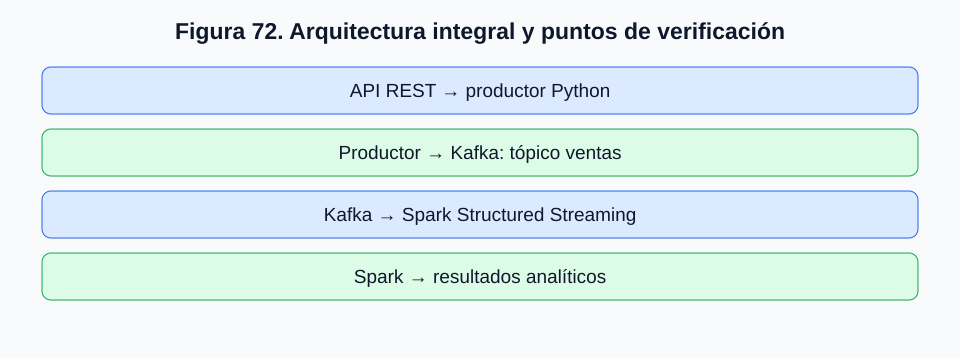
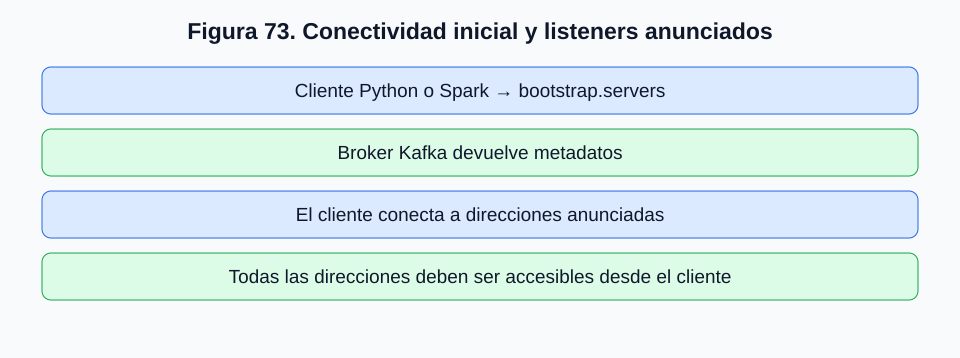
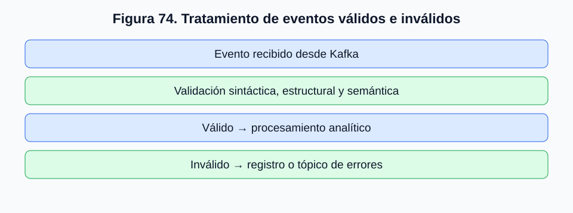
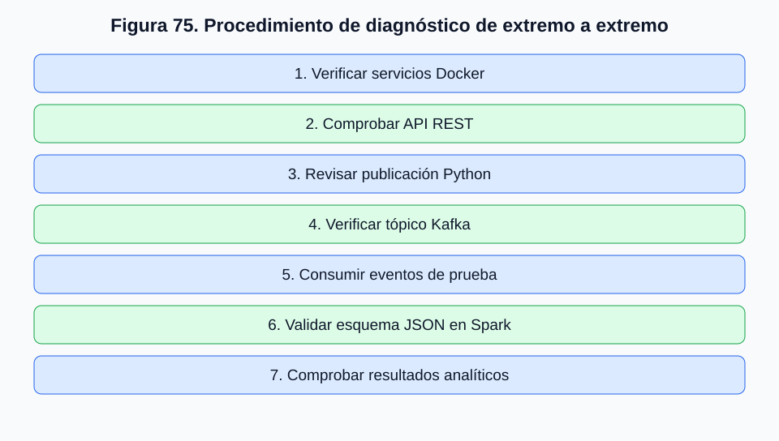

# Volumen II. Apache Kafka: operación, integración e implementación

## 2.10. Validación, monitoreo y tratamiento básico de errores

### 2.10.1. Introducción: de una aplicación funcional a una arquitectura verificable

A lo largo del Volumen II hemos construido progresivamente una arquitectura de integración de datos basada en Apache Kafka.

Comenzamos con la preparación del entorno Docker y la administración de tópicos. Posteriormente, estudiamos la publicación y el consumo de eventos, la estructuración de mensajes y la incorporación de información desde fuentes externas.

En los apartados 2.7 y 2.8 desarrollamos un productor Python que consulta una API REST y examinamos los mecanismos necesarios para convertir esa integración puntual en un flujo Near Real-Time.

Finalmente, en el apartado 2.9 incorporamos Apache Spark Structured Streaming para interpretar, transformar y analizar los eventos publicados.

Sin embargo, disponer de todos estos componentes no garantiza que el sistema funcione correctamente.

Una aplicación puede ejecutarse sin mostrar errores y, aun así, publicar registros duplicados. Un broker puede encontrarse disponible mientras determinados consumidores acumulan retrasos. Una consulta Spark puede permanecer activa, pero interpretar incorrectamente los mensajes JSON.

Por ello, necesitamos incorporar una última dimensión a nuestro trabajo: **la capacidad de verificar, observar y diagnosticar el funcionamiento de toda la arquitectura**.

Este apartado reúne procedimientos de validación funcional, monitoreo operacional y tratamiento básico de errores, utilizando como referencia el laboratorio desarrollado durante el curso.

Nuestro objetivo no será implementar una plataforma empresarial completa de observabilidad, sino establecer una metodología rigurosa para comprobar que los componentes funcionan de manera coordinada y que los resultados obtenidos son confiables.

### 2.10.2. Objetivos de aprendizaje del apartado

Al finalizar este capítulo, el estudiante deberá ser capaz de:

1. Verificar la disponibilidad de los servicios Docker, Kafka y sus componentes asociados.
2. Comprobar la existencia y configuración de los tópicos utilizados por las aplicaciones.
3. Validar la publicación y el consumo de eventos mediante procedimientos reproducibles.
4. Identificar errores frecuentes de conectividad, serialización, configuración y procesamiento.
5. Interpretar indicadores básicos de operación, incluyendo offsets, particiones y consumer lag.
6. Reconocer problemas asociados con duplicados, retrasos y registros inválidos.
7. Verificar la integración entre Kafka y Spark Structured Streaming.
8. Documentar evidencias técnicas que permitan reproducir y diagnosticar problemas.

Estas competencias son relevantes porque, en ingeniería de datos, **un sistema no se considera correctamente implementado únicamente porque sus procesos se encuentren en ejecución**.

También debe existir evidencia de que los datos se reciben, transforman y procesan de acuerdo con las reglas establecidas.

### 2.10.3. Arquitectura integral que debemos validar

Retomemos la arquitectura desarrollada en los capítulos anteriores.

Una API REST proporciona información de ventas.

Una aplicación Python consulta el servicio, valida los registros y publica eventos en Kafka.

El broker almacena los eventos en el tópico `ventas`.

Posteriormente, Spark Structured Streaming consume esos registros, interpreta su estructura JSON y ejecuta transformaciones analíticas.

Finalmente, los resultados se entregan a un destino de procesamiento o visualización.



*Figura 72. Los puntos de control permiten localizar errores por etapa: fuente HTTP, publicación, broker y procesamiento analítico.*

La arquitectura presenta varios puntos de verificación.

| Punto | Componente | Pregunta de validación |
|---|---|---|
| 1 | API REST | ¿La fuente entrega datos válidos y accesibles? |
| 2 | Productor Python | ¿Los registros se transforman y publican correctamente? |
| 3 | Kafka | ¿Los eventos están disponibles en el tópico esperado? |
| 4 | Spark | ¿Los eventos se interpretan y procesan correctamente? |

Este enfoque evita tratar la arquitectura como una caja negra.

Cuando aparece un problema, podemos identificar en qué etapa se produce y reducir progresivamente las posibles causas.

### 2.10.4. Diferencia entre validación, monitoreo y diagnóstico

Aunque estos conceptos se relacionan, cumplen funciones diferentes.

**Validación** consiste en comprobar que un componente o proceso cumple determinadas condiciones.

Por ejemplo, verificar que un evento publicado pueda recuperarse desde Kafka.

**Monitoreo** consiste en observar el comportamiento del sistema a lo largo del tiempo.

Por ejemplo, registrar la cantidad de eventos publicados por minuto o comprobar si un consumidor acumula retrasos.

**Diagnóstico** consiste en investigar las causas de un comportamiento inesperado.

Por ejemplo, determinar por qué Spark recibe mensajes desde Kafka, pero no logra extraer correctamente el campo `monto_total`.

Podemos resumir estas diferencias:

| Actividad | Pregunta principal | Ejemplo |
|---|---|---|
| Validación | ¿Funciona según lo esperado? | Comprobar publicación y consumo |
| Monitoreo | ¿Cómo se está comportando? | Observar retrasos y errores |
| Diagnóstico | ¿Por qué ocurre un problema? | Investigar fallos de conexión |

En una implementación real, estas tres actividades deben complementarse.

Validar una vez no garantiza que el sistema continuará funcionando indefinidamente.

Monitorear un proceso tampoco demuestra, por sí solo, que sus resultados sean correctos.

### 2.10.5. Primera etapa: verificación del entorno Docker

Nuestro procedimiento comienza por la infraestructura.

Antes de revisar el código Python o Spark, debemos comprobar que los servicios necesarios se encuentren disponibles.

Podemos ejecutar:

```bash
docker ps
```

El comando muestra los contenedores activos.

Para consultar también los contenedores detenidos:

```bash
docker ps -a
```

La diferencia es importante.

Un contenedor puede existir, pero encontrarse detenido.

También puede reiniciarse repetidamente debido a errores de configuración.

Para inspeccionar sus registros utilizaremos:

```bash
docker logs --tail 100 kafka
```

Si necesitamos observar nuevos mensajes mientras se generan:

```bash
docker logs -f kafka
```

La opción `-f` mantiene la consulta activa y muestra las nuevas líneas del registro.

Podemos detener la visualización mediante `Ctrl+C`, sin que esto implique necesariamente detener el contenedor.

En nuestro laboratorio, Kafka se ejecuta mediante Docker y utiliza una configuración asociada a ZooKeeper.

Debemos recordar que esta arquitectura corresponde al entorno docente existente. Las distribuciones modernas de Kafka también pueden utilizar KRaft, pero no corresponde modificar el laboratorio únicamente para desarrollar los procedimientos de validación de este capítulo.

#### ¿Qué debemos observar?

No basta con que el contenedor aparezca en la lista.

Debemos comprobar que el proceso Kafka haya iniciado correctamente y que no existan errores recurrentes de conectividad, configuración o almacenamiento.

También debemos identificar posibles reinicios.

Un servicio que se reinicia constantemente puede aparecer momentáneamente como activo, aunque no sea operacionalmente estable.

### 2.10.6. Segunda etapa: verificación de la conectividad Kafka

Una de las dificultades más frecuentes en entornos Docker es la conectividad entre aplicaciones y brokers.

En los apartados anteriores distinguimos entre ejecutar un cliente dentro del contenedor Kafka, desde otro contenedor o desde el sistema anfitrión.

Esta diferencia sigue siendo fundamental.

El parámetro `bootstrap.servers` permite establecer una conexión inicial, pero posteriormente el cliente utiliza la información de los brokers anunciados por Kafka.

Por ello, un cliente puede alcanzar el puerto inicial y, aun así, fallar cuando intenta comunicarse con las direcciones anunciadas.

En nuestro laboratorio hemos utilizado el puerto `9092` y existe una referencia histórica a la dirección `172.27.1.16`.

Sin embargo, debemos verificar la configuración efectiva antes de asumir que esa dirección continúa siendo accesible.



*Figura 73. La conectividad inicial al bootstrap server no basta si el cliente no puede alcanzar las direcciones anunciadas por el broker.*

Este comportamiento explica por qué algunos problemas no se resuelven simplemente cambiando `localhost` por el nombre del contenedor.

La configuración de listeners debe ser coherente con la ubicación de los clientes.

### 2.10.7. Tercera etapa: comprobación de tópicos y particiones

Una vez validada la conectividad, debemos comprobar que el tópico utilizado por nuestras aplicaciones exista.

En el laboratorio, el tópico principal de integración es:

```text
ventas
```

Los comandos de administración deben ejecutarse desde un entorno que disponga de las herramientas Kafka.

Una forma habitual consiste en ingresar al contenedor:

```bash
docker exec -it kafka bash
```

Posteriormente, podemos utilizar la herramienta administrativa correspondiente a la distribución instalada.

En instalaciones que incluyen el ejecutable en el `PATH`, un comando de referencia es:

```bash
kafka-topics.sh \
  --bootstrap-server localhost:9092 \
  --list
```

Para examinar el tópico:

```bash
kafka-topics.sh \
  --bootstrap-server localhost:9092 \
  --describe \
  --topic ventas
```

Estos comandos deben adaptarse si la imagen utiliza otra ubicación de los ejecutables o una interfaz administrativa diferente.

También es importante considerar que algunas distribuciones antiguas utilizan opciones de administración distintas. No debemos asumir que todos los comandos disponibles en versiones actuales funcionarán sin cambios en cualquier imagen Kafka.

#### Información relevante del tópico

Debemos observar:

- Nombre del tópico.
- Cantidad de particiones.
- Factor de replicación.
- Asignación de líderes.
- Réplicas y réplicas sincronizadas, cuando corresponda.

En un laboratorio con un solo broker, el factor de replicación efectivo normalmente estará limitado a uno.

Esto permite desarrollar actividades docentes, pero no representa una configuración tolerante a la pérdida de un broker.

### 2.10.8. Cuarta etapa: validación de la publicación de eventos

Ahora comprobaremos el funcionamiento del productor Python.

Recordemos que en el apartado 2.7 construimos una aplicación que consulta una API REST, transforma ventas y publica eventos.

Antes de ejecutar el productor debemos verificar que la API se encuentre disponible.

Podemos utilizar:

```bash
curl http://127.0.0.1:5000/api/ventas
```

Si la API responde correctamente, ejecutaremos:

```bash
python productor.py
```

Una salida ilustrativa podría ser:

```text
Evento publicado: venta-V-1048-confirmada | partición=0 | offset=18
Evento publicado: venta-V-1049-confirmada | partición=1 | offset=12
Evento publicado: venta-V-1050-rechazada | partición=0 | offset=19
Total de eventos publicados: 3
```

Estos valores son ejemplos y no corresponden a una ejecución verificada.

#### ¿Qué demuestra esta salida?

Cuando el productor recibe correctamente los metadatos de publicación, podemos afirmar que Kafka confirmó la operación conforme a la configuración utilizada.

Sin embargo, no podemos concluir que Spark haya procesado esos registros.

Tampoco podemos afirmar que los datos comerciales sean correctos únicamente porque Kafka los haya aceptado.

La validación debe continuar hasta el consumidor y el resultado analítico.

### 2.10.9. Quinta etapa: validación del consumo

Para verificar la disponibilidad de los eventos podemos utilizar un consumidor de consola.

Un comando de referencia es:

```bash
kafka-console-consumer.sh \
  --bootstrap-server localhost:9092 \
  --topic ventas \
  --from-beginning
```

La opción `--from-beginning` permite solicitar la lectura desde los registros más antiguos todavía disponibles para ese consumo de consola.

No debemos interpretar que Kafka conservará indefinidamente todos los eventos publicados.

La disponibilidad depende de las políticas de retención y de las condiciones del tópico.

Además, el comportamiento exacto del consumidor puede depender de la configuración de su grupo y de los offsets existentes.

Para el laboratorio también podemos utilizar el consumidor Python desarrollado en el apartado 2.7.

La validación debe comprobar que los eventos recuperados contienen los campos esperados.

Por ejemplo:

```json
{
  "id_evento": "venta-V-1048-confirmada",
  "tipo_evento": "venta_confirmada",
  "version": 1,
  "fecha_evento": "2026-10-29T11:35:00-03:00",
  "datos": {
    "id_venta": "V-1048",
    "id_cliente": "C-025",
    "monto_total": 45990,
    "moneda": "CLP",
    "estado": "confirmada"
  }
}
```

Debemos comparar este resultado con el contrato de datos definido previamente.

Un mensaje puede existir en Kafka y, aun así, presentar una estructura incorrecta.

### 2.10.10. Validación del contrato de datos

Un contrato de datos define las características que deben cumplir los registros intercambiados entre componentes.

En nuestro escenario, el productor y los consumidores comparten una estructura JSON.

Podemos establecer condiciones básicas:

| Campo | Condición esperada |
|---|---|
| `id_evento` | Identificador no vacío |
| `tipo_evento` | Tipo reconocido |
| `version` | Número de versión válido |
| `fecha_evento` | Fecha interpretable |
| `datos.id_venta` | Identificador comercial |
| `datos.id_cliente` | Identificador de cliente |
| `datos.monto_total` | Número entero no negativo |
| `datos.moneda` | Código monetario esperado |
| `datos.estado` | Estado reconocido |

La validación debe considerar tanto la estructura como el significado de los datos.

Por ejemplo, el siguiente JSON es sintácticamente válido:

```json
{
  "id_venta": "V-1051",
  "monto_total": -5000
}
```

Sin embargo, si nuestra regla comercial establece que el monto no puede ser negativo, el registro es inválido para ese propósito.

Debemos distinguir entre:

**Validez sintáctica:** el mensaje puede interpretarse como JSON.

**Validez estructural:** contiene los campos y tipos requeridos.

**Validez semántica:** los valores cumplen las reglas de negocio.

Esta distinción será especialmente importante cuando procesemos eventos mediante Spark.

### 2.10.11. Sexta etapa: validación de Spark Structured Streaming

Una vez comprobada la publicación y el consumo desde Kafka, verificaremos la integración con Spark.

El procedimiento debe comenzar por la disponibilidad del conector Spark-Kafka.

En el apartado 2.9 utilizamos como referencia el artefacto:

```text
org.apache.spark:spark-sql-kafka-0-10_2.11:2.4.0
```

Este identificador corresponde a una distribución estándar de Spark 2.4.0 compilada con Scala 2.11.

No debe utilizarse sin verificar las versiones efectivas del laboratorio.

También debemos comprobar que Spark pueda acceder a las direcciones anunciadas por Kafka.

Posteriormente validaremos tres operaciones.

**Lectura:** Spark debe recibir los registros del tópico `ventas`.

**Interpretación:** la función `from_json` debe extraer los campos esperados.

**Procesamiento:** las transformaciones deben producir resultados coherentes con los eventos publicados.

Por ejemplo, si publicamos tres ventas, dos confirmadas y una rechazada, un filtro sobre el estado `confirmada` debería seleccionar únicamente las dos confirmadas.

Sin embargo, si el tópico contiene eventos históricos o duplicados, el resultado podría incluir más registros.

Por ello, debemos definir cuidadosamente el conjunto de datos utilizado en la prueba.

### 2.10.12. Diseño de pruebas controladas

Una buena práctica consiste en utilizar eventos de prueba con identificadores conocidos.

Por ejemplo:

| Evento | Cliente | Monto | Estado |
|---|---|---:|---|
| TEST-001 | C-001 | $10.000 | confirmada |
| TEST-002 | C-001 | $15.000 | confirmada |
| TEST-003 | C-002 | $8.000 | rechazada |
| TEST-004 | C-002 | $20.000 | confirmada |

Si filtramos únicamente las ventas confirmadas, esperamos recuperar tres registros.

Si agrupamos por cliente y sumamos sus montos, esperamos:

| Cliente | Total confirmado |
|---|---:|
| C-001 | $25.000 |
| C-002 | $20.000 |

Estos resultados constituyen una referencia conocida.

La comparación entre valores esperados y observados permite validar la transformación.

Es preferible utilizar un tópico de pruebas aislado o una consulta con condiciones que permitan distinguir estos registros de los eventos históricos.

De lo contrario, las agregaciones podrían incluir información ajena al ejercicio.

### 2.10.13. Matriz de problemas frecuentes y diagnóstico

Durante la implementación pueden aparecer errores de naturaleza muy diferente.

La siguiente matriz reúne problemas habituales y procedimientos iniciales de diagnóstico.

| Síntoma | Posibles causas | Primera verificación |
|---|---|---|
| El productor no conecta con Kafka | Broker detenido, listener incorrecto, red inaccesible | Estado Docker y configuración de conexión |
| La API no responde | Servicio detenido, URL incorrecta, timeout | Solicitud HTTP independiente |
| El tópico no existe | Nombre incorrecto o creación pendiente | Listar tópicos |
| El productor publica, pero no se observan mensajes | Tópico equivocado, offsets o grupo | Revisar tópico y consumidor |
| Se publican eventos duplicados | Consultas repetidas sin control de estado | Identificadores y checkpoint |
| Spark no reconoce `kafka` | Conector ausente o incompatible | Versiones Spark, Scala y dependencias |
| Spark recibe JSON, pero los campos aparecen nulos | Esquema incompatible o JSON inválido | Inspeccionar `value` original |
| Los totales son mayores de lo esperado | Duplicados o registros históricos | Identificadores y alcance de consulta |
| El consumidor acumula retraso | Capacidad insuficiente o errores | Consumer lag y rendimiento |
| Una consulta Spark no recupera su estado | Checkpoint ausente o incompatible | Ruta, persistencia y configuración |

Esta matriz no reemplaza un diagnóstico completo.

Su función es orientar la investigación y evitar modificaciones arbitrarias.

Por ejemplo, si Spark no puede interpretar un mensaje JSON, aumentar la cantidad de particiones Kafka probablemente no resolverá el problema.

Del mismo modo, si la API no responde, modificar la configuración del consumidor tampoco solucionará la causa.

### 2.10.14. Interpretación de registros de errores

Los registros de ejecución, habitualmente denominados *logs*, constituyen una fuente importante de información operacional.

Sin embargo, debemos evitar interpretar cualquier mensaje de error de manera aislada.

Un mismo síntoma puede aparecer como consecuencia de distintos problemas.

Por ejemplo, una excepción de conexión puede originarse en:

- Un servicio detenido.
- Una dirección incorrecta.
- Un puerto inaccesible.
- Una configuración de listeners incompatible.
- Una interrupción temporal de red.

Por ello, proponemos un procedimiento básico:

1. Identificar el componente que genera el error.
2. Registrar el momento en que ocurre.
3. Identificar la operación que se estaba ejecutando.
4. Examinar el mensaje completo y su contexto.
5. Verificar las dependencias inmediatas.
6. Reproducir el problema mediante una prueba controlada.
7. Aplicar una corrección y comprobar su resultado.

Este procedimiento es más confiable que modificar simultáneamente múltiples configuraciones.

Si cambiamos varios parámetros a la vez, puede resultar difícil determinar cuál resolvió el problema.

### 2.10.15. Registro estructurado de eventos operacionales

En el productor Python utilizamos inicialmente instrucciones `print()` para mostrar información.

Este mecanismo es suficiente para comprender el funcionamiento básico, pero presenta limitaciones cuando la aplicación opera durante períodos prolongados.

Una alternativa es utilizar el módulo estándar `logging`.

Por ejemplo:

```python
import logging

logging.basicConfig(
    level=logging.INFO,
    format=(
        "%(asctime)s | "
        "%(levelname)s | "
        "%(message)s"
    )
)

logging.info(
    "Iniciando consulta de ventas"
)

logging.warning(
    "La API no entregó registros nuevos"
)

logging.error(
    "No fue posible publicar un evento"
)
```

La salida podría presentar:

```text
2026-10-29 11:35:00 | INFO | Iniciando consulta de ventas
2026-10-29 11:35:01 | WARNING | La API no entregó registros nuevos
2026-10-29 11:35:31 | ERROR | No fue posible publicar un evento
```

Los registros permiten distinguir niveles de severidad y conservar información temporal.

En una implementación más avanzada, también podríamos registrar identificadores de ejecución, nombres de tópicos, cantidades de eventos y duración de las operaciones.

No obstante, debemos evitar registrar información sensible innecesaria, como contraseñas, tokens de acceso o datos personales completos.

### 2.10.16. Métricas operacionales fundamentales

Además de los logs, necesitamos observar indicadores cuantitativos.

Podemos organizar las métricas por componente.

| Componente | Métrica | Interpretación |
|---|---|---|
| API REST | Tiempo de respuesta | Latencia de la fuente |
| API REST | Tasa de errores HTTP | Disponibilidad y restricciones |
| Productor | Eventos publicados | Actividad de ingesta |
| Productor | Fallos de publicación | Problemas de envío |
| Kafka | Particiones y líderes | Estado de distribución |
| Kafka | Volumen de registros | Actividad del tópico |
| Consumidor | Consumer lag | Trabajo pendiente |
| Spark | Duración de micro-batches | Rendimiento del procesamiento |
| Spark | Registros procesados | Throughput de la consulta |
| Spark | Fallos de consulta | Estabilidad de la aplicación |

Estas métricas deben interpretarse en conjunto.

Por ejemplo, un aumento del consumer lag puede relacionarse con un incremento de eventos publicados o con una disminución de la capacidad de consumo.

Por tanto, el indicador aislado no identifica automáticamente la causa.

### 2.10.17. Monitoreo de grupos de consumidores

Los grupos de consumidores permiten distribuir el procesamiento entre múltiples instancias.

Para observar su estado podemos utilizar herramientas administrativas de Kafka, cuando se encuentren disponibles en la distribución instalada.

Un comando de referencia es:

```bash
kafka-consumer-groups.sh \
  --bootstrap-server localhost:9092 \
  --list
```

Para describir un grupo:

```bash
kafka-consumer-groups.sh \
  --bootstrap-server localhost:9092 \
  --describe \
  --group verificacion-ventas
```

La salida puede incluir información sobre tópicos, particiones, offsets y retrasos.

Debemos interpretar estos valores considerando que las herramientas y columnas disponibles pueden variar entre versiones.

Un ejemplo ilustrativo sería:

```text
GROUP                TOPIC   PARTITION  CURRENT-OFFSET  LOG-END-OFFSET  LAG
verificacion-ventas  ventas  0          120             150             30
verificacion-ventas  ventas  1          85              100             15
```

En este caso, el grupo presenta un retraso total de 45 registros.

Sin embargo, el lag no indica directamente cuánto tiempo llevan esperando esos eventos.

Para evaluar la antigüedad de la información debemos considerar marcas temporales y tasas de procesamiento.

### 2.10.18. Monitoreo de consultas Spark

Structured Streaming proporciona información sobre el estado y progreso de sus consultas.

En PySpark podemos consultar si una ejecución continúa activa:

```python
print(
    consulta.isActive
)
```

También podemos inspeccionar el progreso reciente:

```python
print(
    consulta.lastProgress
)
```

Cuando existe información disponible, `lastProgress` puede contener indicadores sobre duración de lotes, registros procesados y fuentes utilizadas.

Sin embargo, el contenido exacto depende de la versión de Spark y del tipo de consulta.

En nuestro laboratorio, basado en Spark 2.4.0, debemos evitar asumir que estarán disponibles todos los indicadores incorporados en versiones posteriores.

Podemos inspeccionar el estado general:

```python
print(
    consulta.status
)
```

Estas herramientas permiten observar la consulta desde la propia aplicación.

No reemplazan un sistema de monitoreo persistente, pero proporcionan información útil para el diagnóstico docente.

### 2.10.19. Detección de registros duplicados

En el apartado 2.8 analizamos por qué una integración Near Real-Time puede publicar duplicados.

Ahora debemos incorporar su detección a los procedimientos de validación.

Supongamos que un tópico contiene:

| id_evento | id_venta | Estado |
|---|---|---|
| venta-V-1048-confirmada | V-1048 | confirmada |
| venta-V-1049-confirmada | V-1049 | confirmada |
| venta-V-1048-confirmada | V-1048 | confirmada |

El primer y tercer registro comparten el mismo identificador de evento.

Esto puede indicar una publicación repetida.

Sin embargo, debemos recordar que el identificador diseñado en el apartado 2.7 se construye utilizando el ID de venta y su estado.

Por ello, su capacidad para distinguir versiones es limitada.

En una aplicación real, la detección de duplicados debe basarse en una definición explícita de identidad del evento.

También debemos diferenciar entre:

**Duplicado técnico:** el mismo evento se publica o procesa más de una vez.

**Evento de actualización:** una entidad comercial produce una nueva versión o cambio de estado.

Confundir ambos casos puede llevar a eliminar información válida.

### 2.10.20. Tratamiento de registros inválidos

Una arquitectura robusta debe definir qué hacer cuando recibe un registro que no cumple el contrato de datos.

Entre las alternativas encontramos:

- Rechazar el registro.
- Registrar el error y continuar.
- Conservar el mensaje original para análisis.
- Enviar el registro a un tópico de errores.
- Interrumpir la ejecución si el problema afecta la integridad del procesamiento.

La elección depende de la criticidad del sistema.

Por ejemplo, un registro de venta sin identificador puede resultar imposible de asociar con una transacción comercial.

En cambio, un campo descriptivo opcional ausente podría no impedir el procesamiento.

Una práctica habitual consiste en separar los eventos válidos de aquellos que requieren revisión.



*Figura 74. Validación y separación conceptual de eventos válidos e inválidos.*

Un tópico de errores, frecuentemente denominado *Dead Letter Topic* (DLT), puede utilizarse para conservar eventos que no pudieron procesarse correctamente.

Sin embargo, Kafka no implementa automáticamente este comportamiento para cualquier productor o consumidor Python.

Debemos desarrollar o configurar explícitamente el mecanismo correspondiente.

### 2.10.21. Recuperación ante interrupciones

Un sistema de integración debe contemplar la posibilidad de interrupciones.

Por ejemplo, el productor puede detenerse mientras consulta una API, Kafka puede dejar de estar disponible o una consulta Spark puede fallar durante el procesamiento.

La recuperación depende de la etapa afectada.

| Componente | Mecanismo de recuperación |
|---|---|
| API REST | Reintentos controlados y nueva consulta |
| Productor Python | Estado persistente y control de registros |
| Kafka | Disponibilidad de registros según retención y configuración |
| Consumidor | Reanudación desde offsets correspondientes |
| Spark | Checkpoint compatible y reinicio de consulta |

Es importante reconocer que los mecanismos no proporcionan automáticamente las mismas garantías.

Por ejemplo, Spark puede recuperar el progreso de una consulta desde un checkpoint válido, pero eso no significa que cualquier sistema externo de destino sea necesariamente idempotente.

De manera similar, reiniciar un productor Python sin conservar su estado puede provocar publicaciones repetidas.

La recuperación debe diseñarse considerando el flujo completo.

### 2.10.22. Procedimiento de diagnóstico de extremo a extremo

Con los conceptos anteriores podemos establecer una metodología ordenada para investigar problemas.



*Figura 75. Secuencia recomendada de verificación desde infraestructura hasta resultados analíticos.*

El procedimiento comienza por los componentes básicos y avanza hacia los niveles superiores.

Esta secuencia permite localizar fallos sin introducir cambios innecesarios.

Si los eventos no llegan al tópico, debemos revisar la API y el productor antes de investigar Spark.

Si los eventos están disponibles y pueden consumirse, pero Spark no los interpreta, debemos concentrarnos en el conector, el esquema y las transformaciones.

Si Spark interpreta correctamente los registros, pero los totales son incorrectos, debemos revisar la lógica analítica, los duplicados y el conjunto de datos utilizado.

### 2.10.23. Actividad integradora final del Volumen II

Como cierre del volumen, proponemos una actividad de laboratorio que permita demostrar el funcionamiento completo de la arquitectura.

El escenario consiste en procesar ventas obtenidas desde una API REST, publicarlas en Kafka y calcular indicadores mediante Spark Structured Streaming.

La actividad deberá desarrollarse en etapas.

#### Etapa 1. Preparación de infraestructura

El estudiante verificará la disponibilidad de Docker y Kafka.

También comprobará la existencia del tópico utilizado por la aplicación.

**Evidencia:** registros de los servicios y descripción del tópico.

#### Etapa 2. Verificación de la fuente

El estudiante ejecutará la API REST y comprobará que devuelve registros JSON válidos.

**Evidencia:** respuesta HTTP y estructura de datos.

#### Etapa 3. Publicación de eventos

El estudiante ejecutará el productor Python y verificará las confirmaciones de publicación.

**Evidencia:** identificadores de evento, particiones y offsets.

#### Etapa 4. Consumo y validación

El estudiante utilizará un consumidor para recuperar los eventos y comprobar su estructura.

**Evidencia:** mensajes recibidos y correspondencia con los registros de origen.

#### Etapa 5. Procesamiento con Spark

El estudiante implementará una consulta Structured Streaming que interprete el JSON y calcule el total de ventas confirmadas por cliente.

**Evidencia:** código PySpark y resultados analíticos.

#### Etapa 6. Simulación de errores

El estudiante seleccionará al menos dos situaciones de fallo controlado.

Por ejemplo, detener temporalmente la API o utilizar una dirección Kafka incorrecta.

Posteriormente deberá identificar el síntoma, diagnosticar la causa y documentar la corrección.

**Evidencia:** registros del error, explicación y comprobación de recuperación.

#### Etapa 7. Reflexión técnica

Finalmente, el estudiante elaborará una reflexión sobre las limitaciones de la implementación.

Deberá considerar duplicados, checkpoints, latencia, conectividad y posibilidades de mejora.

Esta última etapa es importante porque el propósito del curso no consiste solamente en reproducir comandos.

Buscamos que el estudiante comprenda las decisiones arquitectónicas y pueda justificar técnicamente sus resultados.

### 2.10.24. Matriz de evidencias de la actividad final

Para organizar la entrega proponemos la siguiente matriz.

| Dimensión | Evidencia requerida | Criterio de verificación |
|---|---|---|
| Infraestructura | Estado de servicios y tópico | Componentes disponibles |
| Fuente externa | Respuesta de API | JSON válido |
| Productor | Registro de publicaciones | Eventos confirmados |
| Kafka | Consumo de mensajes | Registros disponibles |
| Estructura | Validación de campos | Contrato de datos respetado |
| Spark | Consulta Structured Streaming | Lectura y transformación |
| Analítica | Totales por cliente | Resultados coherentes |
| Diagnóstico | Simulación de errores | Causas identificadas |
| Recuperación | Nueva ejecución | Comportamiento documentado |
| Reflexión | Análisis técnico | Limitaciones y mejoras justificadas |

La matriz permite comprobar tanto la ejecución como la comprensión conceptual.

Además, facilita identificar qué componentes fueron efectivamente validados.

### 2.10.25. Buenas prácticas para documentar resultados técnicos

Una implementación reproducible requiere documentación.

No basta con presentar una captura de pantalla donde aparece un mensaje de éxito.

Debemos explicar qué se ejecutó, en qué condiciones y qué resultado se obtuvo.

Una evidencia técnica adecuada debería incorporar:

- Objetivo de la prueba.
- Componente evaluado.
- Configuración relevante.
- Comando o procedimiento ejecutado.
- Resultado esperado.
- Resultado observado.
- Interpretación.
- Correcciones realizadas, si corresponde.

Por ejemplo, podemos documentar:

**Prueba:** publicación de tres eventos desde una API REST.

**Resultado esperado:** tres confirmaciones de publicación.

**Resultado observado:** tres eventos confirmados con sus respectivos offsets.

**Interpretación:** el productor logró publicar los registros en Kafka bajo la configuración utilizada.

**Limitación:** la prueba no demuestra por sí sola que Spark haya procesado los eventos.

Esta última observación es especialmente importante.

Una buena documentación técnica distingue entre aquello que fue efectivamente comprobado y aquello que todavía requiere validación.

### 2.10.26. Limitaciones del laboratorio y proyección hacia entornos productivos

Nuestro laboratorio ha sido diseñado para comprender los principios de integración y procesamiento distribuido.

Por ello, algunas de sus características no representan necesariamente una arquitectura de producción.

Entre sus limitaciones encontramos el uso de un entorno Docker docente, una configuración Kafka que puede disponer de un solo broker, fuentes de datos de demostración y mecanismos simplificados de recuperación.

Asimismo, la integración con Spark se ha desarrollado tomando como referencia la versión 2.4.0.

En una implementación empresarial deberíamos evaluar aspectos adicionales, como:

**Alta disponibilidad.** Capacidad de mantener servicios ante fallos de infraestructura.

**Seguridad.** Autenticación, autorización, cifrado y protección de credenciales.

**Gobierno de datos.** Esquemas, calidad, trazabilidad y responsabilidades.

**Observabilidad.** Métricas persistentes, alertas, registros centralizados y seguimiento de eventos.

**Escalabilidad.** Capacidad de aumentar recursos según el volumen de datos.

**Recuperación.** Procedimientos documentados frente a interrupciones y fallos.

**Gestión del ciclo de vida.** Actualizaciones de versiones, compatibilidad y mantenimiento.

Estas dimensiones exceden el alcance operativo básico del volumen, pero constituyen una proyección natural de los aprendizajes desarrollados.

### 2.10.27. Síntesis del apartado

En este último capítulo consolidamos los procedimientos necesarios para verificar y diagnosticar una arquitectura de integración basada en Apache Kafka.

Diferenciamos validación, monitoreo y diagnóstico, y establecimos una secuencia de comprobación desde Docker y la API REST hasta el productor Python, Kafka y Spark Structured Streaming.

Examinamos la conectividad, la configuración de tópicos, las confirmaciones de publicación, el consumo de mensajes y la validación del contrato de datos.

También analizamos métricas operacionales, consumer lag, registros de errores, duplicados, eventos inválidos y mecanismos básicos de recuperación.

Finalmente, propusimos una actividad integradora que permite evaluar el funcionamiento completo de la arquitectura y documentar evidencias técnicas.

Con este apartado concluimos el desarrollo conceptual y operativo del Volumen II.

El recorrido realizado permite comprender que una plataforma de procesamiento de eventos no depende únicamente de la capacidad de transportar información.

También requiere garantizar, dentro de los alcances definidos, que los datos sean interpretables, que los componentes puedan observarse y que los problemas puedan diagnosticarse mediante procedimientos reproducibles.

---

## Cierre del Volumen II

A través de los diez apartados del volumen hemos recorrido un proceso progresivo de aprendizaje:

| Apartado | Competencia principal |
|---|---|
| 2.1 | Preparar y verificar Kafka en Docker |
| 2.2 | Administrar tópicos y particiones |
| 2.3 | Publicar eventos mediante productores |
| 2.4 | Consumir eventos y comprender los grupos |
| 2.5 | Estructurar mensajes y definir claves |
| 2.6 | Integrar fuentes externas |
| 2.7 | Construir un productor Python conectado a una API |
| 2.8 | Implementar flujos Near Real-Time |
| 2.9 | Procesar eventos mediante Spark Structured Streaming |
| 2.10 | Validar, monitorear y diagnosticar la arquitectura |

El resultado es una secuencia formativa que conecta los fundamentos de Kafka con su aplicación en escenarios de ingeniería de datos.

El estudiante no solamente conoce los componentes de la arquitectura, sino que dispone de una base metodológica para implementar integraciones, analizar su comportamiento y justificar decisiones técnicas.

**El Volumen II queda así desarrollado en sus diez apartados, pendiente de la revisión editorial y técnica integral antes de considerarlo una versión definitiva.**
