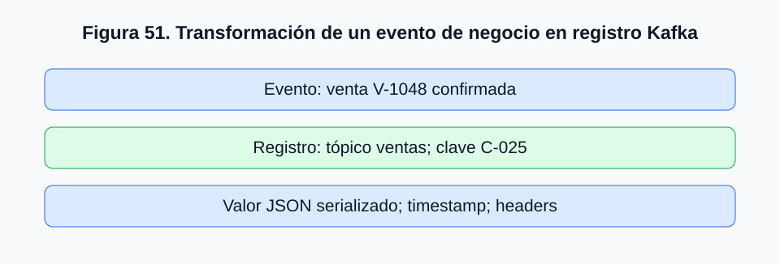
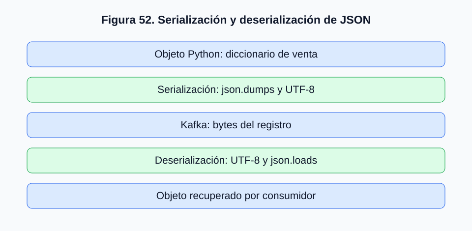
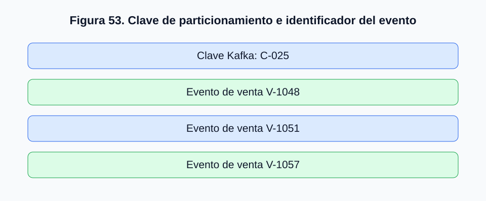
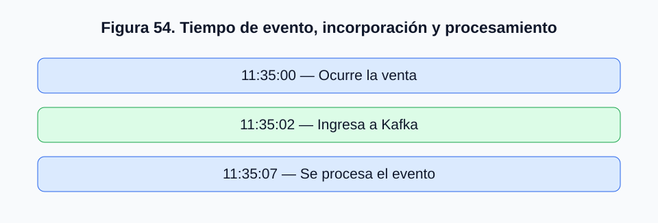

# 2.5. Estructuración de mensajes: texto, JSON, claves y marcas temporales

## 2.5.1. De la publicación de eventos a la representación de la información

En los apartados anteriores estudiamos cómo Kafka organiza los registros mediante tópicos y particiones, cómo los productores publican eventos y cómo los consumidores recuperan esa información.

Sin embargo, todavía debemos resolver una cuestión fundamental: **¿cómo representar los datos para que diferentes aplicaciones puedan intercambiarlos e interpretarlos correctamente?**

Una aplicación registra una venta por $45.990. El productor puede publicar:

```text
Venta realizada por $45.990
```

Este mensaje es comprensible para una persona, pero presenta limitaciones para el procesamiento automatizado. Una alternativa es una estructura explícita:

```json
{
  "id_venta": "V-1048",
  "id_cliente": "C-025",
  "monto": 45990,
  "moneda": "CLP",
  "estado": "confirmada"
}
```

**Kafka transporta y almacena registros cuyos componentes clave y valor se representan como secuencias de bytes.** La interpretación corresponde a los productores, consumidores y serializadores. Kafka no exige JSON ni otro formato específico.

## 2.5.2. Diferencia entre evento, registro y mensaje

Un **evento** representa algo que ocurrió o un cambio de estado relevante para el sistema: por ejemplo, el cliente C-025 realizó la venta V-1048 por $45.990.

Un **registro Kafka** es la representación técnica almacenada en una partición; puede contener clave, valor, marca temporal, cabeceras y metadatos. **Mensaje** suele designar la información transmitida entre productor y consumidor.



*Figura 51. Transformación de un evento de negocio en un registro Kafka.*

Un mismo hecho de negocio puede representarse mediante texto, JSON o Avro. El significado del evento puede mantenerse aunque cambie su representación técnica.

## 2.5.3. Mensajes de texto: simplicidad y limitaciones

```text
Venta V-1048 confirmada
```

El texto resulta útil para verificar conexiones y comprender la publicación desde consola, pero presenta dificultades de interpretación automática. Comparemos:

```text
Venta V-1048 confirmada por 45990 pesos
La transacción V-1049 fue aprobada. Total: $52.990
```

Aunque ambos describen ventas, usan estructuras distintas. Un consumidor tendría que interpretar las frases para extraer montos. **El texto libre es útil para ejemplos sencillos, pero no suele ser la mejor alternativa para intercambiar datos estructurados.**

## 2.5.4. JSON como formato de intercambio de eventos

JSON (*JavaScript Object Notation*) representa información mediante pares de clave y valor, objetos y arreglos:

```json
{
  "id_venta": "V-1048",
  "id_cliente": "C-025",
  "fecha": "2026-10-29T11:35:00-03:00",
  "productos": [
    {"codigo": "P-101", "cantidad": 2, "precio_unitario": 15995},
    {"codigo": "P-205", "cantidad": 1, "precio_unitario": 14000}
  ],
  "monto_total": 45990,
  "moneda": "CLP",
  "estado": "confirmada"
}
```

Los campos son explícitos y sus tipos reconocibles; el consumidor puede leer `monto_total` sin interpretar lenguaje natural. JSON es legible y facilita depuración, pero no incorpora por sí solo un contrato formal de esquema, puede ocupar más espacio que formatos binarios y exige serialización.

## 2.5.5. Serialización y deserialización

Kafka no almacena directamente objetos Python o diccionarios. El productor los transforma en bytes mediante **serialización**; el consumidor reconstruye la información mediante **deserialización**.

```python
import json

venta = {"id_venta": "V-1048", "monto": 45990}
mensaje = json.dumps(venta).encode("utf-8")
venta_recuperada = json.loads(mensaje.decode("utf-8"))
```



*Figura 52. Proceso de serialización y deserialización de un evento JSON.*

Productor y consumidor deben usar mecanismos compatibles. Interpretar bytes JSON con un formato incompatible puede provocar errores.

## 2.5.6. La clave del mensaje y su relación con las particiones

Un registro puede contener **clave (*key*)** y **valor (*value*)**. La clave no es necesariamente un identificador único del evento; suele asociar registros con una entidad y contribuir a seleccionar la partición.

Por ejemplo, clave `C-025` y valor:

```json
{"id_venta": "V-1048", "monto": 45990, "estado": "confirmada"}
```

Una estrategia basada en la clave puede enviar los eventos de C-025 a la misma partición bajo condiciones estables de particionamiento, preservando su orden de incorporación.

| Clave Kafka | Identificador de venta |
|---|---|
| `C-025` | `V-1048` |
| `C-025` | `V-1051` |
| `C-025` | `V-1057` |
| `C-103` | `V-1060` |



*Figura 53. Diferencia entre clave de particionamiento e identificador del evento.*

La selección de claves debe considerar ordenamiento, distribución de carga y necesidades de consumidores.

## 2.5.7. Registros sin clave y registros con clave nula

Kafka admite registros sin clave:

```python
productor.send("ventas", value=venta)
```

La distribución sin clave depende del particionador y de la versión del cliente; no debe asumirse que todos usan *round-robin*. Algunas implementaciones favorecen la agrupación por partición.

Una **clave nula** es distinta de un **valor nulo**. Los registros con valor nulo pueden utilizarse en tópicos compactados como *tombstones*, para representar la eliminación lógica del estado asociado con una clave, según el contrato de la aplicación.

## 2.5.8. Marcas temporales: cuándo ocurrió y cuándo se registró un evento

Debemos distinguir **tiempo del evento (*event time*)**, momento en que ocurrió el hecho; **tiempo de incorporación (*ingestion time*)**, cuando ingresa a un sistema; y **tiempo de procesamiento (*processing time*)**, cuando una aplicación lo procesa.

| Referencia | Momento |
|---|---|
| Venta realizada | 11:35:00 |
| Evento publicado y recibido | 11:35:02 |
| Procesamiento analítico | 11:35:07 |



*Figura 54. Diferencias entre tiempo del evento, incorporación y procesamiento.*

La marca temporal del registro Kafka puede corresponder a `CreateTime` o `LogAppendTime`, según versión y configuración. No necesariamente coincide con el instante del hecho de negocio. Puede ser útil incluir `fecha_venta` en el valor. Esta distinción será esencial al estudiar ventanas de tiempo con Spark Structured Streaming.

## 2.5.9. Formatos de fecha y zonas horarias

ISO 8601 permite representar fechas inequívocas:

```text
2026-10-29T11:35:00-03:00
2026-10-29T14:35:00Z
```

Ambas expresiones representan el mismo instante. En cambio, `29/10/2026 11:35` carece de información explícita de zona horaria. En sistemas distribuidos conviene documentar el huso horario o normalizar a UTC.

## 2.5.10. Cabeceras de los registros Kafka

Las **cabeceras (*headers*)** contienen metadatos opcionales sin mezclarlos necesariamente con el valor principal.

| Cabecera | Valor ilustrativo |
|---|---|
| `origen` | `plataforma_web` |
| `version_evento` | `1` |
| `tipo_evento` | `venta_confirmada` |
| `correlation_id` | `REQ-8421` |

Pueden identificar origen, versión o correlación entre servicios. Kafka no interpreta automáticamente estos metadatos como reglas de negocio: su significado requiere acuerdos entre aplicaciones.

## 2.5.11. Contratos de datos y evolución de esquemas

Un **contrato de datos (*data contract*)** define la estructura y significado de los eventos. Por ejemplo, `id_venta` obligatorio, `id_cliente` como identificador, `monto_total` numérico en pesos chilenos, `moneda` como código, `fecha_venta` inequívoca y `estado` con valores definidos.

Cambiar:

```json
{"id_venta": "V-1048", "monto": 45990}
```

por:

```json
{"id_venta": "V-1048", "monto_total": 45990, "moneda": "CLP"}
```

puede romper un consumidor que espera `monto`. **Modificar JSON no garantiza compatibilidad**. Las versiones de eventos, reglas de compatibilidad y soluciones como JSON Schema, Apache Avro y Protocol Buffers ayudan a formalizar contratos. Kafka no impone automáticamente un esquema a todos los valores.

## 2.5.12. Comparación de formatos

| Formato | Ventajas | Limitaciones |
|---|---|---|
| Texto libre | Simple, inspección fácil | Difícil de interpretar automáticamente |
| JSON | Legible, ampliamente compatible | Tamaño relativo y validación adicional |
| Avro | Binario compacto, soporte de esquemas | Herramientas y gestión de esquemas |
| Protocol Buffers | Binario eficiente, contratos explícitos | Definición y generación de estructuras |

En el laboratorio utilizaremos principalmente JSON por su legibilidad e interoperabilidad con Python, APIs y herramientas analíticas.

## 2.5.13. Construcción de un evento comercial estructurado

```json
{
  "id_evento": "EVT-20261029-0001",
  "tipo_evento": "venta_confirmada",
  "version": 1,
  "fecha_evento": "2026-10-29T11:35:00-03:00",
  "datos": {
    "id_venta": "V-1048",
    "id_cliente": "C-025",
    "monto_total": 45990,
    "moneda": "CLP",
    "medio_pago": "tarjeta",
    "estado": "confirmada"
  }
}
```

`id_evento` identifica la ocurrencia; `tipo_evento` expresa qué ocurrió; `version` identifica el contrato; `fecha_evento` representa el momento del hecho y `datos` contiene los atributos comerciales. Esta organización es una decisión de diseño, no una exigencia de Kafka.

```python
import json

clave = "C-025"
evento = {
    "id_evento": "EVT-20261029-0001",
    "tipo_evento": "venta_confirmada",
    "version": 1,
    "fecha_evento": "2026-10-29T11:35:00-03:00",
    "datos": {
        "id_venta": "V-1048",
        "id_cliente": "C-025",
        "monto_total": 45990,
        "moneda": "CLP",
        "medio_pago": "tarjeta",
        "estado": "confirmada"
    }
}

clave_bytes = clave.encode("utf-8")
valor_bytes = json.dumps(evento, ensure_ascii=False).encode("utf-8")
```

Estas secuencias de bytes pueden utilizarse como clave y valor. El ejemplo se concentra en transformación de datos y no requiere ejecutar Kafka.

## 2.5.14. Errores frecuentes en la estructuración

| Problema | Ejemplo | Consecuencia |
|---|---|---|
| Campos inconsistentes | `monto` vs. `monto_total` | Errores de interpretación |
| Tipos incompatibles | Monto como texto | Dificultad de cálculo |
| Fechas ambiguas | `10/11/2026` | Interpretaciones diferentes |
| Sin identificador | Falta `id_evento` | Difícil detectar duplicados |
| Cambio sin versión | Se elimina campo requerido | Fallos en consumidores |
| Clave mal elegida | Una clave para todos | Carga desequilibrada |
| Serialización incompatible | Formatos distintos | Error de deserialización |

La calidad de una arquitectura de eventos depende de datos consistentes y documentados, no solamente de que Kafka pueda transportar registros.

## 2.5.15. Síntesis del apartado

Diferenciamos evento, mensaje y registro; comparamos texto y JSON; estudiamos serialización, claves, marcas temporales, cabeceras, contratos y evolución de esquemas. Finalmente definimos un evento comercial estructurado como referencia para las siguientes integraciones.

En el apartado **2.6. Integración con fuentes externas: archivos, bases de datos y APIs REST** estudiaremos cómo obtener información desde otros sistemas y transformarla en eventos publicables en Kafka.
