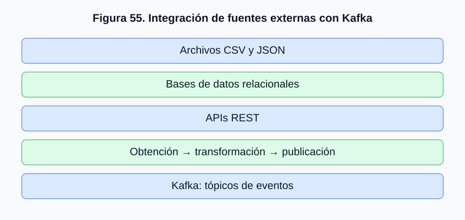
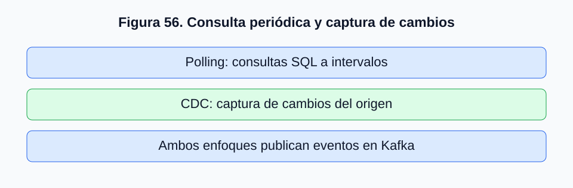
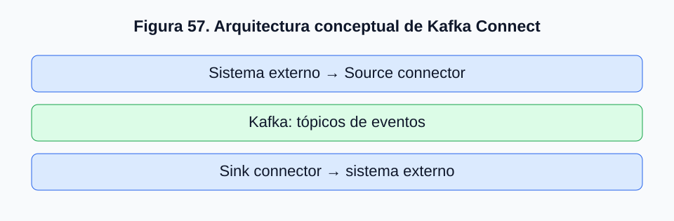
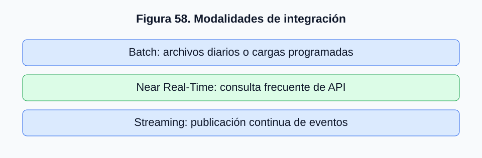

# 2.6. Integración con fuentes externas: archivos, bases de datos y APIs REST

## 2.6.1. Kafka como componente de integración de datos

En los apartados anteriores estudiamos cómo Kafka organiza, recibe, almacena y distribuye eventos. Comprendimos el funcionamiento de productores, consumidores, tópicos, particiones y grupos de consumidores, así como la estructuración mediante JSON, claves y marcas temporales.

En los sistemas empresariales, la información normalmente se origina en aplicaciones y plataformas ya operativas: bases de datos transaccionales, archivos periódicos, aplicaciones web, servicios externos y dispositivos.

**Kafka puede actuar como plataforma de distribución de eventos entre sistemas heterogéneos**, siempre que existan componentes capaces de extraer, transformar y publicar la información. Kafka no consulta automáticamente cualquier base de datos, archivo o API por el solo hecho de estar disponible.

## 2.6.2. Arquitectura general de integración

La integración puede organizarse en tres etapas:

1. **Obtención:** recuperar información desde un sistema de origen.
2. **Transformación:** validar, estructurar y serializar los datos.
3. **Publicación:** enviar los registros a un tópico Kafka.



*Figura 55. Arquitectura general de integración de fuentes externas con Kafka.*

El componente puede ser un programa Python, un servicio Java, un conector o una herramienta como Apache NiFi. La elección depende de la fuente, la frecuencia, el volumen y los requisitos de confiabilidad.

## 2.6.3. Integración mediante archivos

Los archivos CSV, JSON y de texto son fuentes habituales en ingeniería de datos. Por ejemplo, una empresa genera un archivo diario de ventas:

```csv
id_venta,id_cliente,fecha,monto,estado
V-1048,C-025,2026-10-29T11:35:00-03:00,45990,confirmada
V-1049,C-103,2026-10-29T11:36:00-03:00,52990,confirmada
V-1050,C-207,2026-10-29T11:37:00-03:00,18990,rechazada
```

Una aplicación puede leerlo y publicar cada fila como evento independiente. **Publicar datos en Kafka no convierte automáticamente el origen en una fuente de tiempo real**: si el archivo es diario, la información puede tener horas de antigüedad.

## 2.6.4. Lectura y transformación de archivos CSV mediante Python

```python
import csv

with open(
    "ventas.csv",
    mode="r",
    encoding="utf-8",
    newline=""
) as archivo:

    lector = csv.DictReader(archivo)

    for fila in lector:
        evento = {
            "id_venta": fila["id_venta"],
            "id_cliente": fila["id_cliente"],
            "fecha_evento": fila["fecha"],
            "monto": int(fila["monto"]),
            "estado": fila["estado"]
        }

        print(evento)
```

Este programa **no publica todavía en Kafka**: ilustra obtención y transformación. `csv.DictReader` permite acceder por nombres de columnas y `int()` convierte el monto desde texto. Una integración robusta debe gestionar filas incompletas, evitar reprocesamientos y recuperar ejecuciones interrumpidas.

## 2.6.5. Integración con bases de datos relacionales

Una base de datos comercial puede contener:

| id_venta | id_cliente | fecha | monto | estado |
|---|---|---|---:|---|
| V-1048 | C-025 | 2026-10-29 11:35 | 45990 | confirmada |
| V-1049 | C-103 | 2026-10-29 11:36 | 52990 | confirmada |
| V-1050 | C-207 | 2026-10-29 11:37 | 18990 | rechazada |

Una estrategia de extracción incremental utiliza un punto de control:

```sql
SELECT
    id_venta,
    id_cliente,
    fecha,
    monto,
    estado
FROM ventas
WHERE fecha_actualizacion > :ultima_fecha_procesada
ORDER BY fecha_actualizacion, id_venta;
```

Una marca temporal de actualización no garantiza por sí sola capturar todos los cambios: varias filas pueden compartir fecha y pueden existir situaciones de concurrencia. Deben considerarse identificadores, puntos de control y transacciones.

## 2.6.6. Consulta periódica frente a captura de cambios

Dos enfoques son **polling**, que consulta periódicamente tablas, y **Change Data Capture (CDC)**, que captura modificaciones del origen, frecuentemente a través de registros transaccionales.

| Característica | Consulta periódica | CDC |
|---|---|---|
| Mecanismo | Consultas sobre tablas | Captura de cambios |
| Frecuencia | Intervalo de consulta | Puede aproximarse al cambio |
| Carga | Consultas repetidas | Depende de conector y sistema |
| Complejidad | Relativamente sencilla | Configuración especializada |
| Cambios detectados | Según diseño de consulta | Puede capturar inserciones, actualizaciones y eliminaciones |



*Figura 56. Diferencia conceptual entre consulta periódica y CDC.*

Una venta puede pasar de pendiente a confirmada y anulada. Una consulta al estado actual puede no preservar todas las transiciones, mientras un CDC configurado correctamente puede generar eventos para los cambios. CDC requiere permisos, compatibilidad e infraestructura; no es superior en todos los escenarios.

## 2.6.7. Kafka Connect y los conectores de integración

**Kafka Connect** proporciona una arquitectura de transferencia de datos entre Kafka y otros sistemas mediante conectores.

- **Source connectors:** extraen información externa y la publican en Kafka.
- **Sink connectors:** consumen registros Kafka y los entregan a sistemas externos.



*Figura 57. Arquitectura conceptual de Kafka Connect.*

La disponibilidad de Kafka no implica que todos los conectores estén instalados o configurados. Deben comprobarse las herramientas y versiones del laboratorio.

## 2.6.8. Apache NiFi como alternativa de integración

Nuestro entorno docente también contempla Apache NiFi, plataforma para diseñar y ejecutar flujos de datos. Un flujo podría obtener datos de una API REST, validar la respuesta, transformar a JSON y publicar en Kafka.

NiFi permite visualizar las etapas; Kafka recibe, conserva y distribuye los eventos. **Son tecnologías complementarias, no equivalentes.** Que ambos servicios aparezcan en Docker Compose no significa que exista una integración funcional: deben configurarse procesadores, conexiones y parámetros compatibles.

## 2.6.9. Integración mediante APIs REST

Las APIs REST permiten obtener información mediante HTTP. Una operación ilustrativa:

```text
GET /api/ventas
```

Puede devolver:

```json
{
  "ventas": [
    {"id_venta": "V-1048", "id_cliente": "C-025", "monto": 45990, "estado": "confirmada"},
    {"id_venta": "V-1049", "id_cliente": "C-103", "monto": 52990, "estado": "confirmada"}
  ]
}
```

Un programa consulta la API, interpreta el JSON y publica cada venta en Kafka. Esto permite integrar sistemas sin acceso directo a sus bases de datos. Como REST responde habitualmente a solicitudes, la obtención periódica requiere un proceso de consulta programada.

## 2.6.10. Consulta de una API REST mediante Python

```python
import requests

url = "https://api.ejemplo.com/ventas"

respuesta = requests.get(
    url,
    timeout=10
)

respuesta.raise_for_status()

datos = respuesta.json()

for venta in datos["ventas"]:
    print(venta)
```

La dirección es **ilustrativa y no corresponde a un servicio real verificado**. Se establece la URL, se ejecuta la solicitud HTTP, se comprueba el estado mediante `raise_for_status()` y se interpreta la respuesta JSON. Este código todavía no incorpora Kafka: el apartado 2.7 combinará obtención y publicación.

## 2.6.11. Integración mediante consultas periódicas

Una aplicación podría consultar una API cada 30 segundos, pero eso no garantiza que la información tenga exactamente 30 segundos de antigüedad. También depende de la actualización del origen. Deben respetarse límites de solicitudes por minuto, hora o día, y gestionarse las respuestas y fallos.

## 2.6.12. Paginación, límites y recuperación de errores

Muchas APIs distribuyen resultados entre páginas:

```text
GET /api/ventas?page=1&limit=100
GET /api/ventas?page=2&limit=100
GET /api/ventas?page=3&limit=100
```

| Situación | Interpretación | Acción general |
|---|---|---|
| HTTP 200 | Éxito | Validar y procesar |
| HTTP 400 | Solicitud incorrecta | Revisar parámetros |
| HTTP 401 | Autenticación inválida | Revisar credenciales |
| HTTP 403 | Acceso prohibido | Revisar permisos |
| HTTP 429 | Límite alcanzado | Respetar política de reintentos |
| HTTP 500 | Error del servidor | Evaluar reintento controlado |
| Timeout | Sin respuesta oportuna | Registrar y gestionar fallo |

No todos los errores deben reintentarse igual: credenciales incorrectas requieren corrección, mientras una interrupción transitoria puede justificar un reintento controlado.

## 2.6.13. Duplicación y estado de extracción

Si una API devuelve las últimas cien ventas, consultarla cada minuto y publicar todos los resultados podría generar duplicados. Estrategias de control incluyen:

- Identificadores únicos de eventos.
- Consulta de modificaciones desde una fecha.
- Punto de control de última extracción.
- Comparación con identificadores procesados.
- Paginación incremental o cursores cuando estén disponibles.

**Una clave Kafka no elimina automáticamente duplicados**: dos publicaciones con la misma clave pueden generar registros distintos. La deduplicación requiere diseño explícito.

## 2.6.14. Integración batch, near real-time y streaming

| Modalidad | Característica | Ejemplo |
|---|---|---|
| Batch | Procesamiento en intervalos amplios | Archivo diario |
| Near Real-Time | Actualizaciones frecuentes con retraso acotado según diseño | Consulta API cada 30 segundos |
| Streaming | Procesamiento continuo de eventos disponibles | Publicación desde sistema transaccional |



*Figura 58. Diferencias conceptuales entre batch, near real-time y streaming.*

Una fuente diaria publicada en Kafka sigue teniendo actualización diaria; una API consultada cada minuto utiliza extracción periódica aunque alimente un flujo de eventos. El apartado 2.8 profundizará estas modalidades.

## 2.6.15. Criterios para seleccionar un mecanismo

| Criterio | Pregunta de diseño |
|---|---|
| Fuente | ¿Archivo, base de datos o API? |
| Frecuencia | ¿Cada cuánto cambian los datos? |
| Latencia | ¿Qué retraso se acepta? |
| Volumen | ¿Cuántos registros se procesarán? |
| Confiabilidad | ¿Cómo se recuperan fallos? |
| Duplicados | ¿Cómo se detectan registros repetidos? |
| Seguridad | ¿Qué autenticación y permisos se requieren? |
| Mantenimiento | ¿Quién administra la integración? |
| Compatibilidad | ¿Qué versiones y conectores están disponibles? |

Un CSV diario puede requerir solo un proceso programado; cambios inmediatos de base de datos podrían justificar CDC; una API REST es adecuada cuando el servicio externo expone HTTP pero no acceso directo a su base.

## 2.6.16. Aplicación al laboratorio de Big Data

La infraestructura Docker del curso contempla Kafka, ZooKeeper y otras tecnologías, pero debemos distinguir servicios disponibles de conexiones realmente implementadas.

La secuencia didáctica será: obtener y transformar datos externos; implementar un productor Python que consulte una API REST y publique eventos; consumir y procesar mediante herramientas como Spark Structured Streaming.

Kafka no reemplaza la API ni transforma automáticamente los datos: su función en esta arquitectura es recibir, conservar y distribuir eventos.

## 2.6.17. Síntesis del apartado

Estudiamos integración mediante archivos CSV/JSON, bases relacionales, extracción incremental, CDC, Kafka Connect, NiFi y APIs REST. Revisamos HTTP, paginación, límites de solicitudes, errores, duplicados y puntos de control. Distinguimos batch, near real-time y streaming, subrayando que la frecuencia de actualización depende de toda la arquitectura.

En el apartado **2.7. Construcción de un productor que consulta una API y publica eventos en Kafka** integraremos estos conceptos mediante Python.
