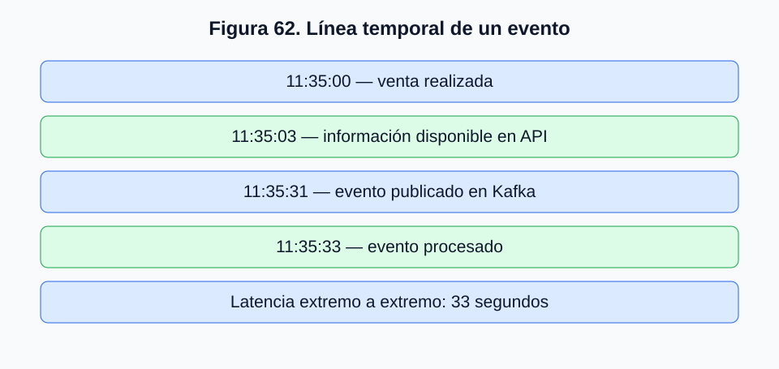
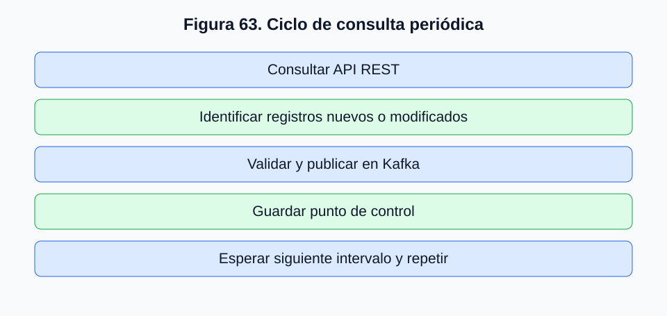
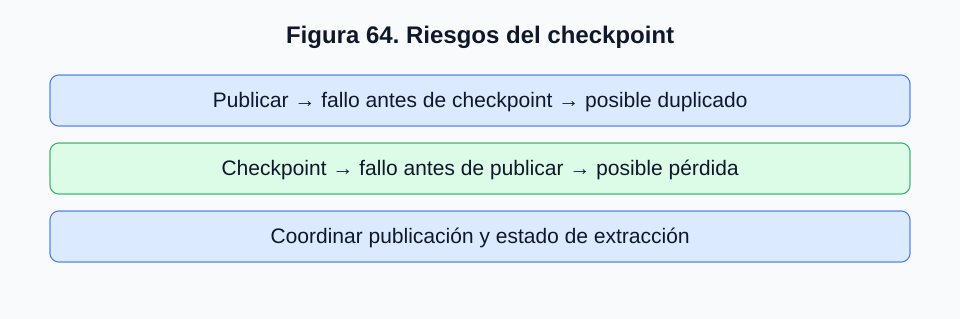
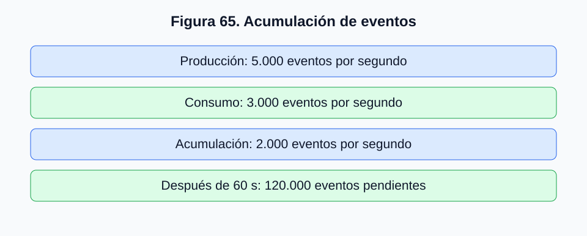
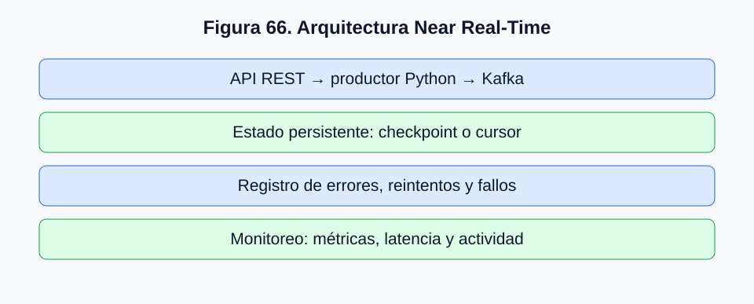

# 2.8. Implementación de flujos en tiempo real y Near Real-Time

## 2.8.1. De la integración puntual al procesamiento continuo

En el apartado 2.7 desarrollamos una aplicación Python capaz de consultar una API REST, transformar los registros obtenidos y publicarlos en un tópico Kafka. Comprendimos el recorrido de los datos desde una fuente externa hasta el sistema de mensajería distribuida. Sin embargo, nuestro productor consultaba una sola vez y terminaba.

En organizaciones que registran ventas durante toda la jornada, actualizan asistencia académica o reciben continuamente mediciones, los datos no constituyen un conjunto cerrado. Se generan, modifican y reciben a lo largo del tiempo. Necesitamos evolucionar hacia una arquitectura que incorpore información de manera continua o periódica, con retrasos compatibles con las necesidades del sistema.

Este apartado diferencia batch, Near Real-Time y streaming, y examina los desafíos de la ejecución prolongada de productores Kafka.

## 2.8.2. ¿Qué significa realmente procesar datos en tiempo real?

En lenguaje cotidiano, *tiempo real* suele significar rapidez. Técnicamente, un sistema de tiempo real es aquel cuya corrección depende tanto del resultado como del cumplimiento de restricciones temporales. En control industrial, una respuesta tardía puede ser inútil aunque sea correcta.

En analítica de datos se emplea a menudo «tiempo real» para flujos con baja latencia. **Kafka no garantiza por sí solo que toda una arquitectura cumpla plazos estrictos de tiempo real**: la latencia depende de fuentes, productores, red, broker, consumidores y sistemas posteriores.

| Modalidad | Característica principal | Ejemplo |
|---|---|---|
| Batch | Procesamiento en conjuntos o intervalos programados | Consolidación diaria de ventas |
| Near Real-Time (NRT) | Actualizaciones con retrasos relativamente pequeños y aceptables | Consulta API cada 30 segundos |
| Streaming | Eventos incorporados y procesados continuamente a medida que están disponibles | Publicación de cada transacción al producirse |

No existen límites temporales universales entre estas categorías. Treinta segundos pueden ser adecuados para un tablero comercial e inaceptables para un sistema de seguridad.

## 2.8.3. Generación, disponibilidad y procesamiento de eventos

Supongamos que una venta ocurre a las 11:35:00, está disponible en la API a las 11:35:03, se publica en Kafka a las 11:35:31 y se procesa a las 11:35:33. Distinguimos:

- **Tiempo del evento:** momento de la venta.
- **Tiempo de disponibilidad:** momento en que la fuente permite recuperarla.
- **Tiempo de publicación:** incorporación a Kafka.
- **Tiempo de procesamiento:** ejecución de la operación del consumidor.



*Figura 62. Línea temporal ilustrativa de un evento, no medida en el laboratorio.*

La latencia extremo a extremo se calcula como:

```text
L_total = t_procesamiento - t_evento
L_total = 33 segundos
```

Entre la publicación Kafka y el procesamiento transcurren solamente dos segundos. La mayor parte del retraso está en la fuente o frecuencia de consulta. **Un broker rápido no implica una arquitectura de baja latencia extremo a extremo.**

## 2.8.4. Latencia, throughput y frecuencia de actualización

**Latencia** es el tiempo transcurrido entre dos momentos definidos; debemos especificarlos. **Throughput** es la cantidad de registros o volumen procesado por unidad de tiempo. **Frecuencia de actualización** es la periodicidad con que una fuente obtiene o entrega datos.

No son equivalentes: un productor puede publicar 10.000 eventos por segundo y trabajar con información generada horas antes. Consultar una API cada segundo tampoco garantiza que la API actualice sus datos a esa frecuencia.

La arquitectura debe evaluar conjuntamente capacidad de procesamiento y oportunidad temporal de la información.

## 2.8.5. Arquitectura Near Real-Time mediante consultas periódicas

Una forma sencilla de evolucionar el productor consiste en consultar la API cada treinta segundos. El ciclo será: consultar, identificar registros nuevos o modificados, validar, publicar, registrar el estado y esperar la siguiente ejecución.



*Figura 63. Ciclo conceptual de consulta periódica y publicación.*

La estrategia puede ser adecuada cuando no se requieren latencias de milisegundos. Pero las consultas pueden durar más de lo previsto, fallar o devolver datos repetidos. La ejecución periódica necesita control de errores y estado.

## 2.8.6. Construcción de un productor periódico

Podemos extender el productor de 2.7 mediante un ciclo:

```python
import time

INTERVALO_SEGUNDOS = 30

while True:
    try:
        publicar_ventas()

    except Exception as error:
        print(
            f"Error durante la ejecución: {error}"
        )

    time.sleep(INTERVALO_SEGUNDOS)
```

Este fragmento muestra la estructura, **no una solución completa**. Con la función original `publicar_ventas()`, cada consulta republicaría todas las ventas. La periodicidad requiere controlar registros procesados.

Además, `time.sleep(30)` espera treinta segundos *después* de terminar la ejecución: si consulta y publicación tardan diez segundos, los inicios de ejecución estarán separados aproximadamente cuarenta segundos.

## 2.8.7. Intervalos fijos y duración variable de consultas

Con una espera posterior de treinta segundos:

| Ejecución | Inicio | Duración | Siguiente inicio |
|---|---|---|---|
| 1 | 11:00:00 | 5 s | 11:00:35 |
| 2 | 11:00:35 | 20 s | 11:01:25 |
| 3 | 11:01:25 | 8 s | 11:02:03 |

Este mecanismo es sencillo y evita superposición dentro de un mismo ciclo. Una planificación con horarios fijos requiere otra estrategia. Si nuevas ejecuciones comienzan mientras las anteriores siguen activas, podrían producirse consultas simultáneas, duplicados y sobrecarga de la API, salvo que el sistema gestione explícitamente esa concurrencia.

## 2.8.8. Control de duplicados mediante identificadores

Nuestra API contiene `id_venta`. Una primera aproximación es conservar los identificadores ya procesados:

```python
ventas_procesadas = set()

def es_venta_nueva(venta):
    identificador = venta["id_venta"]

    if identificador in ventas_procesadas:
        return False

    return True
```

Después de confirmar la publicación:

```python
ventas_procesadas.add(
    venta["id_venta"]
)
```

Esto evita repeticiones mientras el proceso sigue activo, pero el conjunto se pierde al terminar. Además, si una venta cambia de estado, su identificador permanece igual y podríamos ignorar la modificación.

Debemos distinguir **detectar registros nuevos** de **detectar nuevas versiones de registros existentes**.

## 2.8.9. Persistencia del estado de extracción

Un productor recuperable conserva información sobre el trabajo realizado, mediante un *checkpoint* o punto de control. Puede guardar fecha de modificación, último identificador, cursor de API o combinación de atributos.

Ejemplo docente:

```json
{
  "ultima_ejecucion": "2026-10-29T11:35:30-03:00",
  "ventas_procesadas": [
    "V-1048",
    "V-1049",
    "V-1050"
  ]
}
```

La última ejecución no equivale necesariamente al último evento. Conservar solo identificadores impide detectar modificaciones posteriores; podría ser necesario registrar versiones o fechas de cambio. Si la API proporciona un cursor incremental, conviene evaluar su uso. La elección depende del contrato de la fuente.

## 2.8.10. Publicación y confirmación del checkpoint

Consideremos dos secuencias.

**Publicar primero:** se obtiene una venta, Kafka confirma la publicación y el productor falla antes de guardar el checkpoint. Tras reiniciar, la venta podría publicarse de nuevo: **riesgo de duplicación**.

**Guardar primero:** se registra la venta como procesada, pero falla la publicación. Al reiniciar, la venta se omite: **riesgo de pérdida**.



*Figura 64. Riesgos de duplicación o pérdida según el orden entre publicación y checkpoint.*

Guardar un archivo de estado no resuelve por sí solo la coordinación entre publicación y extracción. Este es un problema central en ingeniería de datos distribuida.

## 2.8.11. Semánticas de entrega

| Semántica | Característica | Riesgo principal |
|---|---|---|
| At-most-once | El evento puede entregarse una vez o no entregarse | Pérdida |
| At-least-once | Se procura entregar una o más veces | Duplicación |
| Exactly-once | Se evita duplicar el efecto de una operación dentro de un alcance definido | Complejidad |

Kafka dispone, en versiones compatibles, de productores idempotentes y transacciones. **Esto no convierte automáticamente en exactamente una vez una integración que consulta una API REST y guarda su estado en un archivo externo.** Las garantías dependen de componentes y límites transaccionales.

Para el laboratorio podemos favorecer at-least-once, identificadores estables y consumidores preparados para detectar duplicados.

## 2.8.12. Idempotencia en el procesamiento

Una operación idempotente produce el mismo efecto observable al repetirse. Establecer `estado = "confirmada"` puede ser idempotente; sumar el monto de la venta a un acumulado no lo es necesariamente.

```text
Total acumulado = Total acumulado + 45990
```

Si se ejecuta dos veces, incrementa el total en $91.980. El consumidor debe diseñarse para evitar que un evento repetido altere dos veces los resultados, por ejemplo mediante identificadores de eventos aplicados y controles consistentes con el destino.

## 2.8.13. Manejo de fallos y reintentos

Una integración continua debe asumir errores de conectividad, respuestas HTTP, límites de solicitudes, reinicios del broker, JSON malformado, excepciones de transformación y fallos de checkpoint.

No todos los errores se tratan igual. HTTP 429 puede exigir respetar `Retry-After`; HTTP 401 normalmente requiere revisar credenciales. Reintentos para fallos transitorios pueden aplicar *exponential backoff*:

| Intento | Espera ilustrativa |
|---|---:|
| 1 | 1 s |
| 2 | 2 s |
| 3 | 4 s |
| 4 | 8 s |

En producción se consideran máximos, *jitter* y políticas del proveedor. Los valores anteriores son ilustrativos.

## 2.8.14. Backpressure y capacidad de procesamiento

**Backpressure** describe mecanismos para manejar una producción superior a la capacidad de una etapa posterior. Si un productor publica 5.000 eventos/s y un consumidor procesa 3.000, la diferencia es 2.000 eventos/s. En un minuto se acumularían aproximadamente 120.000 eventos, bajo tasas constantes.



*Figura 65. Ejemplo ilustrativo de producción superior al consumo.*

Kafka desacopla productores y consumidores, permitiendo procesar posteriormente eventos disponibles conforme a retención. Pero la acumulación implica necesidades de almacenamiento, dimensionamiento y recuperación; no puede crecer indefinidamente sin consecuencias.

## 2.8.15. Consumer lag como indicador operacional

El *consumer lag* expresa el retraso de un grupo respecto de los registros disponibles. Aproximadamente, puede calcularse como diferencia entre offset final siguiente y offset confirmado siguiente:

| Partición | Offset final siguiente | Offset confirmado siguiente | Lag |
|---|---:|---:|---:|
| 0 | 1.250 | 1.200 | 50 |
| 1 | 1.500 | 1.350 | 150 |
| 2 | 1.100 | 1.050 | 50 |
| **Total** | | | **250** |

**Un lag de 250 registros no equivale directamente a 250 segundos.** Para estimar retrasos temporales necesitamos tasas, tiempos y marcas temporales. Un consumidor puede haber leído registros sin confirmar todavía sus offsets; el indicador debe interpretarse junto con otras métricas.

## 2.8.16. Monitoreo de una integración Near Real-Time

No basta con que el proceso permanezca activo. Debemos observar si obtiene datos nuevos, publica y mantiene una latencia aceptable.

| Métrica | Qué permite observar |
|---|---|
| Última consulta exitosa | Actividad de la API |
| Duración de consulta | Rendimiento HTTP |
| Registros recuperados | Volumen de origen |
| Eventos publicados | Publicaciones confirmadas |
| Registros descartados | Problemas de validación |
| Errores HTTP | Disponibilidad del servicio |
| Fallos de publicación | Comunicación con Kafka |
| Edad del último evento | Actualidad de los datos |
| Consumer lag | Trabajo pendiente |

Un productor puede consultar cada treinta segundos y recibir siempre los mismos registros. Está activo, pero no incorpora eventos nuevos. A la inversa, la fuente podría legítimamente no tener nuevas ventas. La observabilidad debe considerar el comportamiento esperado.

## 2.8.17. Arquitectura Near Real-Time más robusta

La solución mejorada consulta una API, valida la respuesta, compara con estado persistido, publica registros nuevos o modificados y registra el progreso. También mantiene métricas, errores y resultados.



*Figura 66. Arquitectura conceptual de referencia; los componentes de recuperación y monitoreo requieren implementación específica.*

Esta arquitectura mejora la operación, pero actualizar el checkpoint después de publicar no garantiza por sí solo exactamente una vez. La confiabilidad requiere decisiones coordinadas entre fuente, productor, Kafka y consumidor.

## 2.8.18. Actividad práctica: evolución del productor 2.7

El estudiante evolucionará el productor por etapas: intervalo configurable, control básico de ventas publicadas, registro de ejecuciones y simulación de interrupciones.

| Etapa | Desarrollo | Evidencia esperada |
|---|---|---|
| 1 | Consulta periódica | Varias ejecuciones registradas |
| 2 | Control en memoria | No republicar ventas sin cambios durante la ejecución |
| 3 | Estado persistente | Recuperación básica tras reinicio |
| 4 | Manejo de errores | Registro de fallos y reintentos |
| 5 | Análisis de confiabilidad | Riesgos de duplicación y pérdida |

No se pretende implementar exactamente una vez a escala empresarial, sino comprender los mecanismos adicionales necesarios para operar continuamente.

## 2.8.19. Síntesis del apartado

Estudiamos la evolución desde una integración puntual hacia un flujo Near Real-Time. Distinguimos batch, Near Real-Time y streaming; analizamos tiempos de generación, disponibilidad, publicación y procesamiento, junto con latencia, throughput y frecuencia. Examinamos ejecución periódica, duplicados, checkpoints, semánticas de entrega, idempotencia, reintentos, backpressure y consumer lag. Finalmente propusimos recuperación y monitoreo como elementos esenciales.

En **2.9. Integración de Kafka con Apache Spark Structured Streaming** estudiaremos cómo consumir eventos, interpretar mensajes JSON y aplicar transformaciones analíticas mediante un motor de procesamiento distribuido.
